<!-- record banner: generated by tools/generate.mjs from history/records.json -->
> **Record, written 2 Oct 2026.** It is never current truth. Replaced by [BRD v4.5](../../../business/requirements/Enterprise_Portfolio_Intelligence_Governance_Platform_BRD_v4.5.md).
<!-- end of record banner -->


# Business Requirements Document

**Enterprise Portfolio Intelligence & Governance Platform**

**Unified BRD v4.2: portfolio intelligence, workspace governance and project execution, delivered as a multi-tenant SaaS with a natural-language interface for LLMs (MCP)**

| Document control | Value |
|------------------------|-----------------------------------------------------------------------------|
| Document version | v4.2 Unified Baseline. Supersedes BRD v4.1 and v4.0 (kept in brd/archive/), BRD v2.0 (Consolidated Concept) and the BRD v3.0 addendum (Workspace & Governance Framework Layer). |
| Date | 2 October 2026 |
| Status | Draft for business and technology validation |
| Product sponsor | CEO / Product Director |
| Working product name | Metis (logo and style guide in brand/; final name per D-22) |
| Product form | Multi-tenant SaaS application: web application plus a natural-language interface for LLMs over the Model Context Protocol (MCP) |
| Primary audience | CEO, ExCo, Product, PMO, Finance, HR, Engineering, Project Owners, Delivery Leads |
| Scope | Enterprise portfolio, tenancy and workspace governance, lifecycle frameworks, project execution (charter, WBS, plan, change control, reporting), resources, investment, outcomes and AI access through MCP |
| Target | MVP (Release 1) → V2 Portfolio Intelligence → V3 AI Portfolio Operating System |
| Reference prototypes | VistaX PM Genesis POC (project execution, 36 screens surveyed on 22 Sep 2026) and the Netlify Enterprise Governance MVP demo (portfolio governance, as described in BRD v2.0) |
| Design artifacts | wireframes/ (44 screens as HTML and PNG with manifest.json) and brand/ (logo set, style guide, design tokens) |
| Editions | This document and a Markdown edition, both generated from brd/source/ |

**Revision history**

| Version | Date | Description |
|-----------|--------------------------|----------------------------------------------------------------------|
| v2.0 | Not recorded in source | Consolidated concept: business requirements, functional modules M01-M12, ASCII wireframes and roadmap, validated against the Netlify prototype. |
| v3.0 | Not recorded in source | Product Director change: Workspace & Governance Framework layer, appended to v2.0 inside the same file (own sections 1-18 and an architecture appendix). |
| v4.0 | 2 Oct 2026 | Unified rewrite: one structure and one ID scheme; v2.0 and v3.0 merged; VistaX POC behaviour integrated; conflicts resolved or raised as decisions; full traceability to legacy IDs and POC screens. |
| v4.1 | 2 Oct 2026 | Product defined as a multi-tenant SaaS (Tenant level, module M02, roles, rules, NFRs); natural-language interface for any MCP-capable LLM with token-based access (module M05); modules renumbered M01 to M22 with requirement IDs unchanged; wireframes for 35 screens, logo and style guide; Markdown edition; decisions D-27 to D-31 and question Q-08 added. |
| v4.2 | 2 Oct 2026 | External pre-feasibility review (S5) triaged item by item; delivery capacity stated (A-07), scope kept; nine new requirements and four new rules; sharper acceptance criteria for access, saving, conflicts, isolation, limits, support access, gates, snapshots and MCP; metric versions and freshness; nine new wireframes (44 in total) with every MVP requirement shown on a screen; style guide accessibility and state components. |

**Source documents**

| Ref | Source | Notes |
|------|----------------------------------------------------------|----------------------------------------------------------|
| S1 | Enterprise_Portfolio_Intelligence_Governance_Platform_BRD.docx | 66,335 bytes, MD5 e6e7cfc96039212fdb235a177faa5ebd. Contains the v2.0 body followed by the v3.0 addendum. |
| S2 | Enterprise_Portfolio_Intelligence_Governance_Platform_BRD_v3_Workspace_Governance.docx | Byte-identical to S1 (same size and MD5). No content difference. |
| S3 | vistax-poc-screens/ (screenshots 01-36, screen map 00-tai-lieu-man-hinh.html) | Survey of the VistaX PM Genesis POC (public Claude artifact wbs-master-builder.jsx), 22 Sep 2026. Behaviour observed through the UI only; source code not reviewed. |
| S4 | Model Context Protocol specification, version 2026-07-28 (modelcontextprotocol.io/specification/2026-07-28) | Basis for the MCP requirements: server features (tools, resources, prompts), transports (stdio, Streamable HTTP), optional OAuth 2.1 based authorization for HTTP transports. Retrieved 2 Oct 2026. |
| S5 | review/metis-review-tien-kha-thi.md (external pre-feasibility review, in Vietnamese) | Review of BRD v4.1, the wireframes and the style guide, 2 Oct 2026: conditional Go, 54 refinements RF-01 to RF-54. Each claim was checked against this document before any change; dispositions in review/review-disposition.md. |

**How to read this document**

- **Priority:** P0 = MVP (Release 1), P1 = V2, P2 = V3.
- **Source codes:** "v2 FR-001" or "v2 §16" = BRD v2.0 body; "v3 WS-001", "v3 GF-001", "v3 TPL-001" or "v3 §8" = BRD v3.0 addendum; "POC 09" = screenshot 09 of the VistaX POC (file 09-*.jpg); "Survey §05" = section 05 of the POC screen map; "S4" = the MCP specification; "RF-nn" = refinement nn of the external review (S5); "New" = added in v4.0 to v4.2 to close a gap or resolve a conflict, to be validated.
- **Decisions:** "D-nn" refers to the decision register in Section 19. Each decision carries a recommendation that this document assumes until the decision is taken.
- **Wireframes:** each module lists its screens; open wireframes/screens/NN-name.html in a browser or view wireframes/png/NN-name.png. Every screen carries its requirement IDs.

## Contents

- [1. About This Version](#1-about-this-version)
  - [1.1 Source comparison result](#11-source-comparison-result)
  - [1.2 What the v3.0 addendum changed relative to v2.0](#12-what-the-v30-addendum-changed-relative-to-v20)
  - [1.3 What the VistaX POC adds or contradicts](#13-what-the-vistax-poc-adds-or-contradicts)
  - [1.4 Defects in the source file corrected in v4.0](#14-defects-in-the-source-file-corrected-in-v40)
  - [1.5 Key resolutions made in this version](#15-key-resolutions-made-in-this-version)
  - [1.6 Changes in v4.1](#16-changes-in-v41)
  - [1.7 Changes in v4.2](#17-changes-in-v42)
- [2. Executive Summary](#2-executive-summary)
  - [2.1 Business outcomes](#21-business-outcomes)
- [3. Business Context & Problem Statement](#3-business-context--problem-statement)
- [4. Product Vision, Positioning & Principles](#4-product-vision-positioning--principles)
  - [4.1 Product vision](#41-product-vision)
  - [4.2 Product positioning](#42-product-positioning)
  - [4.3 Core management questions](#43-core-management-questions)
  - [4.4 Product principles](#44-product-principles)
  - [4.5 UX principles](#45-ux-principles)
- [5. Scope, Assumptions & Constraints](#5-scope-assumptions--constraints)
  - [5.1 In scope](#51-in-scope)
  - [5.2 Out of scope for the MVP](#52-out-of-scope-for-the-mvp)
  - [5.3 Assumptions](#53-assumptions)
  - [5.4 Constraints and dependencies](#54-constraints-and-dependencies)
- [6. Stakeholders & Personas](#6-stakeholders--personas)
- [7. Target Operating Model](#7-target-operating-model)
  - [7.1 Unified hierarchy](#71-unified-hierarchy)
  - [7.2 Golden thread](#72-golden-thread)
  - [7.3 Project work model (WBS)](#73-project-work-model-wbs)
  - [7.4 Two framework types](#74-two-framework-types)
  - [7.5 Lifecycle and gate operating model](#75-lifecycle-and-gate-operating-model)
  - [7.6 Company A reference lifecycle (from v3.0)](#76-company-a-reference-lifecycle-from-v30)
  - [7.7 Decision lifecycle](#77-decision-lifecycle)
  - [7.8 Governance cadence](#78-governance-cadence)
  - [7.9 Key user journeys](#79-key-user-journeys)
  - [7.10 Conceptual architecture](#710-conceptual-architecture)
- [8. Functional Requirements: Module Catalogue](#8-functional-requirements-module-catalogue)
- [9. Platform, Tenancy & Access Requirements](#9-platform-tenancy--access-requirements)
  - [M01 Platform Foundation & Collaboration (PLT)](#m01-platform-foundation--collaboration-plt)
  - [M02 Tenant & Subscription Management (TEN)](#m02-tenant--subscription-management-ten)
  - [M03 Workspace Management & Configuration (WSP)](#m03-workspace-management--configuration-wsp)
  - [M04 Lifecycle Governance Framework & Templates (GOV)](#m04-lifecycle-governance-framework--templates-gov)
  - [M05 Natural-Language Interface for LLMs: MCP Server & Access Tokens (MCP)](#m05-natural-language-interface-for-llms-mcp-server--access-tokens-mcp)
- [10. Project Execution Requirements](#10-project-execution-requirements)
  - [M06 Project Charter & Business Case (CHR)](#m06-project-charter--business-case-chr)
  - [M07 WBS Master (WBS)](#m07-wbs-master-wbs)
  - [M08 Deliverable Builder & Process Frameworks (BLD)](#m08-deliverable-builder--process-frameworks-bld)
  - [M09 Project Plan: Timeline & Board (PLN)](#m09-project-plan-timeline--board-pln)
  - [M10 Project Overview & Focus (OVW)](#m10-project-overview--focus-ovw)
  - [M11 Change Control, Baseline & Decision Log (CHG)](#m11-change-control-baseline--decision-log-chg)
  - [M12 Journal & Project Reporting (RPT)](#m12-journal--project-reporting-rpt)
  - [M13 Risk & Dependency (RSK)](#m13-risk--dependency-rsk)
  - [M14 MVP & Product Delivery (MVP)](#m14-mvp--product-delivery-mvp)
- [11. Portfolio & Enterprise Intelligence Requirements](#11-portfolio--enterprise-intelligence-requirements)
  - [M15 Executive Portfolio Cockpit & Workspace Dashboard (EXE)](#m15-executive-portfolio-cockpit--workspace-dashboard-exe)
  - [M16 Portfolio & Project Registry (REG)](#m16-portfolio--project-registry-reg)
  - [M17 Portfolio Roadmap (RMP)](#m17-portfolio-roadmap-rmp)
  - [M18 Resource & Capacity (RES)](#m18-resource--capacity-res)
  - [M19 Investment & Benefits (INV)](#m19-investment--benefits-inv)
  - [M20 Strategy, Prioritization & Scenario Planning (STR)](#m20-strategy-prioritization--scenario-planning-str)
  - [M21 Analytics & Executive Reporting (ANL)](#m21-analytics--executive-reporting-anl)
  - [M22 AI Portfolio Copilot (AIC)](#m22-ai-portfolio-copilot-aic)
- [12. Metric Definitions & KPIs](#12-metric-definitions--kpis)
  - [12.1 Project metric definitions](#121-project-metric-definitions)
  - [12.2 POC discrepancies these definitions remove](#122-poc-discrepancies-these-definitions-remove)
  - [12.3 Portfolio KPIs](#123-portfolio-kpis)
  - [12.4 Workspace governance KPIs](#124-workspace-governance-kpis)
  - [12.5 Metric versions, freshness and snapshots](#125-metric-versions-freshness-and-snapshots)
- [13. Business Rules](#13-business-rules)
- [14. Roles & Permissions](#14-roles--permissions)
- [15. Conceptual Data Model & Reference Data](#15-conceptual-data-model--reference-data)
  - [15.1 Entities](#151-entities)
  - [15.2 Reference data and defaults](#152-reference-data-and-defaults)
- [16. Integration Requirements](#16-integration-requirements)
- [17. Non-Functional Requirements](#17-non-functional-requirements)
- [18. Roadmap, Release Plan & Delivery](#18-roadmap-release-plan--delivery)
  - [18.1 Phase overview](#181-phase-overview)
  - [18.2 Release 1 delivery structure (D-01)](#182-release-1-delivery-structure-d-01)
  - [18.3 Complexity indicators](#183-complexity-indicators)
  - [18.4 Delivery plan](#184-delivery-plan)
  - [18.5 MVP success criteria](#185-mvp-success-criteria)
- [19. Decisions Required & Open Questions](#19-decisions-required--open-questions)
  - [19.1 Decision register](#191-decision-register)
  - [19.2 Open questions](#192-open-questions)
- [20. Product Risks & Mitigations](#20-product-risks--mitigations)
- [21. MVP Acceptance Checklist](#21-mvp-acceptance-checklist)
- [Appendix A. Glossary](#appendix-a-glossary)
- [Appendix B. Screen Inventory & POC Traceability](#appendix-b-screen-inventory--poc-traceability)
  - [B.1 VistaX POC screens](#b1-vistax-poc-screens)
  - [B.2 Target screens and wireframes](#b2-target-screens-and-wireframes)
- [Appendix C. Source Reconciliation Log](#appendix-c-source-reconciliation-log)
- [Appendix D. Legacy ID Traceability](#appendix-d-legacy-id-traceability)
- [Appendix E. Wireframes](#appendix-e-wireframes)
- [Appendix F. Netlify Prototype Cross-Check (from BRD v2.0)](#appendix-f-netlify-prototype-cross-check-from-brd-v20)
- [Appendix G. Recommended Next Artifacts](#appendix-g-recommended-next-artifacts)

# 1. About This Version

## 1.1 Source comparison result

The two supplied BRD files are **byte-identical** (same size, same MD5 checksum). The file whose name carries "v3_Workspace_Governance" is not a separate version: both files contain the full BRD v2.0 body (sections 1-24, appendices A-B) followed by the BRD v3.0 addendum (sections 1-18 and an architecture appendix). The meaningful comparisons are therefore (a) the v2.0 body against the v3.0 addendum, and (b) the BRD against the VistaX PM Genesis POC. Both are summarised below; every individual conflict and its resolution is listed in Appendix C.

## 1.2 What the v3.0 addendum changed relative to v2.0

| Area | BRD v2.0 body | BRD v3.0 addendum | Treatment in v4.0 |
|----------------------|----------------------------------|----------------------------------|----------------------------------|
| Hierarchy | Strategy → Objective → Portfolio → Program/Product → Project → MVP/Feature and Milestone/WBS/Task | Platform → Workspace → Portfolio → Program/Product → Project → MVP → Feature → Milestone/WBS | v3.0 hierarchy adopted; POC "Space" and "Folder" mapped to Portfolio and Program (Section 7.1, D-04) |
| Vision | One system connecting strategy to outcome | Configurable Enterprise Portfolio Operating System: one platform, many workspaces | Merged (Section 4.1) |
| Governance | M08: weekly status, baseline, change request (CR), decision log | Lifecycle stages and gates, templates, waivers; M08 to become a Lifecycle Governance Engine | Split into M04 (framework and gates) and M11 (change, baseline, decisions) |
| Requirement IDs | FR-001…FR-1103 (38 requirements) | WS-001…010, GF-001…014, TPL-001…010 (34 requirements) | Re-keyed by module; every legacy ID kept in Source columns and Appendix D |
| Roles | 8 roles (§12) | 9 workspace roles (§9) | One enforced role model (Section 14) |
| Data model | 15 entities (§9) | 10 new entities (§12) | One model (Section 15) |
| Business rules | BR-01…BR-12 | 10 unnumbered rules (§13) | BR-01…BR-32 (Section 13) |
| KPIs | 12 portfolio KPIs (§11) | 11 governance KPIs (§15) | Section 12, with project metric definitions added |
| Roadmap | MVP / V2 / V3 by module (§15) | MVP / V2 / V3 workspace capabilities (§16) | One roadmap (Section 18) |
| Screens | 13 suggested screens (Appendix A), 12 wireframes | 1 workspace dashboard wireframe | Appendix B (screen inventory with POC evidence) and Appendix E (wireframes) |

## 1.3 What the VistaX POC adds or contradicts

| Topic | BRD (v2.0 and v3.0) | VistaX PM Genesis POC | Resolution in v4.0 |
|------------------|------------------------------|------------------------------|------------------------------|
| Product focus | Portfolio and enterprise, CEO-first | Project execution, PM-first ("From charter to closeout, one connected workspace") | Both: the POC defines the Project Execution layer under the BRD's portfolio layer |
| Hierarchy | Workspace → Portfolio → Program → Project | Workspace → Space → Folder → Project | Space = Portfolio, Folder = Program/Product (D-04) |
| Work structure | Project → MVP → Feature; Milestone / WBS / Task | WBS with Category rows, Types (Deliverable, Work Package, Task, Subtask), five Labels, FS/SS/FF/SF dependencies | POC WBS model adopted (Section 7.3); MVP kept as an optional outcome object (M14) |
| Framework | Lifecycle stage-gate framework (Discovery … Retro) | Process frameworks that generate WBS items (CGI Still Renders, 3D Animation / Video, Simple Review Loop) | Two framework types with distinct names (Section 7.4) |
| Phase or stage | Configurable stages with gates | Phase list (Initiation … Closing) as an item attribute | Phase values = the workspace lifecycle stage list |
| Change control | Baseline locked; CR mandatory for locked fields | CR register is "advisory"; the PM applies changes manually; decisions Approve / Reject / Defer | Advisory before baseline, enforced after baseline (BR-04, BR-05, D-08) |
| Status reporting | PMs submit weekly status; missing reports flagged | Journal plus report builder (Weekly Status, Executive Summary, Full History, Custom) | The generated report becomes the weekly status submission (RPT-04) |
| Risk | Risk register with probability, impact and score | Item Risk Level, "Risk Related" label and a charter risk table | One project risk register feeding the charter and portfolio aggregation (M13) |
| Capacity | FTE capacity and demand by capability | Count of open items per PIC | Workload count in project views; FTE capacity in M18 |
| Roles and access | 8 + 9 roles | Admin / Member labels, not enforced | One enforced role model (Section 14) |
| Platform | SSO, RBAC, audit, scalability | Browser storage (≈4.5 MB per project), no real accounts, single user | Production platform requirements (M01, Section 17) |
| Metrics | Portfolio KPIs only | Inconsistent counts on the same data (22% vs 25% progress; "Deliverables 6" vs none; "Delayed 0" vs 9 overdue) | Standard metric definitions (Section 12) |

## 1.4 Defects in the source file corrected in v4.0

- The document control table and the page footer still read "BRD v2.0" although the file includes the v3.0 addendum.
- The v3.0 addendum restarts numbering at section 1, so sections 1-18 exist twice; v2.0 also has two headings numbered 6.1.
- The numbered steps of the three Key User Journeys continue across journeys (9-15, 16-21, 22-26) instead of restarting at 1.
- Section 23 of v2.0 ends with a leftover machine citation marker ("cite turn0view0").
- Priority conflicts inside v3.0: TPL-001…TPL-007 are P0, but the v3.0 roadmap places "template library, clone/adapt" in V2; GF-012 (framework versioning) is P1 while WS-010 (immutable published versions) is P0 and a business rule requires projects to store the exact framework version.
- Scope conflicts inside v2.0: the MVP checklist requires strategic linkage and portfolio investment reconciliation, while the Strategy and Investment modules are V2/P1; the Capacity dashboard is P0 while the HR integration that feeds it is P1.
- The v2.0 validation note says the supplied Claude artifact could not be reviewed; v4.0 reviews it through the POC survey (S3).
- The v3.0 workspace dashboard wireframe and architecture appendix lost their box formatting.

## 1.5 Key resolutions made in this version

1. One hierarchy and one vocabulary for the BRD and the POC (Section 7.1).
2. The WBS Master is the single source of truth for project work; charter, dashboards, timeline, board, focus and reports are derived views (BR-22).
3. Two framework types: Lifecycle Framework (stage-gate, from v3.0) and Deliverable Process Framework (WBS generator, from the POC) (Section 7.4).
4. Change control combines the POC change register with the v2.0 baseline: advisory before commitment, enforced after it (M11).
5. Standard metric definitions remove the counting inconsistencies observed in the POC (Section 12).
6. The combined P0 scope is larger than the v2.0 MVP build guidance. Since v4.2, Release 1 keeps the full P0 scope and is built by parallel workstreams with two integration milestones, sized for the stated delivery capacity (Section 18, D-01, A-07).

## 1.6 Changes in v4.1

| Change | Where |
|--------------------------------------------------------------------------|----------------------------|
| The product owner stated the product form: a multi-tenant SaaS. A Tenant level now sits between the platform and the workspaces; the enterprise layer (strategy, investment, cross-workspace views) is per tenant; provider operations are separated from customer administration. | 7.1, M02, Sections 13, 14, 17 |
| Natural-language interface for LLMs: each tenant gets a remote MCP server that any MCP-capable LLM client can connect to with a scoped token or OAuth, acting with the user's permissions; governance decisions stay with people in the application. | M05, BR-33 to BR-38, Section 17 |
| Modules renumbered M01 to M22 (new M02 Tenant & Subscription Management, new M05 Natural-Language Interface); requirement IDs are unchanged. | Section 8; old to new: M02 → M03, M03 → M04, M04 to M12 → M06 to M14, M13 to M20 → M15 to M22 |
| Wireframes for all 35 target screens (HTML and PNG, annotated with requirement IDs) replace the ASCII wireframes of BRD v2.0; logo, style guide and design tokens for the working name Metis. | Appendix B, Appendix E, brand/ |
| Decisions updated (D-03, D-20, D-21, D-22) and added (D-27 to D-31); open question Q-08 on LLM client compatibility. | Section 19 |
| A Markdown edition is generated from the same source as this document. | brd/ |

## 1.7 Changes in v4.2

An external pre-feasibility review (S5) assessed BRD v4.1, the wireframes and the style guide and concluded "Go with conditions". Every claim that can be checked against the documents was checked before any change, and all of them held: 22 MVP requirements had no screen, a dependency conflict was shown for an item without a start date, a gate showed two different quorums and allowed Pass with mandatory evidence missing, and the Approvals menu item had no screen. The product owner stated the delivery capacity at the same time (A-07): proposals to cut or defer scope because of team size were not applied. The disposition of each refinement is in review/review-disposition.md.

| Change | Where |
|--------------------------------------------------------------------------|----------------------------|
| Delivery capacity stated: an agency team of about 40 developers. Release 1 keeps the full P0 scope; increments 1A and 1B become integration milestones of parallel workstreams; the 10-16 week guidance from v2.0 is withdrawn and the build is re-estimated in Discovery. | A-07, 18.2, 18.4, D-01 |
| New requirements: contextual help (PLT-20), guided workspace setup (WSP-14), template owner (GOV-23) and deprecation (GOV-28), MCP action classes (MCP-19), MCP client allowlist (MCP-20), project creation (CHR-17), saved WBS views (WBS-20), Builder preview and keyboard list editor (BLD-12), My approvals (OVW-09). Quick update from Focus and My work across projects (OVW-07, OVW-08) move into the MVP. | Sections 9, 10 |
| New rules: data as-of time and metric version on every figure (BR-39), no dependency conflict without both dates (BR-40), keyboard equivalent for every drag or canvas action (BR-41), gate eligibility enforced by the server (BR-42). | Section 13 |
| Sharper acceptance criteria: no-access, read-only and expired-session states; save state and conflict handling with one version contract for the application, MCP and the API; notification center; tenant isolation matrix with negative tests; plan-limit states; break-glass support access; gate eligibility and publish readiness; PDF and report snapshots; MCP compatibility list and connection diagnostics. | M01, M02, M04, M05, M11, M12 |
| MCP positioning: open to every LLM client that implements the specification, with a list of verified clients; the differentiation rests on governed data rather than on MCP itself. | 2, 4.2, 7.10, M05 |
| Metrics: MVP progress and health formulas, data freshness, metric versions and snapshots. | 12.1, 12.5 |
| Integration contract, accessibility target, data lifecycle and secrets handling. | 16, 17 |
| Decisions to take first and in which order; D-01, D-03, D-09, D-15 and D-26 updated; questions Q-09 to Q-13; risks for market evidence and stream coordination. | 19, 20 |
| Nine new wireframes (workspace setup, project creation, my approvals, notifications, search, docs and links, editor states, access states, data export and deletion) and revisions from the review; the build now fails if any MVP requirement has no screen. | Appendix B, Appendix E |
| Style guide: focus ring, accessibility contracts for grid, tree, board, canvas and dialogs, saving and error states, planned-capability badge, tenant branding rules, minimum type size, density, data freshness and AI attribution. | brand/ |

# 2. Executive Summary

The company needs one integrated view of its entire project portfolio. Portfolio information is fragmented across project plans, spreadsheets, finance reports, resource plans, weekly status reports and delivery tools. This creates three management problems: lack of transparency, poor cross-project trade-off decisions and slow escalation.

The Enterprise Portfolio Intelligence & Governance Platform solves this with three connected layers:

- **Enterprise Portfolio Intelligence** (from BRD v2.0): strategy, investment, portfolio health, capacity, risk, scenarios and decision support, with an AI copilot in V3.
- **Workspace & Governance Framework** (from BRD v3.0): each company, business unit or operating model runs in its own governed workspace with a configurable lifecycle of stages and gates, built from versioned templates.
- **Project Execution** (evidenced by the VistaX PM Genesis POC): charter, WBS Master, Deliverable Builder, timeline, board, focus list, change register, journal and reports, all derived from one WBS.

The platform is delivered as a **multi-tenant SaaS**: each customer organization is an isolated tenant with its own users, sign-in methods, plan and data, and can run several workspaces. Besides the web application, every tenant gets a **natural-language interface for LLMs**: a Model Context Protocol (MCP) server that any LLM client implementing the MCP specification can connect to with a scoped token or OAuth (clients verified by the provider are listed in the connection guide), so people can ask about and update their projects and portfolio from the AI tools they already use, with the same permissions, metric definitions and audit trail as the application.

Two design principles hold the layers together: *standardize the data and decision language, configure the operating workflow* (v3.0), and *enter work once in the WBS, derive every other view from it* (POC). The executive layer can only be trusted if the execution layer captures real work with consistent definitions; this version therefore treats the POC's project execution capabilities as the foundation of the MVP and adds the governance and portfolio layers above them.

## 2.1 Business outcomes

- Create a single source of truth for all company projects and initiatives.
- Give executives a portfolio-level view of investment, value, resources, delivery health, risks and dependencies.
- Improve resource allocation and identify bottlenecks before they become delivery failures.
- Strengthen change control by protecting committed scope, timeline and dependency baselines.
- Connect every project to strategic objectives and measurable outcomes.
- Enable portfolio decisions to fund, accelerate, maintain, defer or stop initiatives.
- Reduce manual preparation of weekly and SteerCo portfolio reporting.
- Give project teams one place to plan, execute and report work from charter to closeout. *(New, from the POC)*
- Serve many customer organizations from one SaaS with strict tenant isolation. *(New in v4.1)*
- Let people query and update portfolio data in natural language from any LLM client that implements MCP, under the same permissions and audit as the application. *(New in v4.1)*
- Make client and stakeholder commitments (inputs, approvals, sign-offs) visible and tracked. *(New, from the POC)*
- Create a data foundation for scenario planning and an AI portfolio copilot.

# 3. Business Context & Problem Statement

**Portfolio level (BRD v2.0).** Leadership cannot see in one place what the company is investing in, whether it has the capacity to deliver, what is at risk and which commitments have changed. Trade-offs between projects are made without comparable data, and escalation depends on manual status reporting.

**Operating model level (BRD v3.0).** Different companies, business units and operating models need different delivery lifecycles and approval rules, yet the enterprise needs one data model to compare and govern them. Hard-coding one lifecycle forces either custom development or workarounds outside the platform.

**Delivery model (v4.1).** The product owner stated on 2 Oct 2026 that the platform is a multi-tenant SaaS and that it must offer an interface through which LLMs work with it in natural language, over MCP, using tokens to connect from any LLM. The POC is single-user and browser-only, so both are new capabilities.

**Project level (VistaX POC).** The POC's design targets four recurring project problems:

- Charters are static documents that drift away from the plan; the POC makes charter sections live views of the WBS.
- Client inputs and approvals are tracked informally; the POC labels them (Input Required, Approval Gate) and lists them as client commitments in the charter.
- Status reports are assembled by hand; the POC generates them from WBS data and a daily journal.
- Changes are agreed without recorded impact; the POC logs change requests with affected items, downstream impact and a decision trail.

# 4. Product Vision, Positioning & Principles

## 4.1 Product vision

One enterprise platform where leadership can see what the company is investing in, why it matters, whether the company has capacity to deliver it, what is at risk and what action should be taken; and where every team runs its projects, from charter to closeout, inside a governed workspace whose operating rules are configured rather than coded.

ONE PLATFORM → MANY WORKSPACES → CONFIGURABLE GOVERNANCE FRAMEWORKS → STANDARDIZED DATA → LOCAL OPERATING MODELS → PORTFOLIO INTELLIGENCE

## 4.2 Product positioning

| Traditional PM tool | Governance prototype (Netlify) | Project execution POC (VistaX) | Target platform |
|--------------------|--------------------|--------------------|--------------------|
| How are tasks progressing? | How are projects governed? | How is this project planned, executed and controlled? | Are we investing in the right things and delivering the right outcomes? |
| Task / sprint focus | Project / milestone focus | WBS / deliverable focus | Strategy / investment / portfolio / delivery / outcome |
| Mostly project-level | Portfolio visibility + governance | Single project, single user | Enterprise strategic portfolio intelligence on governed execution data |
| Status reporting | Exception reporting | Live derived views and generated reports | Decision support + scenario planning |

**Where the differentiation lies.** An MCP interface alone is not a lasting advantage: other work-management products are adding MCP servers [Unverified - confirm in the Discovery market review]. The platform differentiates on what the interface exposes: metrics derived from one WBS with versioned definitions (Section 12), governance that is configured, versioned and enforced (M04, M11), the same permissions, metric engine and audit for people and AI (BR-32, BR-34), and decisions that AI can prepare but only people can take (BR-35). Discovery tests this thesis with buyers and design partners (18.4, Q-09).

## 4.3 Core management questions

1. What are we investing in?
2. Why are we investing in it?
3. How much are we investing?
4. Do we have enough people and capability?
5. When will the value be delivered?
6. What is at risk or dependent on something else?
7. Which commitments have changed, why, and who decided?
8. Which projects should be funded, accelerated, delayed or stopped?
9. What must each team clear today and this week? *(New, from the POC Focus view)*
10. What does the client owe us, and by when? *(New, from the POC Input Required section)*

## 4.4 Product principles

- **CEO-first for executives, PM-first for delivery:** executive views surface decisions and exceptions before detail; project views surface today's work first.
- **One golden thread:** every project traces from strategy to investment, MVP or deliverable, delivery and outcome.
- **Exception-based management:** highlight what needs attention instead of forcing leaders to inspect every project.
- **Baseline integrity:** committed scope, dates, budget and dependencies change only through governed change.
- **Single data model:** project, resource, budget, roadmap, risk and outcome information is not maintained in disconnected spreadsheets.
- **Enter once, derive everywhere:** the WBS is the single source of truth for project work; every other project view reads from it.
- **Standardize the data and decision language; configure the operating workflow:** workspaces differ in lifecycle, approvals and lists, never in the core data model.
- **Warn, do not auto-reschedule:** dependencies are constraints that flag conflicts; only people move dates.
- **Drill-down by design:** executives stay at portfolio level while delivery teams drill to milestone, WBS item and activity.
- **Integrate rather than replace execution tools:** Jira, Azure DevOps, ERP, HR and finance remain systems of record where appropriate.
- **Decision-oriented analytics:** dashboards lead to actions, not just visualization.
- **Accountable AI:** AI explains, predicts and recommends from traceable portfolio data; humans approve every action.
- **Tenant isolation by default:** every record, file, search index, report, export and MCP call belongs to exactly one tenant; nothing crosses tenants.
- **Open, governed AI access:** any LLM client that implements MCP can work with the platform through scoped tokens or OAuth; it acts as the user, sees only what the user may see, gets figures computed by the platform, and can prepare but never take governance decisions.

## 4.5 UX principles

- Progressive disclosure: summary first, detail on demand.
- Executive screens are decision-oriented; avoid dashboard overload (5-8 high-value executive signals).
- Consistent RAG semantics that never rely on color alone.
- Every warning has a reason and a next action; every empty state explains what to do next (the POC's "Add one in the WBS Master" pattern).
- Every metric is drillable to the underlying records.
- Baseline, forecast and actual are shown consistently.
- Strategic, investment and execution information stays visually connected.
- Calculated indicators show confidence and data freshness; every dashboard, report and AI answer states its data as-of time and metric version (BR-39).
- Every drag-and-drop or canvas action has a keyboard equivalent (BR-41).
- Help sits where the work happens: terms such as Stage, Phase, Gate and Baseline are explained in place (PLT-20).
- Planned capabilities are labelled as planned, never shown as disabled controls.

# 5. Scope, Assumptions & Constraints

## 5.1 In scope

| Domain | Scope |
|------------------------|----------------------------------------------------------------------|
| Platform | Identity and access, multi-user collaboration, notifications, files, audit, export and import |
| SaaS and tenancy | Tenant provisioning and lifecycle, tenant administration, sign-in methods per tenant, plans and limits, provider operations, support access, export and offboarding |
| AI access (MCP) | MCP server per tenant, personal access tokens and OAuth, read tools, append-only and update tools, prepare-only governance actions, audit, rate limits |
| Workspace | Workspace lifecycle, navigation hierarchy, fields and options, team and roles, configuration audit |
| Lifecycle governance | Stages, gates, mandatory evidence, waivers, templates (clone, adapt, review, publish, instantiate), versioning |
| Project execution | Charter and business case, WBS Master, Deliverable Builder and process frameworks, timeline, board, focus, overview, change control and baseline, journal and reports, documents and links |
| Strategy | Strategic pillars, objectives and KPI linkage |
| Portfolio | Portfolio hierarchy, registry, investment allocation, prioritization |
| MVP / Product | MVP definition, features, release milestones, expected value |
| Roadmap | 12-24 month portfolio, project and MVP roadmap |
| Resource | Capacity, demand, utilization, capability bottlenecks |
| Risk | Risk register, risk engine, portfolio risk aggregation, dependencies |
| Investment | Budget, actual, forecast, variance, CapEx/OpEx, value |
| Outcome | KPI, expected benefit, realized benefit, value at risk |
| AI | Portfolio Q&A, alerts, recommendations and scenario support (V3) |

## 5.2 Out of scope for the MVP

- Full replacement of Jira / Azure DevOps or enterprise task management.
- Full accounting / ERP functionality, payroll or HR administration, complex procurement.
- Automatic scheduling, critical-path rescheduling or resource levelling (BR-23).
- Native mobile applications (D-19).
- Anonymous public access to a demo workspace (D-21).
- Advanced AI autonomous actions without human approval.
- Hosting or training an LLM inside the platform: customers bring their own MCP-capable LLM client; the in-app copilot is V3 (M22).
- Online self-serve signup and billing (V2, D-27).

## 5.3 Assumptions

| ID | Assumption | Impact if wrong |
|------|------------------------------------------------------------|----------------------------------|
| A-01 | The public Claude artifact referenced (but not reviewed) in BRD v2.0 is the VistaX PM Genesis POC (artifact file wbs-master-builder.jsx). | Another prototype exists and must be reviewed (Q-02). |
| A-02 | POC behaviour in this document was observed through the UI only; hidden logic (formulas, scheduling) is inferred. | Some POC-derived rules change once the source code is reviewed (Q-03). |
| A-03 | The Netlify governance prototype is as described in BRD v2.0 §23; it was not re-reviewed for v4.0. | Appendix F needs updating (Q-05). |
| A-04 | Example data is illustrative: banking examples in v2.0, the Company A digital product lifecycle in v3.0, a CGI production agency in the POC. The platform itself is industry-neutral. | Industry-specific requirements may be missing. |
| A-05 | The sources give no target dates; the durations in Section 18 are guidance to be re-estimated in Discovery for the team in A-07. | Release dates move. |
| A-06 | The platform is a multi-tenant SaaS and exposes an MCP interface usable from any MCP-capable LLM with tokens (stated by the product owner on 2 Oct 2026). | Modules M02 and M05 and the SaaS NFRs change scope. |
| A-07 | Delivery capacity is an agency team of about 40 developers working in parallel workstreams (stated by the product owner on 2 Oct 2026). Scope follows business need and is not reduced to fit a smaller team. | The workstream structure of Section 18.2 and the dates are re-planned; requirement priorities stay. |

## 5.4 Constraints and dependencies

- The POC runs entirely in the browser with about 4.5 MB of storage per project, no real accounts, no enforced roles and no file store; the product needs a hosted backend (POC 34, 36; Survey §11).
- Enterprise SSO is a P0 integration (v2 §13).
- The SaaS is hosted and operated by the provider; cloud regions, data residency options and client-data security rules must be confirmed before solution design (D-20, D-28).
- MCP support differs between LLM client applications (OAuth versus static tokens, remote server support); any client that implements the specification can connect, and compatibility is verified per client before it is listed in the connection guide (MCP-15, Q-08) [Unverified - confirm per client].
- Integrations with ERP, HR, Jira / Azure DevOps and BI depend on data owners in those functions (V2).
- Several requirements depend on client decisions listed in Section 19.

# 6. Stakeholders & Personas

| Persona | Primary need | Key views | Source |
|----------------------|------------------------------|----------------------------------------|------------|
| CEO / ExCo | Investment and strategic decisions | Executive cockpit, decision center, scenarios, portfolio value | v2 §5 |
| Product Director | Build the right products and manage trade-offs | Portfolio, roadmap, MVP, capacity, dependencies | v2 §5 |
| PMO / Portfolio Manager | Govern portfolio health and reporting | Workspace dashboard, registry, governance, CRs, reporting | v2 §5; v3 §9 |
| Workspace Owner / Admin | Configure the operating model of a workspace | Settings: fields and options, team and roles, frameworks, templates, data | v3 §9; POC 31-36 |
| Project Owner / Project Manager | Deliver commitments | Overview, Charter, WBS, Plan, Focus, CRs, Reports | v2 §5; POC 02-29 |
| Stage Owner / Gate Approver | Stage readiness and formal gate decisions | Gate readiness, evidence, decisions | v3 §9 |
| Delivery team member | Know and update assigned work | Focus ("Only mine"), Board, WBS item, comments | POC 21, 23, 29 |
| Client / external stakeholder | Provide inputs, approve deliverables, sign off | Charter (Input Required, sign-off), approvals, shared reports | POC 06-07; D-02 |
| Finance | Budget and forecast control | Investment, actuals, forecast, variance | v2 §5 |
| HR / Resource Manager | Capacity and capability planning | Capacity, demand, bottlenecks | v2 §5 |
| Business Owner / Sponsor | Business case and outcome | Strategy, KPI, benefits, project health | v2 §5; v3 §9 |
| Engineering / Delivery Lead | Delivery feasibility | MVP, WBS, dependencies, capacity | v2 §5 |
| Control function (Risk, Finance, Security, Legal, Compliance) | Configured reviews at gates | Gate reviews and evidence | v3 §9 |
| Tenant Admin | Run the customer organization's account: users, sign-in, security, plan, AI access | Tenant admin console | New (M02) |
| Provider Operator | Operate the SaaS: tenants, plans, global templates, support | Provider console | New (M02) |
| LLM-assisted user (any persona) | Ask, summarise and log updates in natural language from an LLM client | An MCP client (verified clients listed); My profile, AI access | New (M05) |

# 7. Target Operating Model

## 7.1 Unified hierarchy

```
PLATFORM (SaaS provider)   shared product, global template library, plans, operations
 |
 +-- TENANT   one customer organization: users, sign-in methods, plan and limits,
      |       data boundary, enterprise layer (strategy, investment, cross-workspace views)
      |
      +-- WORKSPACE   governance boundary: team and roles, fields and options,
           |          lifecycle framework, process frameworks, policies, calendar
           |
           +-- PORTFOLIO              (POC: "Space")
                |
                +-- PROGRAM / PRODUCT  (POC: "Folder", e.g. a client account; optional)
                     |
                     +-- PROJECT   charter, business case, budget, stage instances, baseline
                          |
                          +-- MVP / RELEASE   optional outcome container (product workspaces)
                          |
                          +-- WBS   single source of truth for project work
                               +-- Category (grouping node, level 1)
                                    +-- Deliverable / Work Package / Task / Subtask

Cross-cutting: Strategy, Investment, Resources, Risks, Dependencies,
               Governance (stages, gates, CRs, decisions), Outcomes
Access channels: web application; MCP server for LLM clients; REST API (V2)
```

| Level | BRD term (v2.0 / v3.0) | POC term | Definition | POC example |
|----------------|------------------|------------------|----------------------------------------|----------------------|
| Platform | Platform | Not shown | SaaS provider level: shared product, common data model, global templates, plans | |
| Tenant | Not present (new in v4.1) | Not present (single user) | One customer organization: users, sign-in, plan, data boundary and the enterprise layer | Acme Holdings (wireframe sample data) |
| Workspace | Workspace | Workspace | Governance boundary; owns configuration, roles, frameworks and reporting scope | My Workspace |
| Portfolio | Portfolio | Space | Grouping of programs and projects managed as one investment portfolio | My Workspace (space) |
| Program / Product | Program / Product | Folder (with project count badge) | Optional grouping of projects, e.g. a product line or client account | Client Projects (1) |
| Project | Project | Project | Unit of delivery with a charter, team, plan and governance | Meridian CGI Campaign (client: Northwind Furniture Co.) |
| MVP / Release | MVP | Not present | Optional outcome container with KPIs and release criteria | |
| Category | Not present | Category row (1.0, 2.0 …) | PM control area grouping work items | 1.0 Deliverables, 2.0 Technical |
| Work item | Milestone / WBS / Task / Feature | WBS item | Deliverable, Work Package, Task or Subtask | 1.1 51 Render Images (Work Package) |

## 7.2 Golden thread

Every investment keeps a traceable relationship: Strategic Objective → Portfolio → Project → MVP or Deliverable → Investment → Resource → Delivery (WBS) → KPI / Benefit.

## 7.3 Project work model (WBS)

- **Node kinds:** Category nodes group work at level 1; every other node is a work item with a Type (default list: Deliverable, Work Package, Task, Subtask).
- **Classification:** Category = PM control area; Type = work object level; Phase = lifecycle stage of the workspace framework.
- **Labels (multi-select management roles):** Milestone, Checkpoint, Approval Gate, Input Required, Risk Related. Each built-in label drives a view (Section 15.2).
- **Assignment:** PIC (person in charge), Reviewer, Approver. The client can be the PIC of Input Required items.
- **Dependencies:** FS, SS, FF, SF. They flag conflicts and never move dates.

| Derived view | What it shows | Derived from |
|----------------------|----------------------------------------------------|----------------------------|
| Overview dashboard | KPI tiles, progress, status, category progress, workload, milestones and gates, overdue, high risks | All work items (Section 12) |
| Charter V Deliverables | Work items with Type = Deliverable | Type |
| Charter VI Input Required | Client commitments with PIC and target date | Label Input Required |
| Timeline | Dated work items as points on a time axis | Start / Target dates |
| Board | Work items by status | Status |
| Focus | Overdue, due this week, starting this week | Target, Start, PIC |
| Reports | Health summary, completed, coming up, overdue, milestones, journal, CRs, activity | Work items, journal, CRs, activity |

## 7.4 Two framework types

| Aspect | Lifecycle Framework | Deliverable Process Framework |
|----------------|------------------------------------------|------------------------------------------|
| Purpose | How a project moves from idea to outcome through stages and gates | How one deliverable is produced: steps, approvals, inputs, quality gates, milestones, risks |
| Structure | Ordered stages with entry and exit criteria, mandatory artifacts, gates, SLAs and rules | Swimlanes (default: Deliverables, Approval, Input Required, Quality Gate, Milestones, Risk) with nodes and connections |
| Applied when | A project is created (stage instances are instantiated) | The PM runs the Deliverable Builder for a deliverable |
| Output | Project stage instances and gate records | WBS items, dependencies and a Blueprint canvas |
| Examples | Company A: Discovery → Design → Solution → Development → Test → GTM → Retro. Creative production: Initiation → Planning → Production → Review → Delivery → Closing | CGI Still Renders (16 items, 15 relationships), 3D Animation / Video (12, 11), Simple Review Loop (6, 5) |
| Versioning | Published versions are immutable; projects keep the version they started with (BR-15) | Built-ins are read-only; "Edit a copy" creates a custom framework; generated items record framework and version (BLD-10) |
| Requirements | M04 | M08 |
| Source | v3 §4-7 | POC 15-18, 35 |

## 7.5 Lifecycle and gate operating model

Governance is embedded in the lifecycle, not only reported on: PROPOSE → STAGE → GATE → STAGE → GATE → … → OUTCOME / RETRO (stage names come from the workspace framework).

- Gate readiness is visible before meetings: required evidence, open risks, dependencies, budget and resource impact, decision history.
- Approvers can request information or rework without bypassing baseline and change-control rules.
- Gate decisions are linked to project, stage, evidence, approver and the Decision Log.
- Failed or conditional gates create actions, risks or change requests.
- Escalation rules trigger for overdue, repeatedly failed or materially blocked gates.

Two gate levels exist and both feed governance KPIs:

| Gate level | Example | Decided by | Decision values |
|----------------------|----------------------------------|----------------------|----------------------------------|
| Lifecycle gate (stage exit) | Solution approval before Development | Gate Approvers with quorum, per framework | Pass, Pass with Conditions, Rework, Hold, Reject |
| Deliverable approval gate (WBS item labelled Approval Gate) | Client approval of draft renders | The item's Approver | Item status (approved = Done) with comment |

## 7.6 Company A reference lifecycle (from v3.0)

| Stage | Purpose | Typical mandatory outputs | Gate / exit |
|------------|----------------------------------|----------------------------------------|----------------------|
| Discovery | Validate problem, customer need, opportunity and strategic fit | Problem statement, customer evidence, opportunity, initial business case, KPI | Discovery approval |
| Design | Define experience, process and target operating model | Journey or service blueprint, UX/UI, process design, acceptance criteria | Design approval |
| Solution | Define technical and business solution and feasibility | Architecture, NFRs, integrations, security and risk assessment, estimate | Solution approval |
| Development | Build approved scope | Sprint or release plan, WBS, code and review evidence, progress, dependencies | Build readiness |
| Test | Validate quality, security, performance and business acceptance | Test evidence, defects, UAT, security and performance results | Go-live readiness |
| GTM | Prepare launch, adoption and operational readiness | Launch plan, training, communication, support model, KPI baseline | GTM / launch approval |
| Retro / Improvement | Measure outcome and improve the delivery system | Outcome review, KPI result, lessons learned, improvement actions | Closure / improvement backlog |

## 7.7 Decision lifecycle

| Decision | Trigger | Required evidence | Outcome |
|------------|------------------------------|----------------------------------------|----------------------|
| START | New initiative proposed | Business case, strategic fit, capacity, value | Approved / rejected |
| CONTINUE | Periodic review | Health, value, risk, spend | Continue / remediate |
| ACCELERATE | High value or critical opportunity | Capacity, dependency, scenario impact | Additional funding or resources |
| DELAY | Capacity or priority conflict | Strategic score, dependencies, scenario | Replanned roadmap |
| STOP | Low value or poor feasibility | Value at risk, spend, score, alternatives | Close / reallocate |

## 7.8 Governance cadence

| Cadence | Forum | Purpose | Platform output |
|------------|----------------------|----------------------------------------|----------------------------|
| Daily | Project team | Clear overdue and due work, log events | Focus view, journal |
| Weekly | Project status | Progress, risks, changes, client commitments | Weekly status submission (RPT-04) |
| Weekly | Portfolio Ops | Exceptions, risks, capacity, missing reports | Attention queue and actions |
| Bi-weekly | Product / Program Review | Roadmap, MVP, dependencies, resources | Updated roadmap and decisions |
| Monthly | Portfolio Review | Investment, health, benefits, strategic alignment | Portfolio scorecard |
| Quarterly | SteerCo / ExCo | Investment allocation and strategic trade-offs | Decision pack and scenario options |
| Per gate | Gate review | Stage exit decision | Gate decision and Decision Log entry |
| Ad hoc | Change control | Material scope, budget, date or dependency changes | CR decision and audit trail |

## 7.9 Key user journeys

**CEO weekly review:** (1) Open the executive cockpit. (2) Review portfolio health, investment, value and capacity. (3) Open Requires Attention. (4) Review green-but-risky projects and material budget or resource exceptions. (5) Review recommended decisions. (6) Approve, reject or request further analysis. (7) Publish decisions into the Decision Log.

**Product Director portfolio review:** (1) Filter the portfolio by strategic objective or product. (2) Review roadmap and MVP delivery. (3) Identify capacity conflicts and dependencies. (4) Review project score and expected value. (5) Create a scenario if trade-offs are required. (6) Submit the recommendation to governance.

**PM project setup:** (1) Create the project (CHR-17): workspace, portfolio, program, client, PM, owner and sponsor, optionally from a project template; the lifecycle framework version is pinned and the project starts in Draft with a setup checklist. (2) Complete charter sections I-IV and the business case. (3) Build the WBS manually or with the Deliverable Builder. (4) Assign PIC, Reviewer and Approver. (5) Pass the commitment gate; the baseline is captured.

**PM and team daily execution:** (1) Open Focus and clear overdue items. (2) Update status on the Board or in the WBS. (3) Comment and @mention on items. (4) Log meetings, decisions, issues and highlights in the Journal.

**PM weekly update:** (1) Review the Overview. (2) Generate the Weekly Status report for the period. (3) Add declared health and narrative. (4) Publish it as the weekly status submission. (5) If a baselined commitment must change, raise a CR instead of editing it.

**Change request:** (1) Log the CR with affected items. (2) Review the automatic impact analysis. (3) The approver decides (Approve, Reject, Defer, Request information) with rationale. (4) If approved, the PM applies the change and a new baseline version is recorded. (5) The decision is stored in the Decision Log.

**Gate review:** (1) The stage owner completes mandatory evidence. (2) Gate readiness is checked; decision buttons stay disabled until the gate is eligible, and the server rejects an ineligible decision (BR-42). (3) Gate approvers decide with rationale. (4) Conditions become tracked actions; the decision enters the Decision Log.

**Approver daily round:** (1) Open My approvals (OVW-09): every CR, gate, charter sign-off, waiver and MCP-prepared decision waiting for the user, oldest first. (2) Open an item with its evidence and impact. (3) Decide with rationale or request information. (4) The requester is notified (PLT-09).

**Tenant onboarding:** (1) A provider operator creates the tenant with plan, region and first admin (self-serve signup is V2). (2) The tenant admin sets sign-in methods (SSO, or password with MFA) and invites users. (3) The admin creates workspaces, starting from global templates. (4) Workspace owners configure fields, roles and frameworks.

**Connect an LLM through MCP:** (1) The user opens My profile, AI access. (2) Connects a client with OAuth, or creates a personal access token with scopes, workspace restriction and expiry, within the clients and workspaces the tenant allows (MCP-20). (3) Adds the endpoint and token to the LLM client; a test call names the cause of any failure (MCP-15). (4) Asks questions or logs updates in natural language; answers use the figures the platform computes. (5) Decisions the LLM prepares wait for confirmation in the application; every call appears in the audit log.

**Workspace setup (WSP-14):** (1) Create the workspace from a starter template and complete the profile. (2) Configure fields and options. (3) Invite the team and assign roles. (4) Clone, adapt, review and publish the lifecycle framework. (5) Add or adapt deliverable process frameworks. (6) The readiness check passes and the owner activates the workspace.

## 7.10 Conceptual architecture

```
   People in a browser                     LLM clients implementing MCP (verified ones listed)
           |                                                  |
   Responsive web application              MCP server per tenant (Streamable HTTP, OAuth or token)
           |                                                  |
           +-------------------------+------------------------+
                                     |
          Service layer: one permission model, one metric engine, one audit log
                                     |
  +------------------+------------------+------------------+------------------+
  | Strategy &       | Governance:      | Project          | Resource &       |
  | Investment       | stages, gates,   | execution: WBS,  | Capacity         |
  |                  | CRs, decisions   | plan, reports    |                  |
  +------------------+------------------+------------------+------------------+
                                     |
      Workspace configuration (fields & options, roles, frameworks, policies)
                                     |
   Tenant boundary: tenant-scoped data, files, search, audit and quotas, one per customer
                                     |
  +--------+--------+----------+----------+--------+---------+    +-----------------+
  | ERP    | HR     | Jira/ADO | Data/BI  | SSO    | Email / |    | AI copilot (V3) |
  |        |        |          |          |        | Chat    |    | uses MCP tools  |
  +--------+--------+----------+----------+--------+---------+    +-----------------+
                                     |
        Provider operations: tenants, plans, global templates, support access
```


# 8. Functional Requirements: Module Catalogue

| ID | Module | Layer | Pri | Purpose | Main sources |
|------|----------------------------------|--------------|-----|----------------------------------------|----------------------|
| M01 | Platform Foundation & Collaboration | Platform, Tenancy & Access | P0 | Identity, access enforcement, multi-user persistence, files, notifications, audit, search, export, contextual help | v2 §13-14; POC 01, 30, 36; Survey §11 |
| M02 | Tenant & Subscription Management | Platform, Tenancy & Access | P0 | Tenants, sign-in methods, plans and limits, provider operations, support access, offboarding | New in v4.1 (A-06) |
| M03 | Workspace Management & Configuration | Platform, Tenancy & Access | P0 | Workspaces, navigation hierarchy, fields and options, team and roles | v3 WS-001…010; POC 31-34 |
| M04 | Lifecycle Governance Framework & Templates | Platform, Tenancy & Access | P0 | Stages, gates, evidence, waivers, templates and versioning | v3 GF, TPL, §8 |
| M05 | Natural-Language Interface for LLMs (MCP) | Platform, Tenancy & Access | P0 | MCP server per tenant, tokens and OAuth, tools, prepare-only governance, audit | New in v4.1 (A-06); S4 |
| M06 | Project Charter & Business Case | Project Execution | P0 | Live charter, business case, budget, owner and sponsor | POC 04-08; v2 M03 |
| M07 | WBS Master | Project Execution | P0 | Single source of truth for work: table, tree, blueprint, item form, dependencies | POC 09-14, 19-21 |
| M08 | Deliverable Builder & Process Frameworks | Project Execution | P0 | Generate pre-wired WBS fragments from process frameworks | POC 14-18, 35 |
| M09 | Project Plan: Timeline & Board | Project Execution | P0 | Time and status views of the WBS | POC 22-23 |
| M10 | Project Overview & Focus | Project Execution | P0 | Project dashboard and personal daily work list | POC 02-03, 29 |
| M11 | Change Control, Baseline & Decision Log | Project Execution | P0 | CR register, baseline, decisions | POC 24-25; v2 M08 |
| M12 | Journal & Project Reporting | Project Execution | P0 | Daily journal, report builder, weekly status submission | POC 26-28; v2 FR-701 |
| M13 | Risk & Dependency | Project Execution | P0 | Risk register, portfolio risk, dependency map | v2 M07; POC 03, 07 |
| M14 | MVP & Product Delivery | Project Execution | P0 | MVPs, features, releases, outcome KPIs | v2 M04 |
| M15 | Executive Portfolio Cockpit & Workspace Dashboard | Portfolio Intelligence | P0 | CEO-first control tower and workspace dashboard | v2 M01; v3 WS-005 |
| M16 | Portfolio & Project Registry | Portfolio Intelligence | P0 | Registry of all initiatives and projects | v2 M02 |
| M17 | Portfolio Roadmap | Portfolio Intelligence | P0 | 12-24 month roadmap with dependency overlay | v2 M05 |
| M18 | Resource & Capacity | Portfolio Intelligence | P0 | Capacity, demand, utilization, bottlenecks | v2 M06 |
| M19 | Investment & Benefits | Portfolio Intelligence | P1 | Budget, actual, forecast, value, benefits | v2 M09 |
| M20 | Strategy, Prioritization & Scenario Planning | Portfolio Intelligence | P1 | Strategy model, scoring, what-if scenarios | v2 M10, §4.1 |
| M21 | Analytics & Executive Reporting | Portfolio Intelligence | P1 | SteerCo packs, portfolio reports, governance analytics | v2 M11; v3 GF-013 |
| M22 | AI Portfolio Copilot | Portfolio Intelligence | P2 | Q&A, recommendations, scenario and governance assistance | v2 M12; v3 §16 |

Each module below states its purpose, then its requirements. A module's priority is the highest priority of its requirements; individual requirements may be later.

# 9. Platform, Tenancy & Access Requirements

## M01 Platform Foundation & Collaboration (PLT)

Purpose: turn the single-user, browser-only POC into a governed multi-user product. The POC states this gap itself: "Email invitations and enforced access levels require accounts; they arrive when this graduates to a hosted app" (POC 34) and limits storage to about 4.5 MB per project (POC 36).

Wireframes: 01-sign-in, 02-tenant-admin-users, 03-tenant-admin-security, 06-tenant-admin-audit, 10-workspace-team-roles, 25-project-charter, 33-journal-reports, 36-workspace-setup, 37-project-create, 38-my-approvals, 39-notifications-preferences, 40-search-results, 41-docs-links, 42-editor-states, 43-access-states, 44-data-export-delete.

| ID | Requirement | Acceptance criteria | Pri | Source |
|--------|------------------------------------------------|------------------------------------|------|--------------|
| PLT-01 | **Sign-in and sessions.** Users sign in with the methods their tenant enables (TEN-03): SSO through the tenant's identity provider, email and password with MFA, or a magic link for invited external users. Sessions persist across browser restarts until expiry or sign-out. | (1) No workspace is reachable without an authenticated session. (2) Sign-out ends the session on that device. (3) Session lifetime is configurable. | P0 | v2 §13, §14; POC 01; Survey §01; TEN-03; D-03 |
| PLT-02 | **External user access.** If client access is approved, external users sign in with a local account or magic link and see only the projects they are invited to. | (1) External users cannot browse workspaces, portfolios or other projects. (2) Access can be revoked immediately. | P0 | POC 06-07; Survey §11; D-02, D-03 |
| PLT-03 | **Invitations and membership.** Workspace Owners invite users by email, assign a role and deactivate members. | (1) The invitee receives an email and joins on acceptance. (2) A deactivated member loses access at once but stays on history (BR-26). | P0 | POC 34; Survey §01, §10 |
| PLT-04 | **Access enforcement.** Roles and record-level permissions (Section 14) are enforced in the user interface and on the server. Missing access is explained, never shown as an empty page: no access (with a request-access action that notifies the owner), read-only (archived workspace, suspended tenant, frozen revision, locked baseline field, each with the reason) and session expired (sign in again without losing unsaved input). | (1) A request without permission is rejected by the server even when the UI is bypassed. (2) Each of the three states shows its reason and next action. | P0 | v2 §12, §14; v3 WS-002; POC 34; RF-30 |
| PLT-05 | **Server persistence and autosave.** All data is stored server-side; edits autosave; every editing screen shows the save state in the same place (saving, saved with time, failed with reason and Retry). | (1) A refresh after "saved" shows the edit. (2) A failed save is visible and can be retried. (3) Leaving a page with unsaved or failed changes warns the user. (4) No per-project storage cap comparable to the POC's 4.5 MB. | P0 | POC 02, 36; Survey §11; RF-26 |
| PLT-06 | **Concurrent editing.** Several users work on the same project at the same time; other users' changes appear without a manual reload; conflicting edits of the same field are detected and never silently overwritten. One write contract serves the application, MCP and the API: every write carries the version of the record it was based on and an idempotency key; a stale version is rejected with the newer value; a retried key is applied once (MCP-14). | (1) When two users edit the same field, the later save is not applied; that user sees both values and keeps theirs, takes the newer one or merges. (2) The same rejection happens for a stale MCP or API write. | P0 | Survey §11; New; RF-07, RF-26 |
| PLT-07 | **File storage.** Files on WBS items, comments and project Docs & Links are kept in managed storage with access control and time-limited download links; allowed types and maximum size are configurable per workspace; uploads are scanned for malware. | (1) A user without project access cannot download its files. (2) An oversized or blocked file is rejected with a clear message. | P0 | POC 19, 30, 36; Survey §06, §09, §11; New |
| PLT-08 | **Docs & Links.** Each project has a Docs & Links area, opened from the project node in the navigation tree, to add links or notes and upload files. | Entries can be added, opened, renamed and removed; removal is audited. | P0 | POC 30 |
| PLT-09 | **Notifications.** In-app and email notifications for @mentions; assignment as PIC, Reviewer or Approver; CR and gate decisions requested or made; items due soon or overdue; missing weekly status. An in-app notification center lists unread and read notifications with filters and opens the source record; users set the channel per trigger for non-mandatory notifications. | (1) Each trigger notifies the right recipients once; approval requests cannot be muted. (2) Opening a notification marks it read and opens its record. | P0 | v2 §13; Survey §06-08, §11; D-16; RF-29 |
| PLT-10 | **Digest and chat channels.** Optional morning digest of each user's Focus items; delivery to Slack or Microsoft Teams. | The digest lists overdue, due-today and due-this-week items for the user. | P1 | Survey §08; v2 §13; D-16 |
| PLT-11 | **Audit log.** Configuration changes, baseline changes, approvals and governance decisions record actor, timestamp, before and after values and reason; each item shows its own activity. | Audit entries cannot be edited or deleted and can be exported by authorized roles. | P0 | v2 §14, BR-12; v3 WS-009; POC 21 |
| PLT-12 | **Search.** Search projects by name and WBS items by code or name within the user's authorized scope. | Results respect permissions; selecting a result opens it. | P0 | POC 02, 30; Survey §09; D-17 |
| PLT-13 | **Full-text search.** Search across item descriptions, comments, journal entries and CRs. | Results respect permissions. | P1 | Survey §09; D-17 |
| PLT-14 | **Export and import.** Export a project or a workspace as a data file (JSON); import a project file as a new project; nothing is overwritten. | Export then import reproduces items, dependencies, charter, CRs and journal of the project. | P0 | POC 08, 36; BR-27 |
| PLT-15 | **Protected destructive actions.** Deleting a project or clearing a workspace is limited to Workspace Owners, needs typed confirmation and remains recoverable during a retention period. | A deleted project can be restored within the retention period; the action is audited. | P0 | POC 36 ("Clear workspace"); New |
| PLT-16 | **Document generation.** Formatted PDF output for charters and reports. A PDF is a snapshot: it states its data as-of time, metric version and generator, and the file is kept so the same document can be downloaded again (BR-39). | (1) PDF content equals the on-screen content at the stated as-of time. (2) Downloading it again returns the same file even after the data has changed. | P0 | POC 08, 28; Survey §03, §07; D-13; RF-18 |
| PLT-17 | **Branded templates.** Tenant or workspace PDF branding (logo, colours, cover) for charters and reports. | A workspace can select its branding template. | P1 | Survey §03; TEN-12; D-13 |
| PLT-18 | **Personal preferences.** Display name (used in activity, e.g. "Nadia R. changed Status"), default landing tab and default WBS view, applied when opening or switching projects. | Preferences apply on project open and switch. | P0 | POC 31 |
| PLT-19 | **Sandbox workspace.** A resettable demo or training workspace inside each tenant. | A tenant admin resets it without affecting other workspaces. | P1 | POC 01; Survey §01; D-21 |
| PLT-20 | **Contextual help and glossary.** Help where the work happens: tooltips for product terms used as labels (Stage, Phase, Gate, Baseline, Category, Label, Approval Gate), guidance in every empty state, and a searchable glossary built from Appendix A, reachable from every screen. | Every Appendix A term used as a screen label has a tooltip; the glossary opens from any screen. | P0 | S5; Section 4.5 |

## M02 Tenant & Subscription Management (TEN)

Purpose: run the product as a multi-tenant SaaS (A-06). A tenant is one customer organization: it owns its users, sign-in methods, plan, data boundary and enterprise layer, and contains one or more workspaces. Provider operators run the service without seeing tenant business data.

Wireframes: 01-sign-in, 02-tenant-admin-users, 03-tenant-admin-security, 04-tenant-admin-ai-access, 05-tenant-admin-plan-usage, 07-provider-tenants, 43-access-states, 44-data-export-delete.

| ID | Requirement | Acceptance criteria | Pri | Source |
|--------|------------------------------------------------|------------------------------------|------|--------------|
| TEN-01 | **Tenant provisioning.** A provider operator creates a tenant with organization name, verified domains, first tenant admin, plan, region and trial length; the tenant starts with a default workspace and the default lifecycle framework from the global template library. | The first admin receives an invitation; the tenant shows as Trial or Active with its plan and region. | P0 | New (A-06); D-27 |
| TEN-02 | **Tenant isolation.** Every record, file, search index, cache, report, export, audit entry and MCP session belongs to exactly one tenant; no screen, API, MCP tool, report or AI feature returns another tenant's data. An isolation matrix names the tenant boundary and its test for each data path: database, file storage, search index, caches, queues and background jobs, audit log, backups and restore, application logs and support tools. | (1) Each data path in the matrix has a negative test proving a tenant A user cannot reach tenant B data; the suite runs on every release and fails it on any leak. (2) An external penetration test precedes go-live. | P0 | New (A-06); BR-33; D-28; RF-02 |
| TEN-03 | **Sign-in methods per tenant.** Tenant admins enable SSO (SAML 2.0 or OIDC) with verified domains and just-in-time provisioning, email and password with MFA, and magic links for invited external users. | A user of a verified domain is routed to the tenant's identity provider; MFA can be made mandatory. | P0 | v2 §13; D-03 |
| TEN-04 | **Tenant admin console.** Users and roles, workspaces, sign-in and security policies, AI access policy for MCP, plan and usage, audit log and data export, in one console. | Every console action is audited (PLT-11). | P0 | v3 §9; New |
| TEN-05 | **Plans and entitlements.** Each tenant has a plan that enables modules and sets limits (seats, workspaces, storage, MCP calls per month); usage against limits is visible to the tenant admin. Limit states: approaching (the tenant admin is warned at a set share of the limit), reached (only the limited action is blocked, with a message naming the limit and how to raise it), and always available (reading and export). | (1) At a limit, the blocked action names the limit and the way to raise it. (2) Reading and export still work at every limit (BR-38). | P0 | New; RF-20 |
| TEN-06 | **Tenant lifecycle.** States Trial, Active, Suspended (read-only), Cancelled (export window) and Deleted (data purged after the retention period, with a deletion record). | A suspended tenant can read and export but not edit; a deleted tenant leaves only the deletion record. | P0 | New |
| TEN-07 | **Export and offboarding.** Tenant admins export all data and files on request and when cancelling; deletion follows the retention period. | A full export restores into a new tenant with the same projects, files and history. | P0 | PLT-14; New |
| TEN-08 | **Provider operations console.** Provider operators manage tenants, plans, the global template library, feature flags and service notices, without access to tenant business data. | Operator screens show tenant metadata and usage only. | P0 | v3 §9; New |
| TEN-09 | **Support access grants.** Break-glass access only: provider staff have no standing access to tenant data. A provider request states the reason and case; a tenant admin approves it for named staff, a scope (workspaces, read-only by default) and an expiry; the admin can revoke it at once; every action is audited and visible to the tenant. | (1) Access ends at expiry or on revoke, effective immediately. (2) The tenant audit log shows the request, approval and each action taken. | P0 | BR-37; New; RF-14 |
| TEN-10 | **Fair-use limits.** Per-tenant quotas and rate limits on API and MCP calls, exports and report generation protect other tenants. | One tenant's load cannot push other tenants outside the agreed service level (D-26). | P0 | New |
| TEN-11 | **User provisioning (SCIM).** Automatic user and group provisioning from the tenant's identity provider. | Deprovisioning in the identity provider deactivates the user at the next sync. | P1 | New |
| TEN-12 | **Tenant branding.** Tenant logo, accent colour, email sender name and document templates, within the contrast rules of the style guide. | Branded colours keep text contrast at 4.5:1 or more. | P1 | PLT-17; New |
| TEN-13 | **Data residency.** The tenant chooses a hosting region at provisioning; data at rest and backups stay in that region. | The region is shown in the console and cannot change silently. | P1 | D-20; D-28 |
| TEN-14 | **Self-serve signup and billing.** Signup with trial, online payment, invoices, plan upgrades and downgrades. | A prospect can start a trial without provider intervention. | P1 | D-27 |
| TEN-15 | **Usage metering.** Per-tenant usage (active users, storage, MCP calls) for the provider's capacity planning and billing. | A monthly usage report exists for every tenant. | P1 | New |

## M03 Workspace Management & Configuration (WSP)

Purpose: make the workspace a first-class product object (v3 §18), combining the v3.0 workspace concept with the POC's navigation tree and Settings (General, Fields & Options, Team, Frameworks, Data).

Wireframes: 02-tenant-admin-users, 09-workspace-fields-options, 10-workspace-team-roles, 36-workspace-setup, 43-access-states.

| ID | Requirement | Acceptance criteria | Pri | Source |
|--------|------------------------------------------------|------------------------------------|------|--------------|
| WSP-01 | **Create workspace.** An authorized admin creates a workspace with name, company or business unit, owner, timezone, fiscal calendar and status. | The workspace is created in Draft with its owner. | P0 | v3 WS-001 |
| WSP-02 | **Workspace isolation.** Users see only authorized workspaces and records. | A user of workspace A cannot list, open or search records of workspace B. | P0 | v3 WS-002 |
| WSP-03 | **Workspace profile.** Purpose, operating model, governance owner, currency, business calendar (used for working-day durations), fiscal calendar and reporting cadence. | Profile values drive durations (WBS-15) and reporting periods (RPT-04). | P0 | v3 WS-003, §10 |
| WSP-04 | **Workspace switcher.** Users switch between authorized workspaces without losing context. | Returning to a workspace reopens the last project and tab. | P0 | v3 WS-004 |
| WSP-05 | **Workspace lifecycle.** States Draft, Active, Suspended and Archived; an archived workspace is read-only and auditable. | No edits are possible in an archived workspace. | P0 | v3 WS-006; BR-21 |
| WSP-06 | **Navigation tree.** A collapsible sidebar shows Workspace → Portfolio (Space) → Program (Folder) → Project; nodes can be created, renamed, moved and archived; folders show project counts; a project node expands to Docs & Links. | Moving a project between programs keeps all its data and history. | P0 | POC 02, 30; D-04 |
| WSP-07 | **Fields & Options.** Workspace-managed lists for Category, Type, Label, Phase, Status and Priority; each value shows how many items use it; values can be added, renamed, reordered and deleted. | (1) Renaming a value updates every item using it. (2) Deleting a value in use requires a replacement value (BR-25). | P0 | POC 32-33; Survey §10; D-14 |
| WSP-08 | **System meaning of options.** Each Status maps to a system state (Not started, In progress, Waiting, Blocked, Done) and each built-in Label keeps its system meaning, so renames never break metrics, Board columns or charter sections. | Renaming "Done" to "Completed" leaves progress figures unchanged. | P0 | POC 32-33; New |
| WSP-09 | **Phase list from the lifecycle framework.** The Phase values offered on WBS items are the stages of the workspace's published lifecycle framework. | Publishing a framework with a new stage makes it selectable as a Phase. | P0 | POC 33; v3 §4; New |
| WSP-10 | **Team members.** Add members (name, role or title, email), set their role and see their assigned item count; every member is selectable as PIC, Reviewer and Approver and can be @mentioned; renaming a member updates their assignments everywhere. | Removing a member keeps their name on existing items and history (BR-26). | P0 | POC 02, 34 |
| WSP-11 | **Role assignment.** Assign roles from Section 14 to members at workspace level and, where needed, per project. | A member's effective permissions follow the assigned roles. | P0 | v2 §12; v3 §9; Survey §09-10; D-15 |
| WSP-12 | **Workspace cloning.** Clone a workspace's configuration into a new workspace without live transactions unless explicitly selected. | The clone contains configuration only by default. | P1 | v3 WS-007 |
| WSP-13 | **Cross-workspace governance.** Controlled shared resources, dependencies and executive reporting across workspaces. | Cross-workspace views respect record-level permissions (BR-20). | P1 | v3 WS-008 |
| WSP-14 | **Guided workspace setup.** A new workspace opens a setup checklist (profile, fields and options, team and roles, lifecycle framework, process frameworks) with an optional starter template (for example product delivery or creative production) and a readiness check before activation: owner set, a published default lifecycle framework (BR-14), every Status mapped to a system state, at least one portfolio. | (1) Activating a workspace that fails the readiness check is blocked and lists what is missing. (2) A workspace created from a starter template is ready to activate after the team is invited. | P0 | RF-24; v3 WS-001, WS-003 |

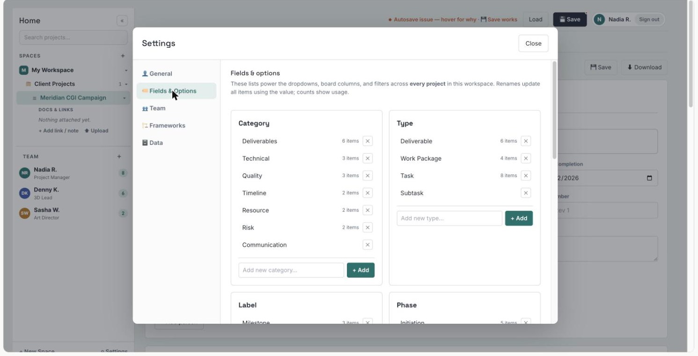

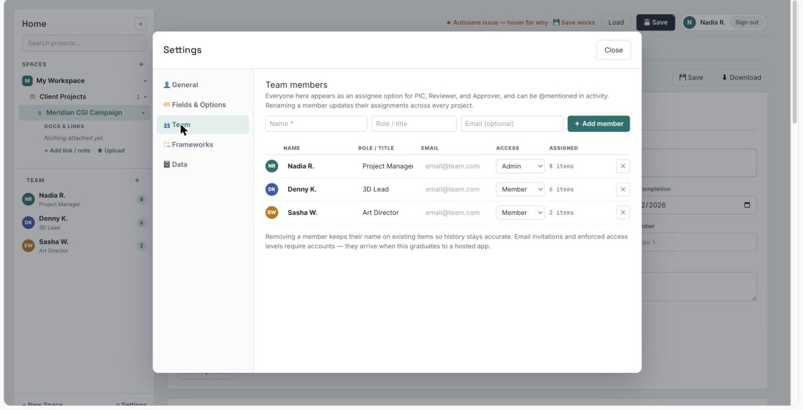

## M04 Lifecycle Governance Framework & Templates (GOV)

Purpose: make the delivery lifecycle configurable through versioned templates rather than custom development (v3 §4-8). The template model behaves as a governed configuration system: CLONE → ADAPT → REVIEW → PUBLISH → INSTANTIATE. Reference lifecycles are in Section 7.6 (Company A) and Section 15.2 (creative production phases).

Wireframes: 11-lifecycle-framework-designer, 12-gate-review, 13-template-library, 15-workspace-dashboard, 37-project-create, 38-my-approvals.

| ID | Requirement | Acceptance criteria | Pri | Source |
|--------|------------------------------------------------|------------------------------------|------|--------------|
| GOV-01 | **Stage library.** Admins create, edit, deactivate and reorder lifecycle stages. | Stage order is reflected in new projects and in the Phase list. | P0 | v3 GF-001 |
| GOV-02 | **Stage metadata.** Objective, description, owner, duration or SLA, activities, artifacts, entry and exit criteria. | All listed attributes can be stored per stage. | P0 | v3 GF-002 |
| GOV-03 | **Gate configuration.** Approvers, quorum, decision options and evidence requirements per gate. | A gate cannot be decided without its quorum. | P0 | v3 GF-003 |
| GOV-04 | **Mandatory artifacts.** Documents, fields, checklists and evidence can be mandatory before gate submission. | Submission is blocked while a mandatory artifact is missing. | P0 | v3 GF-004 |
| GOV-05 | **Role mapping.** Stages map to configurable workspace roles (stage owner, gate approvers, control functions). | Stage tasks route to the mapped roles. | P0 | v3 GF-005 |
| GOV-06 | **Conditional flow.** Rules add or remove stages, e.g. regulatory impact = yes adds Compliance Review. | Changing the triggering field updates the project's stage list. | P0 | v3 GF-006 |
| GOV-07 | **Parallel stages.** Selected activities run in parallel with dependency controls. | Parallel stages show separate readiness. | P1 | v3 GF-007 |
| GOV-08 | **Gate decision.** Pass, Pass with Conditions, Rework, Hold or Reject, each with rationale and evidence. | A decision without rationale is blocked (BR-30). | P0 | v3 GF-008 |
| GOV-09 | **Exit criteria.** A project cannot advance until mandatory criteria pass or an authorized, unexpired waiver exists. Eligibility is checked by the server for every channel (BR-42); the gate review shows which criteria block the decision. | (1) Advancing with an open criterion and no waiver is blocked (BR-17). (2) Pass and Pass with Conditions stay disabled until the gate is eligible, and an ineligible decision sent through the API or MCP is rejected. | P0 | v3 GF-009; RF-10, RF-28 |
| GOV-10 | **Stage SLA.** Planned versus actual stage duration; overdue stages flagged. | Overdue stages appear in the workspace dashboard. | P1 | v3 GF-010 |
| GOV-11 | **Stage health.** Combines schedule, scope, resources, risks, dependencies and gate readiness. | Health is calculated with the same rules in every project. | P1 | v3 GF-011 |
| GOV-12 | **Framework versioning and pinning.** Published framework versions are immutable; changes create a new version; each project and stage instance keeps the version it was created with. | Editing a template never alters existing stage instances (BR-15, BR-16). | P0 | v3 GF-012, WS-010, §13 |
| GOV-13 | **Exception and waiver.** Authorized users temporarily waive a rule with reason, approver and expiry. | Expired waivers re-block the affected criterion and raise an attention item. | P0 | v3 GF-014 |
| GOV-14 | **Gate readiness view.** Before a gate meeting: required evidence status, open risks, dependencies, budget and resource impact, decision history. | All five elements are shown for any pending gate. | P0 | v3 §8 |
| GOV-15 | **Gate follow-up.** Gate decisions link to project, stage, evidence, approver and Decision Log; conditions are tracked as actions with owner and due date; failed or conditional gates can raise risks or CRs. | A "Pass with Conditions" decision creates at least one tracked condition. | P0 | v3 §8 |
| GOV-16 | **Gate escalation.** Escalation for overdue, repeatedly failed or materially blocked gates. | Escalations notify the configured role. | P1 | v3 §8 |
| GOV-17 | **Template catalog.** Authorized users browse approved corporate and workspace templates. | Only published templates are offered for new projects. | P0 | v3 TPL-001 |
| GOV-18 | **Clone template.** An existing template is cloned into an editable draft (the POC's "Edit a copy"). | The clone records its source (GOV-23). | P0 | v3 TPL-002; POC 35 |
| GOV-19 | **Adapt stages.** Add, remove, rename, reorder and configure stages in a draft. | Changes stay in draft until published. | P0 | v3 TPL-003 |
| GOV-20 | **Adapt governance.** Change approvers, artifacts, gates, thresholds and exception rules in a draft. | Changes stay in draft until published. | P0 | v3 TPL-004 |
| GOV-21 | **Publish workflow.** Template changes require review and publication before activation. Publishing runs a readiness check: every stage has an owner role, every gate has approvers and a quorum that the configured approvers can meet, mandatory artifacts are defined, and the stage list yields the Phase values. | (1) Unpublished drafts cannot be instantiated. (2) A draft that fails the readiness check cannot be published and the check lists each failure. | P0 | v3 TPL-005; S5 |
| GOV-22 | **Template version.** Each published version has a unique version number and effective date. | Version and effective date shown on every project. | P0 | v3 TPL-006 |
| GOV-23 | **Template provenance.** Source template, lineage, author, accountable owner and change summary are recorded. | Lineage and owner are viewable for any template. | P0 | v3 TPL-007; RF-19 |
| GOV-24 | **Template comparison.** Compare versions and show stage, rule and artifact differences. | Differences are listed per element. | P1 | v3 TPL-008 |
| GOV-25 | **Template migration.** Propose migration of active projects to a new version and show impact before approval. | No project changes version without approval. | P1 | v3 TPL-009 |
| GOV-26 | **Global template library.** Global standard templates alongside workspace-specific templates. | Workspaces can clone global templates. | P1 | v3 TPL-010 |
| GOV-27 | **Project and WBS templates.** Create a project from a template holding charter defaults and a WBS skeleton. | A new project from a template contains its WBS skeleton. | P1 | v3 §10 |
| GOV-28 | **Template deprecation and review.** A template can be deprecated (no new projects, existing projects unaffected) with a replacement and a reason; templates unused or unreviewed for a set period are flagged to their owner (GOV-23). | A deprecated template is not offered for new projects and still shows on the projects that use it. | P1 | RF-19 |

## M05 Natural-Language Interface for LLMs: MCP Server & Access Tokens (MCP)

Purpose: let people work with the platform in natural language from the LLM tools they already use (A-06). Each tenant gets a remote server for the Model Context Protocol (MCP), the open protocol that connects LLM applications to external data and tools. Any LLM client that implements the MCP specification connects with a token or OAuth, and the clients verified by the provider are listed in the connection guide (MCP-15); the server offers tools (functions the model can call), resources (read-only context such as a charter) and prompts (reusable request templates), and always acts as the user who owns the token.

Protocol facts this module relies on [Source: S4, MCP specification 2026-07-28]:

- Server features are tools, resources and prompts; messages use JSON-RPC 2.0.
- The standard transports are stdio (a local subprocess) and Streamable HTTP (each message is an HTTP POST to one MCP endpoint); a hosted SaaS uses Streamable HTTP.
- Authorization is optional in the protocol. When used over HTTP it follows an OAuth 2.1 based flow: the MCP server publishes OAuth Protected Resource Metadata (RFC 9728), clients send the access token in the Authorization header on every request and never in the URL, and the server accepts only tokens issued for it.

Support for remote servers, OAuth and static tokens differs between LLM client applications [Unverified - confirm per client, Q-08]. The platform therefore offers both OAuth and personal access tokens, issued by its own authorization server (D-29).

Wireframes: 04-tenant-admin-ai-access, 05-tenant-admin-plan-usage, 06-tenant-admin-audit, 08-profile-ai-access, 12-gate-review, 23-ai-copilot, 28-wbs-item, 33-journal-reports, 38-my-approvals, 42-editor-states.

| ID | Requirement | Acceptance criteria | Pri | Source |
|--------|------------------------------------------------|------------------------------------|------|--------------|
| MCP-01 | **MCP server endpoint.** One HTTPS endpoint per tenant using the Streamable HTTP transport, declaring the protocol version it supports; shown on the connection page. | A standard MCP client lists the tools and calls a read tool against the tenant endpoint. | P0 | S4; A-06 |
| MCP-02 | **Personal access tokens.** Users create tokens with a name, scopes, optional workspace or project restriction and an expiry within the tenant maximum; a token is shown once, stored hashed, revocable and shows its last use. | A revoked or expired token gets HTTP 401; the token value is never shown again after creation. | P0 | A-06; BR-36; D-29 |
| MCP-03 | **OAuth authorization.** Clients that support MCP authorization connect through the platform's OAuth 2.1 authorization server with user consent, following the MCP specification (Protected Resource Metadata, PKCE, resource indicator). | A compliant client completes sign-in and consent without copying a token. | P0 | S4; D-29 |
| MCP-04 | **Same permissions, same tenant.** Every request runs as the token's user; the effective permission is the intersection of the user's roles and the token's scopes; tenant isolation applies. | A Viewer's token cannot call write tools; no tool returns another tenant's data (TEN-02). | P0 | BR-34; TEN-02 |
| MCP-05 | **Read tools.** Search and list projects and portfolios; project overview metrics; WBS items with filters; the user's focus list; change requests, risks, decisions and journal entries; charters and reports; workspace configuration. | Results match what the same user sees in the application. | P0 | A-06 |
| MCP-06 | **Append-only write tools.** Add journal entries and comments linked to WBS items. | Entries show the AI avatar and "via MCP" with the token name in activity. | P0 | RPT-01; WBS-16 |
| MCP-07 | **Update tools.** Update WBS item status, dates, PIC and effort; create draft change requests and risks; generate report drafts. | Updates respect baseline locks (BR-04) and version checks (MCP-14). | P0 | D-30 |
| MCP-08 | **Prepare-only governance.** Approvals and decisions (CRs, gates, portfolio decisions), baseline application, deletions, permission and token changes cannot be executed through MCP; a tool can prepare them and returns a link for a person to confirm in the application. | Calling a decision tool creates a draft and a confirmation link; nothing is approved. | P0 | BR-35; BR-10; v2 §14 |
| MCP-09 | **Tool contracts.** Each tool has a stable name, a plain-language description, a JSON input schema with examples and a version; changes stay backward compatible within a major version. | The tool list is published on the connection page and versioned. | P0 | S4 |
| MCP-10 | **Server-computed figures.** Tools return metrics computed by the platform with the Section 12 definitions (progress, overdue, delayed, health) instead of raw rows for the LLM to aggregate. | get_project_overview returns the same values as the Overview screen for the same time. | P0 | BR-32 |
| MCP-11 | **Audit and transparency.** Every call is logged with user, token, client name, tool, parameter summary, result and time; users see their own MCP activity and tenant admins see all of it. | Entries are immutable and exportable (PLT-11). | P0 | PLT-11; BR-12 |
| MCP-12 | **Rate limits and quotas.** Limits per token and per tenant (plan based) with clear errors and retry guidance. | Exceeding a limit returns a clear error and does not affect other tenants. | P0 | TEN-05; TEN-10 |
| MCP-13 | **Data minimization.** Tools return only the fields needed, paginate large results and exclude personal contact data unless the scope allows it. | Contact emails and phones appear only with a contacts scope. | P0 | New |
| MCP-14 | **Write safety.** Write tools use the same write contract as the application and the API (PLT-06): idempotency keys and record versions, so a retried or stale call never duplicates work or overwrites newer changes; a stale call returns the newer value. | (1) Repeating a call with the same key changes nothing a second time. (2) A call based on an old version is rejected with the current value. | P0 | PLT-06; RF-07 |
| MCP-15 | **Connection page and guide.** A page in the user's profile shows the endpoint, the OAuth connection, token creation, example client configurations, a test call and the tool list, plus a compatibility list of verified clients with the connection methods each supports. A failed test call names its category and the fix: invalid or expired token, missing scope, workspace restriction, client not allowed by tenant policy, rate limit, protocol version mismatch, service unavailable. | (1) A new user connects a verified client by following the page alone. (2) Each failure category shows its own message and next step. | P0 | Q-08; RF-06, RF-32 |
| MCP-16 | **Content-injection safety.** Text stored in records (comments, descriptions, files) is returned as data and never interpreted as instructions by the server; write and prepare tools act only on explicit parameters. | A comment containing instructions cannot trigger any server action. | P0 | S4; New |
| MCP-17 | **Resources and prompts.** Charters, reports and journal digests exposed as MCP resources; prompt templates such as "Draft weekly status", "Prepare gate readiness summary" and "Portfolio risk review". | Prompts appear in clients that support them. | P1 | S4 |
| MCP-18 | **REST API.** A REST API with the same tokens, scopes, limits and audit, for system integrations. | The same permission model applies as for MCP. | P1 | v2 §13 |
| MCP-19 | **Action classes.** Every tool belongs to one class that sets its safeguards: read; append-only (new journal entries and comments); reversible write (field updates and drafts, undoable from the item's activity); prepare-only (governance actions that a person confirms in the application, BR-35). The class is shown in the tool list and recorded in the audit log. | (1) Every published tool has exactly one class. (2) A reversible write made through MCP can be undone from the item's activity by a person with edit rights. | P0 | D-30; S5 |
| MCP-20 | **Client allowlist and workspace restrictions.** Tenant admins choose which MCP clients may connect (all clients that implement the specification, or a named list), which workspaces MCP may reach, the maximum token lifetime and the scopes each role may grant. OAuth clients are identified by their registration with the platform's authorization server; a personal access token is a bearer token that works from any application holding it, so it cannot prove which client uses it; for personal tokens the policy is to allow or block them as a whole, per workspace. | (1) An OAuth client outside the allowlist is refused with a message naming the policy. (2) A token cannot reach a workspace the tenant policy excludes. (3) When personal tokens are blocked, every call with one is refused with the policy name. | P0 | RF-32; TEN-04; D-29 |

**Indicative tool catalogue** (final names set in the API design; milestones as in Section 18.2):

| Tool | Purpose | Scope | Class (MCP-19) | Milestone |
|------------------------------|--------------------------------------------------------|--------------------|--------------|------------|
| list_projects | Search and list projects the user can access | projects:read | Read | 1A |
| get_project_overview | Section 12 metrics, health and attention items of a project | projects:read | Read | 1A |
| get_wbs_items | WBS items filtered by status, PIC, category, phase or dates | wbs:read | Read | 1A |
| get_my_focus | The user's overdue, due and starting items across projects | wbs:read | Read | 1A |
| get_portfolio_summary | Cockpit figures and attention queue of a workspace | portfolio:read | Read | 1A |
| list_change_requests, get_change_request | Change register and CR detail with impact analysis | changes:read | Read | 1A |
| list_risks | Project or portfolio risks | risks:read | Read | 1A |
| get_charter, get_report | Charter and reports as Markdown | reports:read | Read | 1A |
| add_journal_entry, add_comment | Append-only writes | journal:write, comments:write | Append-only | 1A |
| update_wbs_item | Change status, dates, PIC or effort | wbs:write | Reversible write | 1B |
| create_change_request_draft, create_risk | Drafts that people submit | changes:draft, risks:write | Reversible write | 1B |
| generate_report | Report draft for a template and period | reports:write | Reversible write | 1B |
| prepare_decision | Prepare a CR, gate or portfolio decision for confirmation in the app | prepare only | Prepare-only | 1B |

# 10. Project Execution Requirements

## M06 Project Charter & Business Case (CHR)

Purpose: a charter that is a live slice of project data rather than a separate document (Survey §03). Sections V and VI are synchronized from the WBS; the business case, budget and sponsorship fields come from BRD v2.0 module M03.

Wireframes: 16-portfolio-registry, 20-investment-benefits, 25-project-charter, 37-project-create, 38-my-approvals.

| ID | Requirement | Acceptance criteria | Pri | Source |
|--------|------------------------------------------------|------------------------------------|------|--------------|
| CHR-01 | **Charter structure.** Nine sections: I Project Identification, II Key Contacts, III Description & Objectives, IV Project Scope, V Deliverables, VI Input Required, VII Overall Project Risk, VIII Other Notes, IX Sign-off. | All nine sections appear in the UI and in the PDF in this order. | P0 | POC 04-07 |
| CHR-02 | **Identification (I).** Project name, client or department, project manager, start date, target completion, overall status, project number, contract value or number, revision number, revision description, project team (name, title or role). Values are shared with the project record, Overview, WBS and Timeline. | Changing target completion in the charter updates the project record, subject to the baseline lock (BR-04). | P0 | POC 04 |
| CHR-03 | **Key contacts (II).** Rows of role, name, email and phone; add and remove rows; default roles Approved Representative, Contracting Officer Representative and Key Contact, configurable per workspace. | Default roles appear on new charters. | P0 | POC 05 |
| CHR-04 | **Description, objectives and scope (III-IV).** Description; objectives, one per line; in scope; out of scope. | Objectives render as a list in the PDF. | P0 | POC 05 |
| CHR-05 | **Deliverables, live (V).** Read-only list of work items with Type = Deliverable (Category nodes excluded), with dates and descriptions taken from the WBS; when empty, a link opens the WBS Master. | Editing a deliverable's date in the WBS updates section V without manual action. | P0 | POC 06; BR-22 |
| CHR-06 | **Client commitments, live (VI).** Read-only list of work items labelled Input Required, with description, PIC (may be the client) and target date, plus a charter note per row. | Labelling an item Input Required adds it to VI at once; the note stays attached to that item. | P0 | POC 06 |
| CHR-07 | **Overall project risk (VII).** Shows the project's top risks (risk, mitigation plan, owner) from the risk register; risks can be added from the charter. | A risk added in the charter appears in the register, and the reverse. | P0 | POC 07; v2 FR-601; New |
| CHR-08 | **Notes and sign-off (VIII-IX).** Free notes; sign-off by Client Representative, Project Owner and Project Manager, each recorded with authenticated signer, timestamp and charter revision. | A signed revision is frozen; further edits start a new revision. | P0 | POC 07; Survey §03; D-12 |
| CHR-09 | **Charter revisions.** Issuing a revision snapshots the charter with revision number and description; earlier revisions remain viewable. | Each issued revision can be opened read-only. | P0 | POC 04; Survey §03; D-12 |
| CHR-10 | **Revision comparison.** Side-by-side comparison of two charter revisions. | Changed fields are highlighted. | P1 | Survey §03; D-12 |
| CHR-11 | **Charter export.** Download as formatted PDF (sections, client commitments with PICs, risks, sign-off lines) or as data (JSON). | The PDF lists every Input Required item with PIC and date. | P0 | POC 08; PLT-16 |
| CHR-12 | **Business case.** Problem, opportunity, target customer, strategic rationale, alternatives, expected benefits and assumptions. | The business case is approved before the project becomes committed. | P0 | v2 FR-201 |
| CHR-13 | **Budget and timeline.** Approved budget, actual, forecast, start and end dates and milestones; budget and date variance calculated automatically. In the MVP, actuals are entered or imported (ERP integration is V2). | Variance updates when actual or forecast changes. | P0 | v2 FR-202, §13 |
| CHR-14 | **Owner and sponsor.** An accountable project owner and an executive sponsor. | Both are mandatory before commitment (BR-01). | P0 | v2 FR-203 |
| CHR-15 | **Strategic linkage.** Link the project to one or more strategic objectives (a workspace-managed list in the MVP) or record an approved exemption. | Committed projects without objective or exemption are flagged (BR-02). | P0 | v2 BR-02, §22; D-25 |
| CHR-16 | **Lifecycle position.** Current stage, gate readiness and framework version shown on the project. | Values match the project's stage instances. | P0 | v3 §14 (M03) |
| CHR-17 | **Create project.** A project is created with workspace, portfolio, optional program, name, client or business unit, PM, owner and sponsor, and an optional project template (GOV-27 when available); the workspace's published lifecycle framework version is pinned (BR-15); the project starts in Draft with a setup checklist (charter I-IV, business case, team, first WBS items) that leads to commitment. | (1) A project cannot be created outside a workspace (BR-13). (2) The new project shows its pinned framework version and its setup checklist. | P0 | RF-25; v3 §13 |

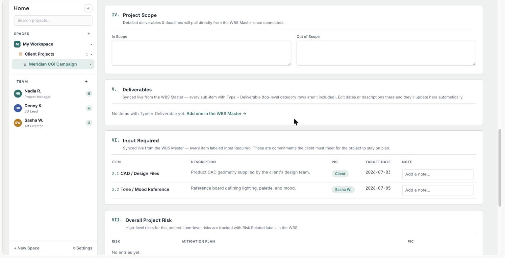

## M07 WBS Master (WBS)

Purpose: the heart of project execution. One data set, three views (Table, Tree Diagram, Blueprint), one item form, and dependencies that warn but never reschedule.

Wireframes: 17-portfolio-roadmap, 19-risk-dependency, 26-wbs-table, 27-wbs-tree, 28-wbs-item, 30-plan-timeline, 31-plan-board, 42-editor-states.

| ID | Requirement | Acceptance criteria | Pri | Source |
|--------|------------------------------------------------|------------------------------------|------|--------------|
| WBS-01 | **Single source of truth.** Project work is created and edited only through the WBS (table, tree, item form, Board, Builder); every other view reads from it. | No other view stores its own copy of WBS fields (BR-22). | P0 | POC 06, 09; Survey §00 |
| WBS-02 | **Hierarchy.** Hierarchical items with codes 1.0, 1.1, 1.1.1; Level is derived from position; Category nodes exist only at level 1; up to five levels. | An item cannot be created deeper than the maximum depth. | P0 | POC 09, 19; D-06 |
| WBS-03 | **Code generation.** The system generates codes when items are created and renumbers them on move; each item keeps a permanent internal ID so links, dependencies and history survive renumbering. | Moving 1.2 under 1.1 renumbers it 1.1.3 with dependencies and activity intact. | P0 | POC 19; Survey §04; D-05 |
| WBS-04 | **Table view.** Columns: selection, WBS (code, name, type and label icons), Description, Type, Phase, PIC, Start, Target, Duration, Status, Priority, Risk, Actions (add child, attach, duplicate, delete); inline editing with date pickers; expand and collapse; the WBS column stays visible during horizontal scroll. | All columns are editable inline except Duration and codes; the View Option menu switches between Table, Tree Diagram and Blueprint. | P0 | POC 09-11 |
| WBS-05 | **Filters.** Category, Phase, Type, Status and PIC, default All, applied instantly without an Apply button; matches keep their hierarchy context. | Filtering by PIC shows matching items with their parents. | P0 | POC 09; Survey §04 |
| WBS-06 | **Bulk actions.** After multi-select: change Status, PIC, Phase, Priority or Risk Level; delete with confirmation. | A bulk change is recorded in each item's activity. | P0 | POC 09; Survey §04 |
| WBS-07 | **Drag-and-drop restructuring.** Reorder and re-parent items by drag-and-drop in the table. | Codes renumber per WBS-03. | P1 | Survey §04 |
| WBS-08 | **Tree Diagram view.** Hierarchy canvas with dependency arrows; Auto Vertical and Auto Horizontal layouts; zoom; expanded full-screen view. | Every item appears once; arrows match dependencies. | P0 | POC 12-13 |
| WBS-09 | **Free Move layout.** Drag nodes anywhere; positions are remembered. | Positions persist across sessions. | P1 | POC 13 |
| WBS-10 | **Blueprint view.** Shows Deliverable Builder canvases (items, connections, connection points) exactly as laid out; when empty, a button opens the Builder. | The Blueprint matches the canvas saved at generation. | P0 | POC 14; BLD-08 |
| WBS-11 | **Item form.** WBS code, parent, level (derived), Category (PM control area), Type (work object level), Phase, Labels (multi), Name (required), Description, Input Required list, Output Produced list, Files & Links, PIC, Reviewer, Approver, Start Date, Target Date, Duration (auto), Planned Effort, Actual Effort (entries such as 12h or 2d 4h), Status, Priority, Risk Level, Dependencies, Notes. | (1) Name and parent or Category are required. (2) Target is not before Start. (3) Effort text is stored as hours. | P0 | POC 19-21; New (Planned Effort) |
| WBS-12 | **Assignment.** PIC, Reviewer and Approver are chosen from workspace members; "Client" can be chosen as an external party for Input Required items. | Free-text names are not accepted for internal people. | P0 | POC 06, 09, 34 |
| WBS-13 | **Dependencies.** Predecessor links of type FS, SS, FF or SF between items of the same project; violations are flagged on both items; dates are never moved automatically. A conflict is evaluated only when both compared dates exist (BR-40). | (1) An FS predecessor finishing after the successor starts shows a conflict flag on both items and no date changes (BR-23). (2) A link whose compared date is missing shows "schedule data incomplete", not a conflict. | P0 | POC 20, 25; RF-09, RF-33 |
| WBS-14 | **Cross-project dependencies.** Dependencies between items, MVPs and milestones of different projects in the same workspace. | The impact is visible in both projects and in the dependency map (RSK-03). | P0 | v2 FR-603 |
| WBS-15 | **Duration.** Duration = Target − Start + 1, in calendar days (POC behaviour) or in working days from the workspace business calendar. | 13 Jul-28 Aug 2026 shows 47 calendar days or 35 working days (Mon-Fri, no holidays). | P0 | POC 10; v3 WS-003; D-07 |
| WBS-16 | **Activity and comments.** Each saved item shows its change history (e.g. "Nadia R. changed Status") and comments with @mentions and attachments, posted as the signed-in user. | Activity starts on first save; @mentions notify (PLT-09). | P0 | POC 19, 21 |
| WBS-17 | **Item attachments.** Files and links on an item (deliverables, references), available once the item has been saved. | Attachments are stored per PLT-07. | P0 | POC 19 |
| WBS-18 | **Category nodes.** Category nodes group work by PM control area; their dates, status and progress roll up from their children; they are excluded from work-item counts and KPIs. | Overview totals equal the number of work items (BR-24). | P0 | POC 02, 28, 32; New |
| WBS-19 | **Duplicate and delete.** Duplicate an item with or without children; deleting an item that has children or dependents requires confirmation listing what will be removed. | Deleted dependencies are removed from both ends. | P0 | POC 10 |
| WBS-20 | **Saved views and column presets.** Column presets for common jobs (Planning: dates, duration, dependencies; Tracking: status, PIC, target; Risk: risk level, labels), personal saved views (filters, columns, sort, expansion) and views shared with the project; key columns stay frozen; the table is fully operable from the keyboard. | A saved view reopens with the same filters, columns and sort; a shared view is available to every project member. | P0 | RF-38 |

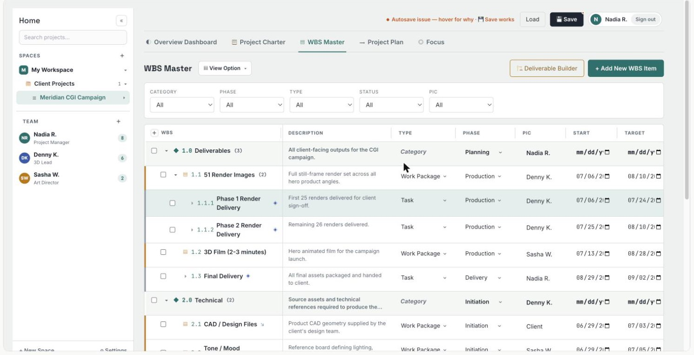

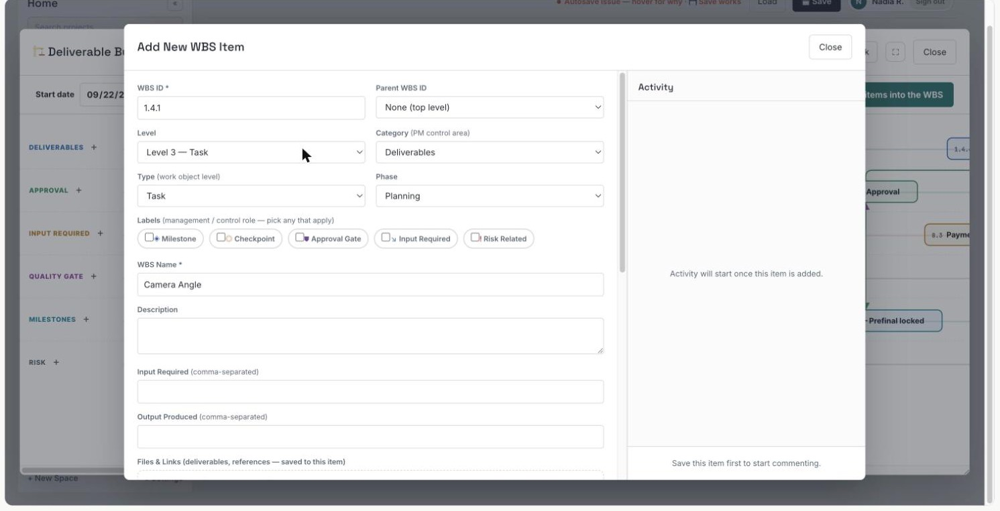

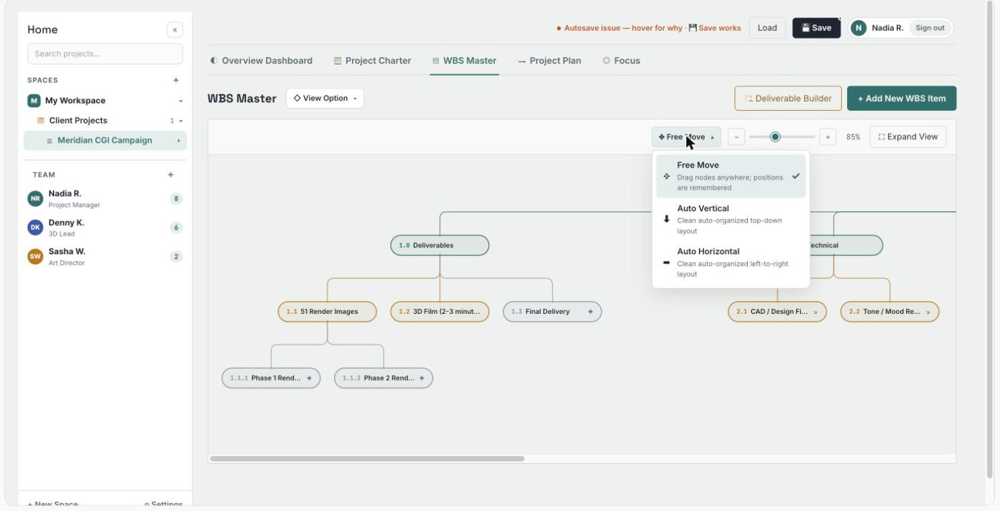

## M08 Deliverable Builder & Process Frameworks (BLD)

Purpose: the POC's most distinctive capability. Instead of typing tasks one by one, the PM picks a process framework and generates a pre-wired set of WBS items and dependencies. The survey rates it the hardest block to build (custom canvas, drag-and-drop, connector drawing, automatic date spreading) and recommends a separate milestone.

Wireframes: 13-template-library, 29-deliverable-builder.

| ID | Requirement | Acceptance criteria | Pri | Source |
|--------|------------------------------------------------|------------------------------------|------|--------------|
| BLD-01 | **Launch and target.** From the WBS Master, the PM opens the Builder and either builds under an existing item or creates a new deliverable (name and parent Category). | The new deliverable is created under the chosen Category. | P0 | POC 15, 17 |
| BLD-02 | **Framework selection and preview.** Cards show each framework's flow summary and item and relationship counts; a read-only swimlane preview opens with "Use this framework". | Preview counts equal the framework definition. | P0 | POC 15-16 |
| BLD-03 | **Canvas.** Swimlanes defined by the framework (default: Deliverables, Approval, Input Required, Quality Gate, Milestones, Risk); nodes show provisional WBS codes; one Start Date drives the dates of all nodes. | Changing the Start Date shifts every node by the same offset rule (D-09). | P0 | POC 16, 18 |
| BLD-04 | **Canvas editing.** Drag a node along its lane to reschedule; click a node to edit it with the full item form; drag the link handle onto another node to connect; double-click a lane line to add a connection point; select an arrow and drag its ends or corners; Delete removes; "+" adds a node to a lane. | Each listed gesture works with the mouse and has a keyboard equivalent (BR-41); the list editor (BLD-12) performs the same edits without the canvas. | P0 | POC 18-19; RF-35 |
| BLD-05 | **Generate into the WBS.** "Build N items into the WBS" creates the items with codes, labels and dependencies under the target deliverable and saves the canvas as that deliverable's Blueprint. | Item and relationship counts in the WBS equal the canvas (e.g. 16 and 15 for CGI Still Renders). | P0 | POC 18 |
| BLD-06 | **Lane mapping.** Each lane maps to WBS attributes (Label and, optionally, Category) as defined in the framework. | Items generated from the Approval lane carry the Approval Gate label (per D-09). | P0 | POC 18; D-09 |
| BLD-07 | **Re-run protection.** Running the Builder again for the same deliverable asks whether to add another set or cancel; items with progress, effort or comments are never overwritten. | No existing item changes after a re-run (BR-31). | P0 | Survey §05; D-09 |
| BLD-08 | **Blueprint storage.** One Blueprint per deliverable; the Blueprint view lets the user choose the deliverable. | Two deliverables built separately show two Blueprints. | P0 | POC 14; Survey §05; D-09 |
| BLD-09 | **Framework library.** Built-in frameworks (CGI Still Renders, 3D Animation / Video, Simple Review Loop) are read-only; users create frameworks on the canvas (steps, lanes, connections, offsets) or "Edit a copy" of a built-in, saved as a custom framework of the workspace. | Editing a built-in always produces a custom copy. | P0 | POC 35; D-23 |
| BLD-10 | **Framework provenance.** Generated items record the framework and version used. | Provenance is visible on each generated item. | P0 | v3 TPL-007; New |
| BLD-11 | **Framework governance.** Custom process frameworks follow the template review, publish and version workflow (GOV-17…GOV-23) and can be shared through the template library. | Only published frameworks are offered in the Builder. | P1 | v3 §7; Survey §05 |
| BLD-12 | **Build preview, re-run difference and list editor.** Before building, a preview lists the items, codes, labels, dates and dependencies that will be created; building is deterministic (the same framework version, target and Start Date always give the same result); a re-run shows the difference against the existing set before confirmation; a list editor (an outline of lanes and nodes) edits the same graph as the canvas with the keyboard. | (1) The preview counts equal the created items and relationships. (2) Every canvas edit can be done in the list editor without a pointer. | P0 | RF-15, RF-35; D-09 |

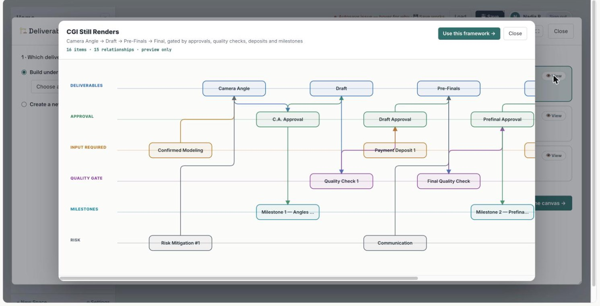

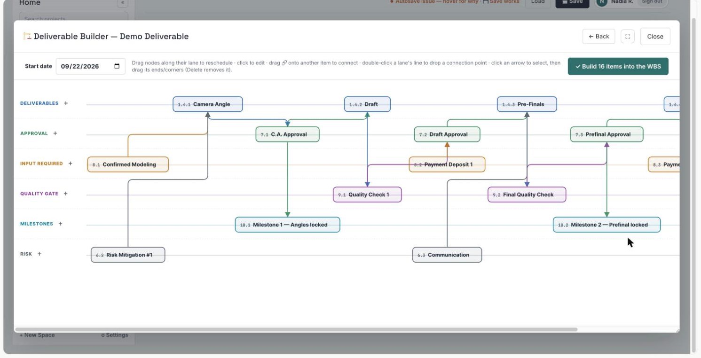

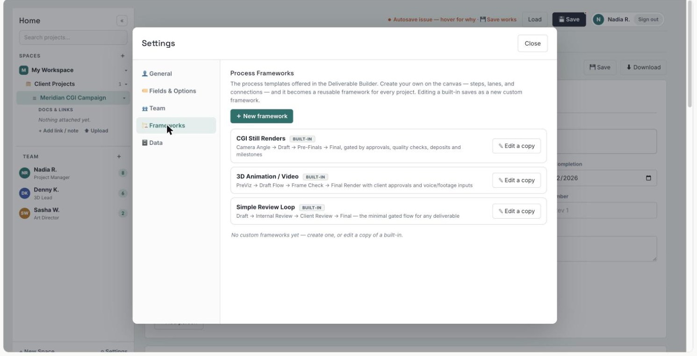

## M09 Project Plan: Timeline & Board (PLN)

Wireframes: 30-plan-timeline, 31-plan-board.

| ID | Requirement | Acceptance criteria | Pri | Source |
|--------|------------------------------------------------|------------------------------------|------|--------------|
| PLN-01 | **Plan area.** Project Plan groups Timeline, Board, Changes and Reports with a full-screen toggle. | Switching views keeps the project context. | P0 | POC 22-28 |
| PLN-02 | **Timeline.** Point-in-time timeline of dated work items: each card shows date, days relative to today, code and name, a status dot and an OVERDUE tag when late; filter; zoom (default 100%); horizontal or vertical orientation; equal-spacing mode. | An item past its target date and not Done shows OVERDUE. | P0 | POC 22 |
| PLN-03 | **Timeline overlays.** Lifecycle stages, gate dates and governance milestones on the timeline. | Gate dates appear as distinct markers. | P1 | v3 §14 (M05) |
| PLN-04 | **Project Gantt.** Bar-based Gantt with dependency lines. | Bars and dependency lines match WBS dates and links. | P1 | Survey §07; D-11 |
| PLN-05 | **Board.** Kanban columns from the workspace Status list (Not Started, In Progress, Waiting, Blocked; Done per D-10) with counts; cards show code, name, labels, PIC avatar, target date and priority; drag-and-drop changes status and is recorded in the item's activity; a "Move to…" menu on every card does the same from the keyboard or on touch (BR-41); "+ Add Task" creates an item in that column; empty columns show a drop zone; filter. | (1) Dragging a card to Blocked sets Status = Blocked and logs the change. (2) "Move to…" gives the same result and announces the new status to screen readers. | P0 | POC 23; Survey §07; D-10; RF-36 |

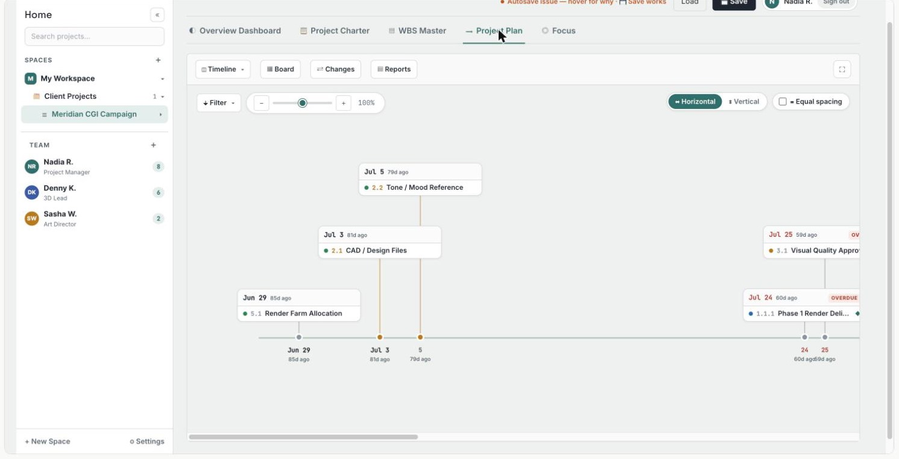

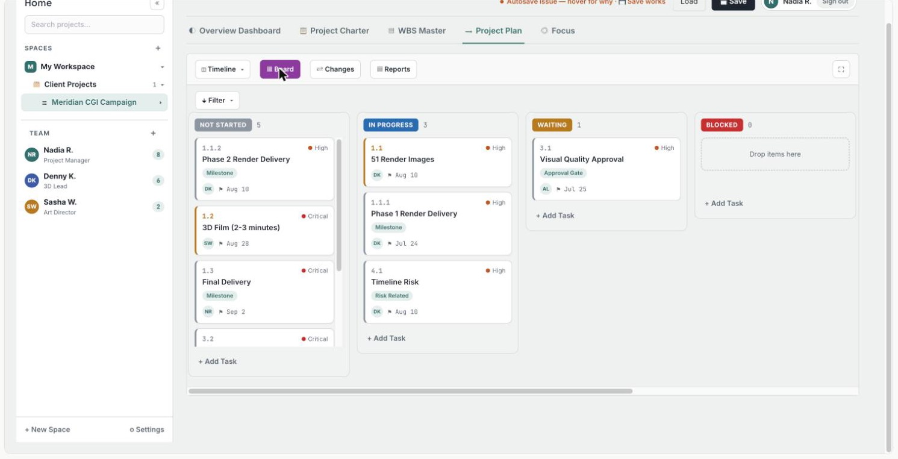

## M10 Project Overview & Focus (OVW)

Purpose: read-only views that summarise the WBS for the project (Overview) and for the person (Focus). Portfolio and program aggregation is covered by M15.

Wireframes: 24-project-overview, 34-focus, 38-my-approvals.

| ID | Requirement | Acceptance criteria | Pri | Source |
|--------|------------------------------------------------|------------------------------------|------|--------------|
| OVW-01 | **KPI tiles.** Total work items, Deliverables, Work Packages, Milestones, Gates, Blocked, Delayed and High Risk, calculated per Section 12; tiles for Blocked, Delayed and High Risk are highlighted when above zero. | Tile values equal the Weekly Status health summary for the same date. | P0 | POC 02; Section 12 |
| OVW-02 | **Charts.** Overall progress (Done / total work items), status breakdown with counts, progress by Category (done versus total). | Charts exclude Category nodes. | P0 | POC 02 |
| OVW-03 | **Attention lists.** Workload by PIC (open items only), upcoming milestones and gates, overdue items with a count badge, high and critical risk items. | List membership follows Section 12. | P0 | POC 03 |
| OVW-04 | **Drill-down.** Every tile, chart segment and list entry opens the filtered WBS or the item. | Clicking "Blocked" opens the WBS filtered on Status = Blocked. | P0 | POC 03; v2 §18; Survey §02 |
| OVW-05 | **Project health.** Computed RAG health (delivery, risk, resource, financial) shown next to the PM-declared status; a mismatch is flagged as green-but-risky. | A declared Green with a computed Red is flagged until an override with rationale exists (BR-08). | P0 | v2 FR-003, BR-08; New |
| OVW-06 | **Focus.** "Today & This Week" with the date and a one-line summary; counters for overdue, due today, due in the next 7 days and in progress; columns Overdue, Due this week, Starting this week; rows show code, name, PIC, status and days overdue; each empty column states why it is empty; "Only mine" filters to the signed-in user. | Counts follow Section 12 (e.g. days overdue = today − target date). | P0 | POC 29 |
| OVW-07 | **Quick update from Focus.** Change status or mark done without opening the item. | The change is logged in the item's activity. | P0 | Survey §08; RF-11 |
| OVW-08 | **My work across projects.** Focus across all projects of the workspace that the user belongs to. | Items from several projects appear with project names. | P0 | Survey §08; RF-11 |
| OVW-09 | **My approvals.** One queue of everything waiting for the user's decision across the workspaces they belong to: CR decisions, gate decisions and votes, charter sign-offs, waiver requests, deliverable approvals (items labelled Approval Gate where the user is Approver) and decisions prepared through MCP; each row shows type, project, requester, age and due date and opens the decision screen; the navigation shows how many the user can act on now; items blocked by another decision show their blocker. | (1) Every pending request addressed to the user appears once and disappears when decided or withdrawn. (2) The navigation count equals the number of queue items the user can act on now. | P0 | RF-12, RF-27; PLT-09 |

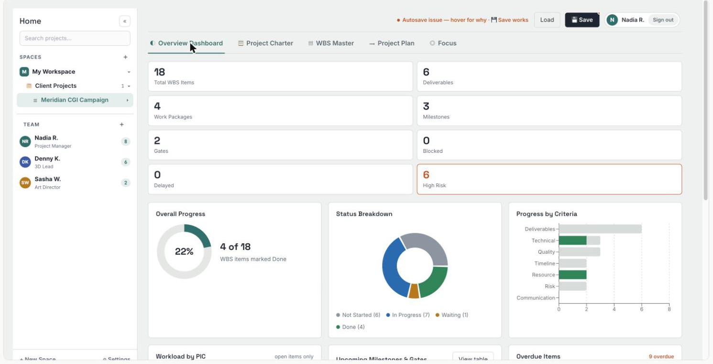

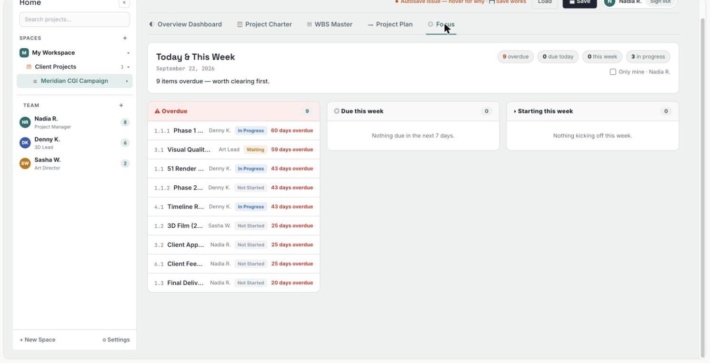

## M11 Change Control, Baseline & Decision Log (CHG)

Purpose: combine the POC change register (advisory, with impact analysis) with v2.0 baseline governance. Before commitment the register is advisory, as in the POC; after commitment locked fields change only through approved CRs.

Wireframes: 12-gate-review, 32-change-requests, 33-journal-reports, 38-my-approvals.

| ID | Requirement | Acceptance criteria | Pri | Source |
|--------|------------------------------------------------|------------------------------------|------|--------------|
| CHG-01 | **Change register.** Counters (Open, Approved, Rejected, Total logged), status filters (All, Open, Approved, Rejected, Deferred, Closed), columns Ref, Change, Type, Priority, Status, Requester, Logged and Impacts; references numbered CR-001, CR-002…; the register states whether the project is baselined (enforced) or not (advisory). | Counters equal the filtered lists. | P0 | POC 24 |
| CHG-02 | **CR form.** Requester, Type (Scope, Schedule, Budget, Resource, Dependency, Other), Priority, What is changing, Why (justification), Affected WBS items, Schedule impact (days), Budget impact, Resource impact (FTE), Impact notes (cost, risk, quality), Proposed action, Effective date. | What, Why, Type and at least one affected item or baseline field are mandatory. | P0 | POC 25; v2 FR-703 |
| CHG-03 | **Impact analysis.** Automatic count and list of directly affected items and of downstream items that could shift through dependency links; advisory only. | For POC CR-001: 1 item directly affected, 0 downstream; nothing is rescheduled. | P0 | POC 25; BR-23 |
| CHG-04 | **Review and decision.** Approver; status (Draft, Under Review, Approved, Approved pending application, Rejected, Deferred, Withdrawn, Closed); decision notes; actions Approve, Reject, Defer and Request information. | A decision without rationale is blocked (BR-30); decisions record actor and time. | P0 | POC 25; v2 FR-703, §8 wireframe |
| CHG-05 | **CR history.** Submission, edits, information requests and decisions with actor and timestamp. | History cannot be edited. | P0 | POC 25; PLT-11 |
| CHG-06 | **Baseline.** On commitment (charter approval or the configured gate) the system captures a baseline of scope (deliverables), dates, budget and critical dependencies; locked values cannot be edited directly. | Editing a locked target date prompts the user to raise a CR (BR-04). | P0 | v2 FR-702 |
| CHG-07 | **Applying approved changes.** An approved CR unlocks only its affected baseline fields for the PM to apply; the CR shows "Approved pending application" until applied; before applying, the PM sees the difference between the current baseline and the values to apply; applying creates a new baseline version referencing the CR. Each role sees only its actions: the requester edits or withdraws, the approver decides, the PM applies. | (1) Approved CRs not applied within the workspace threshold raise an attention item (BR-05). (2) Apply is available only after the difference has been shown. | P0 | v2 BR-05; POC 24; D-08; RF-39 |
| CHG-08 | **Structured change sets.** A CR carries proposed field changes that are applied automatically on approval. | Applied values equal the approved change set. | P1 | D-08 |
| CHG-09 | **Segregation of duties.** The requester cannot be the sole approver of the same CR unless workspace policy allows self-approval for operational changes. | Self-approval is blocked by default (BR-28). | P0 | POC 25; New |
| CHG-10 | **Approval authority.** Thresholds on schedule, budget and FTE impact route CRs to PM, PMO or Executive per the role model. | A CR above the PMO threshold requires an Executive decision. | P1 | v2 §12 |
| CHG-11 | **Decision log.** CR, gate and portfolio decisions stored with rationale, evidence links, approver and date; immutable after approval except through a correction workflow; Journal entries of type Decision can be promoted. | A promoted decision links back to its journal entry. | P0 | v2 FR-704; v3 §8; POC 26 |
| CHG-12 | **CR deletion.** Only draft CRs can be deleted; submitted CRs are withdrawn or closed with a reason. | "Delete" is unavailable after submission (BR-29). | P0 | POC 25; New |

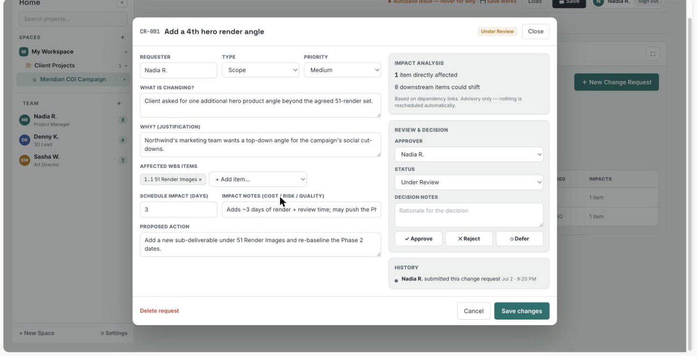

## M12 Journal & Project Reporting (RPT)

Wireframes: 33-journal-reports.

| ID | Requirement | Acceptance criteria | Pri | Source |
|--------|------------------------------------------------|------------------------------------|------|--------------|
| RPT-01 | **Journal.** Everyday project log with entry types Note, Meeting, Decision, Issue and Highlight; optional link to a WBS item; timestamped and attributed; entries flow into reports. | A linked entry appears in that item's report section. | P0 | POC 26 |
| RPT-02 | **Report builder.** Templates Weekly Status, Executive Summary, Full History and Custom; period from and to; selectable sections Health summary, Completed this period, Coming up (next 7 days), Overdue, Milestones, Journal entries, Item notes, Change requests, Activity log; default title "[Template]: [from] to [to]". | Each template preselects its default sections. | P0 | POC 27 |
| RPT-03 | **Report output.** Generated on screen with project, period, preparer, data as-of time and metric version; copy as Markdown; export to PDF; save to the Saved list. A saved report is a snapshot that keeps its figures when the data changes (BR-39). | (1) Health summary figures equal the Overview for the same as-of time (Section 12). (2) A saved report reopened later shows its original figures and as-of time. | P0 | POC 28; RF-18 |
| RPT-04 | **Weekly status submission.** The workspace sets the reporting cadence; for each period the PM publishes a status report (generated report, declared health and narrative); missing or late submissions appear in the executive attention queue. | A project without a submission at the cadence deadline raises an exception (BR-09). | P0 | v2 FR-701; POC 27-28 |
| RPT-05 | **Report sharing.** Saved reports shared by permission-checked link inside the organization; external sharing only per D-02. | A link opened by an unauthorized user shows no content. | P1 | Survey §07; D-02 |

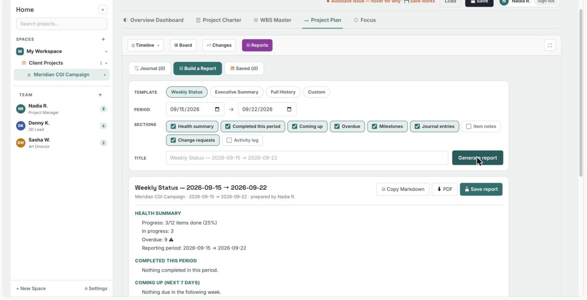

## M13 Risk & Dependency (RSK)

Wireframes: 16-portfolio-registry, 19-risk-dependency.

| ID | Requirement | Acceptance criteria | Pri | Source |
|--------|------------------------------------------------|------------------------------------|------|--------------|
| RSK-01 | **Project risk register.** Risk, description, probability, impact, score and severity (one method per workspace), owner, mitigation plan, due date and status; linked to WBS items with Risk Level or the Risk Related label and to charter section VII. | (1) Score and severity are calculated consistently. (2) High or Critical item risks without a register entry are flagged. | P0 | v2 FR-601; POC 03, 07, 09 |
| RSK-02 | **Portfolio risk.** Aggregate project risks and identify systemic risks across projects. | Cross-project risks are grouped and traceable. | P0 | v2 FR-602 |
| RSK-03 | **Dependency map.** Upstream and downstream dependencies between projects, MVPs and milestones. | A dependency delay shows the impacted downstream items. | P0 | v2 FR-603; WBS-14 |
| RSK-04 | **Green-but-risky detection.** Projects declared Green while risk rules indicate Amber or Red are flagged until an override with rationale is recorded. | Flags appear in the attention queue (BR-08). | P0 | v2 BR-08, §23 |
| RSK-05 | **Gate-aware risk.** Stage and gate readiness included in health and escalation. | A gate overdue beyond its SLA lowers stage health. | P1 | v3 §14 (M07) |

## M14 MVP & Product Delivery (MVP)

Wireframes: 35-mvp-detail.

| ID | Requirement | Acceptance criteria | Pri | Source |
|--------|------------------------------------------------|------------------------------------|------|--------------|
| MVP-01 | **MVP definition.** Objective, customer problem, scope, release date, KPI, owner and expected benefit. | Every MVP has a clear outcome and release criteria (BR-06). | P0 | v2 FR-301 |
| MVP-02 | **Feature linkage.** Features (WBS work items) are linked to MVPs and milestones. | No orphan feature in a committed MVP. | P0 | v2 FR-302 |
| MVP-03 | **MVP health.** Scope, schedule, resource and dependency health and progress at MVP level, calculated as defined in Section 12.1. | Progress and health follow Section 12.1, and MVP status can be compared with project status. | P0 | v2 FR-303; RF-21 |
| MVP-04 | **Workspace option.** MVP objects are enabled per workspace (e.g. product delivery) and can be disabled where not used (e.g. creative production). | A workspace with MVPs disabled hides MVP fields and views. | P0 | v3 §10; New |
| MVP-05 | **MVP lifecycle.** An MVP or release lifecycle can reference the workspace framework. | MVP stages come from a published framework. | P1 | v3 §14 (M04) |


# 11. Portfolio & Enterprise Intelligence Requirements

## M15 Executive Portfolio Cockpit & Workspace Dashboard (EXE)

Purpose: the CEO-first control tower (v2.0) and the workspace dashboard (v3.0). In the MVP the cockpit works within one workspace at a time; the cross-workspace executive view follows in V2.

Wireframes: 14-executive-cockpit, 15-workspace-dashboard.

| ID | Requirement | Acceptance criteria | Pri | Source |
|--------|------------------------------------------------|------------------------------------|------|--------------|
| EXE-01 | **Executive KPI summary.** Total projects, portfolio investment, FTE, expected value and realized value, each with its data as-of time (BR-39). | (1) Values aggregate correctly from approved portfolio records; value tiles show "not tracked" until benefits are captured (INV-02). (2) A tile fed by data older than the workspace freshness threshold is marked stale; a tile missing some projects' data is marked partial and names them. | P0 | v2 FR-001; RF-31 |
| EXE-02 | **Executive attention queue.** Missing status reports, green-but-risky projects, overdue milestones, overdue gates, pending and approved-but-unapplied CRs, capacity overloads and material budget variance. | Each item has owner, reason, severity and next action (decide, review, rebalance or remind). | P0 | v2 FR-002; v3 §8; RF-42 |
| EXE-03 | **Portfolio health.** Overall and dimension-level health: delivery, risk, resource and financial in the MVP; strategic in V2. | Health is calculated consistently, drillable to projects, and shows which projects have stale or missing status data. | P0 | v2 FR-003; RF-31 |
| EXE-04 | **Executive decision center.** Projects recommended for START, CONTINUE, ACCELERATE, DELAY or STOP. | Each recommendation includes rationale and supporting evidence (BR-10). | P1 | v2 FR-004, §6.2 |
| EXE-05 | **Workspace dashboard.** Portfolio health, investment, capacity, risk, governance exceptions and upcoming gates; delivery pipeline showing projects per lifecycle stage, overdue gates and blocked projects. | Pipeline counts equal the projects' current stages. | P0 | v3 WS-005, §11 |
| EXE-06 | **Cross-workspace executive view.** Enterprise cockpit across workspaces with governance health per workspace. | Data shown respects record-level permissions (BR-20). | P1 | v3 §14 (M01), WS-008 |

## M16 Portfolio & Project Registry (REG)

Wireframes: 16-portfolio-registry, 37-project-create.

| ID | Requirement | Acceptance criteria | Pri | Source |
|--------|------------------------------------------------|------------------------------------|------|--------------|
| REG-01 | **Project master record.** Unique project ID, name, description, workspace, portfolio, program, owner, sponsor, account or business unit, status and framework version. | A project cannot be duplicated; required fields are validated. | P0 | v2 FR-101; v3 §14 (M02) |
| REG-02 | **Search and filter.** Search by project ID or name; filter by workspace, portfolio, program, owner, health, lifecycle stage, strategic objective, business unit and status. | Results update without page reload. | P0 | v2 FR-102; v3 §14 (M02) |
| REG-03 | **Portfolio hierarchy.** Projects are grouped under portfolios (Spaces) and programs or products (Folders). | Each project has one primary portfolio and optional secondary tags. | P0 | v2 FR-103; POC 02 |

## M17 Portfolio Roadmap (RMP)

Wireframes: 17-portfolio-roadmap.

| ID | Requirement | Acceptance criteria | Pri | Source |
|--------|------------------------------------------------|------------------------------------|------|--------------|
| RMP-01 | **Portfolio roadmap.** Projects, MVPs and major milestones over 12-24 months. | Quarter and month zoom; filtering. | P0 | v2 FR-401 |
| RMP-02 | **Dependency overlay.** Cross-project dependencies on the roadmap. | Dependency conflicts are visually identifiable. | P0 | v2 FR-402 |
| RMP-03 | **Strategic theme overlay.** Group the roadmap by strategic objective and investment theme. | Every committed project maps to an objective or is explicitly exempt. | P1 | v2 FR-403 |
| RMP-04 | **Lifecycle overlay.** Stages, gate dates and governance milestones on the roadmap. | Gate dates appear for every project with a published framework. | P1 | v3 §14 (M05) |

## M18 Resource & Capacity (RES)

Purpose: FTE capacity and demand by person and capability. The POC only counts open items per PIC (OVW-03); FTE planning needs capacity data and allocations. In the MVP, capacity is maintained in the platform or imported from a file; the HR integration follows in V2.

Wireframes: 18-capacity.

| ID | Requirement | Acceptance criteria | Pri | Source |
|--------|------------------------------------------------|------------------------------------|------|--------------|
| RES-01 | **Capacity dashboard.** Capacity, demand, utilization and gap by person, department and capability. | Utilization is calculated from active allocations and capacity. | P0 | v2 FR-501 |
| RES-02 | **Bottleneck detection.** Resources or capabilities above configurable utilization thresholds. | Overload items link to the projects causing the demand (BR-07). | P0 | v2 FR-502 |
| RES-03 | **Capacity and allocation records.** Resource Managers maintain capacity per person or capability and period; PMs record project allocations (FTE per person or capability per period); import from file. | Demand equals the sum of active allocations for the period. | P0 | v2 FR-501, §13; New |
| RES-04 | **Scenario capacity.** Simulate the impact of adding or removing projects or changing allocations. | Scenarios never change the baseline until approved (BR-11). | P1 | v2 FR-503 |
| RES-05 | **Stage-specific demand.** Demand and capability needs by lifecycle stage. | Demand can be viewed per stage. | P1 | v3 §14 (M06) |

## M19 Investment & Benefits (INV)

Project-level budget, actual and forecast are P0 in the charter (CHR-13) and roll up as simple sums in the MVP cockpit. This module adds portfolio investment management in V2.

Wireframes: 20-investment-benefits.

| ID | Requirement | Acceptance criteria | Pri | Source |
|--------|------------------------------------------------|------------------------------------|------|--------------|
| INV-01 | **Investment tracking.** Approved budget, actual, forecast, CapEx and OpEx, and variance by project and portfolio. | Portfolio totals reconcile with project-level records. | P1 | v2 FR-801 |
| INV-02 | **Benefits.** Expected and realized benefits linked to KPIs. | Benefit owner and measurement date are required. | P1 | v2 FR-802 |
| INV-03 | **Value at risk.** Expected value at risk for delayed, over-budget or low-health initiatives. | The method is documented and configurable. | P1 | v2 FR-803 |
| INV-04 | **Funding checkpoints.** Configured stage gates act as funding checkpoints. | Funding release is recorded against the gate decision. | P1 | v3 §14 (M09) |

## M20 Strategy, Prioritization & Scenario Planning (STR)

Wireframes: 21-scenario-planner.

| ID | Requirement | Acceptance criteria | Pri | Source |
|--------|------------------------------------------------|------------------------------------|------|--------------|
| STR-01 | **Strategy model.** Strategic pillars, objectives, KPIs and targets, linked to portfolios and projects (golden thread). The MVP uses a simple objective list (CHR-15). | Every committed project traces to an objective or exemption. | P1 | v2 §4.1, §6.1, BR-02 |
| STR-02 | **Portfolio score.** Score initiatives on strategic alignment, customer value, financial value, risk, urgency and feasibility. | The score is transparent, weighted and auditable. | P1 | v2 FR-901 |
| STR-03 | **Investment scenario.** Model budget reductions or increases and show project, resource and value impact. | Scenario results do not alter the approved baseline. | P1 | v2 FR-902 |
| STR-04 | **Resource scenario.** Simulate capacity changes and identify projects delayed or accelerated. | The impact chain is traceable. | P1 | v2 FR-903 |
| STR-05 | **Lifecycle-aware evaluation.** Evaluate projects by lifecycle stage and governance readiness. | Stage and gate readiness are scoring inputs. | P1 | v3 §14 (M10) |

## M21 Analytics & Executive Reporting (ANL)

Wireframes: 22-steerco-report.

| ID | Requirement | Acceptance criteria | Pri | Source |
|--------|------------------------------------------------|------------------------------------|------|--------------|
| ANL-01 | **SteerCo pack.** Executive portfolio review with health, investment, capacity, risks, decisions and changes. | The pack can be generated for a selected period and portfolio. | P1 | v2 FR-1001 |
| ANL-02 | **Weekly portfolio report.** Changes since the previous week and exceptions requiring action. | Only material changes and exceptions are highlighted. | P1 | v2 FR-1002 |
| ANL-03 | **Drill-down analytics.** Move from a portfolio metric to the project and source record. | Every KPI has lineage to underlying data. | P1 | v2 FR-1003 |
| ANL-04 | **Governance analytics.** Stage distribution, bottlenecks, gate failures, cycle time, gate throughput, rework and compliance by workspace (KPIs in Section 12.4). | Figures can be filtered by workspace and framework version. | P1 | v3 GF-013, §14 (M11), §15 |
| ANL-05 | **Cross-workspace benchmarks.** Compare workspaces and framework versions where policy permits. | Benchmarks only include workspaces that opted in. | P2 | v3 §15, §16 |

## M22 AI Portfolio Copilot (AIC)

Wireframes: 22-steerco-report, 23-ai-copilot.

| ID | Requirement | Acceptance criteria | Pri | Source |
|--------|------------------------------------------------|------------------------------------|------|--------------|
| AIC-01 | **Portfolio Q&A.** Natural-language questions across strategy, projects, resources, investment and risk. | Answers cite the underlying portfolio records. | P2 | v2 FR-1101 |
| AIC-02 | **Recommendations.** Recommend stop, accelerate, fund or delay actions from configured decision rules. | Each recommendation includes evidence, assumptions and confidence. | P2 | v2 FR-1102 |
| AIC-03 | **Scenario assistant.** Interpret what-if questions and generate scenario proposals. | No baseline change without explicit human approval. | P2 | v2 FR-1103 |
| AIC-04 | **Governance copilot.** Answer workspace-rule and gate-readiness questions; suggest framework improvements. | Suggestions cite the analytics they are based on. | P2 | v3 §14 (M12), §16 |
| AIC-05 | **Predictive risk.** Predict delivery and gate risk from historical patterns. | Predictions show confidence and contributing factors. | P2 | v2 §15; v3 §16 |
| AIC-06 | **Automated narrative.** Draft weekly and SteerCo narratives from data and journal entries for human review. | Drafts are never published without human approval. | P2 | v2 §15 |

# 12. Metric Definitions & KPIs

## 12.1 Project metric definitions

All project views, reports, portfolio roll-ups and MCP tools use these definitions (BR-32, MCP-10). "Work item" means any WBS node that is not a Category node. "Today" is the user's date in the workspace timezone.

| Metric | Definition | Used in |
|----------------------|------------------------------------------------------------------|----------------------|
| Total work items | Count of work items (Category nodes excluded) | OVW-01, RPT-03 |
| Deliverables | Work items with Type = Deliverable | OVW-01, CHR-05 |
| Work packages | Work items with Type = Work Package | OVW-01 |
| Milestones | Work items labelled Milestone | OVW-01, OVW-03 |
| Gates (deliverable) | Work items labelled Approval Gate; lifecycle gates are counted separately as "Lifecycle gates due" | OVW-01, EXE-05 |
| Overall progress % | Done work items ÷ total work items × 100 (count-based) | OVW-02, RPT-03 |
| Progress by Category | Per Category: Done work items ÷ work items in that Category | OVW-02 |
| In progress | Work items whose Status maps to "In progress" | OVW-06, RPT-03 |
| Blocked | Work items whose Status maps to "Blocked" | OVW-01 |
| Overdue | Work item not Done and Target Date before today | OVW-03, OVW-06, PLN-02 |
| Days overdue | Today − Target Date, in calendar days | OVW-06 |
| Delayed | Work item not Done whose current Target Date is later than its baseline Target Date; shown as "not baselined" before CHG-06 | OVW-01, EXE-02 |
| High risk | Work items with Risk Level High or Critical | OVW-01, OVW-03 |
| Due today | Not Done and Target Date = today | OVW-06 |
| Due this week | Not Done and Target Date within the next 7 days (rolling) | OVW-06, RPT-02 |
| Starting this week | Status maps to "Not started" and Start Date within the next 7 days (rolling) | OVW-06 |
| Upcoming milestones and gates | Not Done items labelled Milestone or Approval Gate with Target Date today or later, earliest first | OVW-03 |
| Workload by PIC | Count of not-Done work items per PIC | OVW-03 |
| Duration | Target Date − Start Date + 1, in calendar days or working days (D-07) | WBS-15 |
| Dependency conflict | Evaluated only when both compared dates exist (FS: predecessor Target and successor Start; SS: both Starts; FF: both Targets; SF: predecessor Start and successor Target); a missing date gives "schedule data incomplete" (BR-40) | WBS-13, RSK-03 |
| MVP progress % | Done work items linked to the MVP ÷ work items linked to the MVP × 100; "no linked work" when none are linked | MVP-03 |
| MVP health | The worst of its scope, schedule, resource and dependency health; a dimension without data shows "unknown" and does not count as Green | MVP-03 |
| Data as-of time | Time of the newest change included in a figure; "stale" when older than the workspace freshness threshold, "partial" when some included projects lack data (BR-39) | EXE-01, EXE-03, RPT-03 |

## 12.2 POC discrepancies these definitions remove

Observed in the POC data of 22 Sep 2026 (one project, 18 WBS rows of which 6 are Category rows):

| Observation | Evidence | Cause | Fix |
|------------------------------------|------------|------------------------------|----------------------|
| Overview progress 22% (4 of 18) while the Weekly Status report shows 25% (3 of 12) | POC 02, 28 | The Overview counts the 6 Category rows as items; the report excludes them | Category nodes excluded everywhere (BR-24) |
| "Deliverables 6" tile while Charter V says "No items with Type = Deliverable yet" | POC 02, 06, 32 | Category rows are stored with Type = Deliverable (Settings: Deliverable 6, Work Package 4, Task 8 = 18) | Category is its own node kind; Deliverables count Type = Deliverable work items |
| "Delayed 0" while 9 items are overdue | POC 02, 03, 29 | "Delayed" is not date-based and undocumented | Delayed = slipped against baseline; Overdue = past target |
| "Upcoming Milestones & Gates" lists items 20 to 60 days in the past | POC 03 | No date filter on "upcoming" | Upcoming = target today or later; late items appear under Overdue |
| High & Critical risk list includes Category rows (4.0 Timeline, 6.0 Risks) | POC 03 | Category rows carry a Risk Level | Risk counted on work items only |
| Board shows 9 open items while the status donut shows 14 not done | POC 02, 23 | Same Category-row cause | One definition set for all views |

## 12.3 Portfolio KPIs

| KPI | Definition | Target direction |
|----------------------------|------------------------------------------------------------------|--------------|
| Portfolio health | Weighted health across strategic, financial, delivery, resource and risk dimensions | ↑ |
| Strategic alignment coverage | % committed projects linked to approved objectives | 100% |
| Budget variance | Forecast versus approved budget | ↓ |
| Schedule variance | Forecast milestone completion versus baseline | ↓ |
| Capacity utilization | Demand ÷ available capacity | Within threshold |
| Critical resource bottlenecks | Number of capabilities above the critical threshold | ↓ |
| Critical portfolio risks | Number of critical risks | ↓ |
| Green-but-risky rate | Projects declared Green while the risk engine says Amber or Red | ↓ |
| Change request cycle time | Median time from CR submission to decision | ↓ |
| Approved-not-applied CRs | Approved CRs not yet applied to the baseline beyond the threshold | ↓ |
| Benefit realization | Realized benefit ÷ expected benefit | ↑ |
| Decision lead time | Time from portfolio exception to executive decision | ↓ |
| Reporting compliance | Projects submitting weekly status on time | ↑ |
| Client commitment reliability | Input Required items delivered by their target date | ↑ |

## 12.4 Workspace governance KPIs

| KPI | Definition |
|------------------------------|------------------------------------------------------------------|
| Stage cycle time | Planned versus actual stage duration |
| Gate outcome rate | Share of Pass, Pass with Conditions and Rework decisions |
| First-pass gate approval rate | Gates passed at the first submission |
| Governance waiting time | Time waiting for a governance decision |
| Stage bottlenecks | Stage volume and ageing |
| Mandatory evidence completion | Mandatory artifacts complete at gate submission |
| Waiver rate | Exceptions and waivers granted; overdue waivers |
| Framework compliance | Compliance rate by workspace |
| Gate rework | Rework caused by failed gates |
| Framework-version impact | Effect of a framework version on cycle time, quality and outcomes |
| Cross-workspace benchmarks | Comparisons where policy permits |

## 12.5 Metric versions, freshness and snapshots

- Every metric definition in this section carries a version. A changed definition is published as a new version with its effective date; it never silently changes past figures.
- Every dashboard, report, PDF and MCP answer states the data as-of time and the metric version it used (BR-39).
- Saved reports, PDFs, weekly status submissions and gate packs are snapshots: they keep the figures, as-of time and metric version they were generated with (PLT-16, RPT-03).
- Each workspace sets freshness thresholds (for example for weekly status and capacity data); views mark stale and partial data instead of hiding it.

# 13. Business Rules

| ID | Business rule | Source |
|-------|----------------------------------------------------------------------------|----------------------|
| BR-01 | Every committed project must have an owner and a sponsor. | v2 BR-01 |
| BR-02 | Every committed project must have a strategic objective or an approved exemption. | v2 BR-02 |
| BR-03 | Every committed project must have a baseline budget and target date. | v2 BR-03 |
| BR-04 | Baseline scope, dates, budget and critical dependencies are locked after commitment. Before commitment the plan is freely editable and the CR register is advisory. | v2 BR-04; v3 §13; POC 24 |
| BR-05 | Changes to locked fields require an approved CR; applying it creates a new baseline version that references the CR. | v2 BR-05; v3 §13; D-08 |
| BR-06 | Every MVP must have a measurable outcome or KPI and release criteria. | v2 BR-06 |
| BR-07 | Resource utilization thresholds are configurable by capability and organization. | v2 BR-07 |
| BR-08 | A project cannot be shown Green if critical risk rules force Amber or Red, unless an explicit override with rationale is recorded. | v2 BR-08 |
| BR-09 | A missing weekly status submission creates an exception item. | v2 BR-09 |
| BR-10 | Portfolio recommendations are advisory until an authorized executive approves the decision. | v2 BR-10 |
| BR-11 | Scenario analysis must not alter approved baseline data. | v2 BR-11 |
| BR-12 | All approvals and governance decisions must be auditable. | v2 BR-12 |
| BR-13 | A project cannot be created without a workspace. | v3 §13 |
| BR-14 | Every active workspace has one published default lifecycle framework. | v3 §13 |
| BR-15 | A project instantiated from a framework stores the exact framework version used. | v3 §13 |
| BR-16 | Editing a template never retroactively alters existing project stage instances; moving a project to a new version needs an approved migration. | v3 §13, TPL-009 |
| BR-17 | A governed stage cannot be Complete while mandatory exit criteria are incomplete, unless an approved and unexpired waiver exists. | v3 §13 |
| BR-18 | Gate decisions are immutable after approval except through a correction workflow. | v3 §13 |
| BR-19 | Workspace configuration changes require role-based authorization and audit logging. | v3 §13 |
| BR-20 | Cross-workspace reporting respects record-level permissions. | v3 §13 |
| BR-21 | Archived workspace configurations and historical gate decisions remain auditable and read-only. | v3 §13 |
| BR-22 | The WBS is the single source of truth for project work; charter sections V-VI, Overview, Timeline, Board, Focus and Reports are derived views and hold no divergent copy of WBS data. | POC 06; Survey §00 |
| BR-23 | Dependencies are constraints that flag conflicts; the system never moves dates automatically. | POC 20, 25 |
| BR-24 | Category nodes are grouping nodes: excluded from work-item counts, progress and KPIs; their dates and progress roll up from their children. | New (Section 12.2) |
| BR-25 | Renaming a configurable option updates every item using it; an option in use cannot be deleted without choosing a replacement; options with a system meaning cannot be deleted. | POC 32; D-14 |
| BR-26 | Removing a member keeps their name on existing items and history and revokes their access immediately. | POC 34; New |
| BR-27 | Importing a project file never overwrites existing data; it creates a new project. | POC 36 |
| BR-28 | The requester of a CR cannot be its sole approver unless workspace policy explicitly allows self-approval for operational changes. | POC 25; New |
| BR-29 | A submitted CR cannot be deleted; it is withdrawn or closed with a reason. | POC 25; New |
| BR-30 | Every CR decision and gate decision records a rationale. | v2 FR-703, FR-704; v3 GF-008; POC 25 |
| BR-31 | Generating items from a process framework never overwrites existing WBS items that have progress, effort or comments. | Survey §05; New |
| BR-32 | Every KPI shown in the product or returned through MCP follows the definitions in Section 12 and is drillable to its underlying records. | v2 FR-1003, §18; New |
| BR-33 | Every record belongs to exactly one tenant; no query, report, export, search, MCP call or AI feature crosses tenants. | New (A-06) |
| BR-34 | Actions through MCP or the API are attributed to the token's user, recorded with the token and client name, and never exceed the user's permissions. | New (A-06) |
| BR-35 | Approvals, decisions, baseline application, deletions and permission or token changes require a person acting in the application; MCP clients can only prepare them. | New (A-06); v2 BR-10 |
| BR-36 | Access tokens are shown once, stored hashed, always expire, and are revoked when the user is deactivated or the tenant is suspended. | New (A-06) |
| BR-37 | Provider staff cannot access tenant business data without a time-limited, audited support grant from a tenant admin. | New (A-06) |
| BR-38 | Plan limits block only the limited action; they never block reading or exporting a tenant's own data. | New (A-06) |
| BR-39 | Every dashboard, report, PDF and MCP answer states the data as-of time and the metric version it used; saved outputs are snapshots. | RF-08, RF-18, RF-31 |
| BR-40 | A dependency conflict is flagged only when both compared dates exist; otherwise the link shows "schedule data incomplete". | RF-09, RF-33 |
| BR-41 | Every drag-and-drop or canvas action has a keyboard equivalent. | RF-35, RF-36, RF-47 |
| BR-42 | The server enforces gate eligibility: a gate decision or stage advance that fails mandatory criteria without a valid waiver is rejected from every channel (application, API, MCP). | RF-10, RF-28 |

# 14. Roles & Permissions

One role model replaces the v2.0 role table, the v3.0 workspace roles and the POC access labels (Admin, Member). Roles are assigned per workspace and, where needed, per project; permissions are enforced on the server (PLT-04).

| Role | Scope | Create / edit | Approve / decide | View |
|--------------------|--------------|------------------------------|------------------------------|----------------------|
| Provider Operator (SaaS) | Platform | Tenants, plans, global template library, feature flags, service notices | Publication of global templates | Tenant metadata and usage; business data only through a support grant (BR-37) |
| Tenant Admin | Tenant | Users and roles, sign-in and security policies, workspaces, AI access policy, branding | Support access grants | Tenant configuration, usage and audit log; business data only through assigned roles |
| Workspace Owner (POC "Admin") | Workspace | Profile, members and roles, fields and options, frameworks and templates, policies | Publication of workspace frameworks; waivers per policy | All workspace data |
| Executive / ExCo | Enterprise or assigned workspaces | Decisions, strategic priorities | Portfolio decisions, major CRs | All enterprise data in scope |
| Portfolio Manager / PMO | Portfolios | Portfolio and project governance, registry, reporting cadence | Portfolio-level CRs within authority; delegated gate decisions | All portfolio data |
| Product Director | Products and programs | Projects, MVPs, roadmaps | Product and project decisions | Assigned items and portfolio summary |
| Project Manager / Project Owner | Project | Charter, WBS, plan, risks, CRs, journal, reports, weekly status | Operational changes within delegated authority | Assigned projects |
| Stage Owner | Stage instance | Stage evidence and readiness | None | Assigned projects |
| Gate Approver | Gate | Gate decision records | Gate decisions within delegated authority | Projects with pending gates |
| Control function (Risk, Finance, Security, Legal, Compliance) | Configured gates | Reviews and evidence | Control approvals where configured | Projects under review |
| Finance | Portfolio investment | Budget, actuals, forecast | Financial controls | Portfolio investment |
| Resource Manager | Capability pools | Capacity and allocations | Resource changes | Resource views |
| Business Owner / Sponsor | Owned initiatives | Business case, KPI, benefits | Business acceptance; sponsor approvals | Owned initiatives |
| Team member (POC "Member") | Member projects | Assigned work items (status, effort, comments, files), journal entries | Item reviews or approvals when named Reviewer or Approver | Projects they belong to |
| Client / external stakeholder (D-02) | Invited projects | Comments; files on their Input Required items | Client approval gates and charter sign-off where named | Shared views of invited projects only |
| Viewer | Granted scope | None | None | Approved read-only views |

Permission principles: least privilege; record-level access by tenant, workspace, portfolio and project; segregation of duties for approvals (BR-28); every permission change is audited (PLT-11). An LLM client connected through MCP has no role of its own: it acts as the token's user within the token's scopes (MCP-04) and cannot take governance actions (BR-35).

The role model is maintained as a machine-readable permission matrix (role × action × scope, with approval thresholds) that drives server enforcement, generated permission tests and this table (D-15, Appendix G).

# 15. Conceptual Data Model & Reference Data

## 15.1 Entities

| Entity | Key attributes | Relationships |
|--------------------|------------------------------------------------------|------------------------------------|
| Tenant | ID, organization name, verified domains, plan, region, lifecycle state, sign-in settings | Contains workspaces, users, tokens, audit log |
| Plan and entitlement | Plan name, enabled modules, limits (seats, workspaces, storage, MCP calls) | Assigned to tenants |
| Workspace | ID, name, company/BU, owner, status, timezone, currency, calendars, cadence | Belongs to a tenant; contains portfolios, members, option lists, frameworks |
| Portfolio (Space) | Name, owner, budget, priority | Belongs to a workspace; contains programs and projects |
| Program / Product (Folder) | Name, owner, roadmap | Belongs to a portfolio; contains projects and MVPs |
| Project | ID, name, client/BU, PM, owner, sponsor, dates, status, project number, contract value, framework version | Belongs to a workspace, portfolio and optional program |
| Charter revision | Revision number and description, sections I-IV and VIII, sign-offs | Belongs to a project; sections V-VI derived from WBS |
| Key contact | Role, name, email, phone | Belongs to a project |
| Business case | Problem, opportunity, customer, rationale, alternatives, benefits, assumptions | Belongs to a project |
| Strategy / strategic objective | Pillar, objective, KPI, target | Linked to portfolios and projects |
| MVP / release | Objective, problem, scope, release date, KPI, owner, expected benefit | Belongs to a project or product; links features (work items) |
| WBS node | Internal ID, code, parent, kind (Category or work item), type, phase, labels, name, description, inputs, outputs, PIC, reviewer, approver, dates, planned and actual effort, status, priority, risk level, notes, framework provenance | Belongs to a project; tree structure |
| Dependency | Predecessor, successor, type (FS, SS, FF, SF) | Between WBS nodes, MVPs or milestones, within or across projects |
| Baseline | Version, captured scope, dates, budget, critical dependencies, CR reference | Belongs to a project |
| Change request | Ref, requester, type, priority, what, why, affected items, impacts, proposed action, effective date, approver, status, decision notes, history | Belongs to a project; references baseline fields and WBS nodes |
| Decision | Type, rationale, evidence, approver, date | Linked to portfolio, project, CR or gate |
| Journal entry | Type, text, author, timestamp, linked WBS node | Belongs to a project |
| Report | Template, period, sections, title, content, preparer | Belongs to a project; a weekly status submission is a published report |
| Activity event / comment | Actor, timestamp, change or comment text, mentions, attachments | Belongs to a WBS node |
| Attachment / doc link | File or URL, name, owner, size, type | Belongs to a WBS node, comment or project (Docs & Links) |
| Risk | Description, probability, impact, score, severity, owner, mitigation, due date, status | Linked to project, MVP, milestone or WBS node |
| Resource / capacity | Person or capability, capacity per period, cost | Allocated to projects and MVPs |
| Allocation | Project, person or capability, period, FTE | Links resources to projects |
| Budget | Approved, actual, forecast, variance, CapEx/OpEx | Linked to project and portfolio |
| Benefit | Expected, realized, owner, measurement date | Linked to objective, project or MVP |
| Member / role assignment | User, title, email, roles, status | Belongs to a workspace; optional project scope |
| Option list value | List, value, order, system meaning, usage count | Belongs to a workspace |
| Lifecycle framework | ID, workspace, version, status, effective date, parent version, change summary, publisher | Contains stages, gates, rules; referenced by projects |
| Lifecycle stage | Name, sequence, type, SLA, entry and exit criteria, owner role | Belongs to a framework; instantiated per project |
| Gate | Decision options, approvers, quorum, criteria | Belongs to a stage; records decisions |
| Stage artifact | Type, mandatory flag, owner, status, evidence | Required by a stage or gate |
| Stage rule | Condition, action, threshold | Controls routing and escalation |
| Project stage instance | Project, stage, dates, status, readiness | Instantiates a framework stage |
| Gate decision | Decision, rationale, approver, timestamp, evidence, conditions | Linked to gate, project and Decision Log |
| Exception / waiver | Rule, reason, approver, expiry | Temporarily overrides a governance rule |
| Process framework | Name, built-in flag, lanes, nodes, connections, offsets, version | Belongs to a workspace; used by the Deliverable Builder |
| Blueprint | Canvas layout, nodes, connections, connection points | Belongs to a deliverable |
| Notification | Recipient, trigger, channel, status | Linked to the triggering record |
| Access token | Name, owner, scopes, workspace or project restriction, hash, created, expiry, last used, status | Belongs to a user; used by MCP and the REST API |
| OAuth client authorization | Client name and ID, user, granted scopes, consent time | Belongs to a user |
| MCP call record | User, token or client, tool, parameter summary, result, time, linked record | Part of the tenant audit log |
| Support access grant | Provider staff member, case, reason, scope, approver, start, expiry, revoked at, actions taken | Requested by the provider, approved by a tenant admin |
| Saved view | Name, owner, shared flag, filters, columns, sort, expansion | Belongs to a user or a project (WBS-20) |
| Metric definition | Metric, formula, version, effective date | Referenced by every figure, report and MCP answer (BR-39) |
| Snapshot | Source (report, PDF, submission, gate pack), as-of time, metric version, content, file | Belongs to a project or portfolio |
| MCP client policy | Allowed clients, allowed workspaces, maximum token lifetime, grantable scopes per role | Belongs to a tenant (MCP-20) |

## 15.2 Reference data and defaults

| List | Default values | Configurable | System meaning |
|----------------|----------------------------------------------------------|--------------|------------------------------|
| Category | Deliverables, Technical, Quality, Timeline, Resource, Risk, Communication | Yes | Grouping only (BR-24) |
| Type | Deliverable, Work Package, Task, Subtask (product workspaces may add MVP feature types) | Yes | Deliverable feeds Charter V |
| Label | Milestone, Checkpoint, Approval Gate, Input Required, Risk Related | Add new; built-ins keep their meaning | Milestone and Approval Gate feed milestone and gate views; Input Required feeds Charter VI; Risk Related links to the risk register |
| Phase | From the lifecycle framework. Creative production: Initiation, Planning, Production, Review, Delivery, Closing. Company A: Discovery, Design, Solution, Development, Test, GTM, Retro | Through the framework | Stage instances and gates |
| Status | Not Started, In Progress, Waiting, Blocked, Done | Yes | Each value maps to a system state (WSP-08) |
| Priority | Low, Medium, High, Critical | Yes | None |
| Risk Level | Low, Medium, High, Critical | No | High and Critical count as High risk |
| Dependency type | FS, SS, FF, SF | No | Conflict rules |
| Journal entry type | Note, Meeting, Decision, Issue, Highlight | No | Decision entries can be promoted to the Decision Log |
| CR type | Scope, Schedule, Budget, Resource, Dependency, Other | Yes | None |
| CR status | Draft, Under Review, Approved, Approved pending application, Rejected, Deferred, Withdrawn, Closed | No | Drives counters and attention items |
| Gate decision | Pass, Pass with Conditions, Rework, Hold, Reject | No | Drives stage progression |
| Workspace state | Draft, Active, Suspended, Archived | No | Archived = read-only |
| Report template | Weekly Status, Executive Summary, Full History, Custom | Custom templates can be added | Weekly Status is the default submission template |
| Key contact roles | Approved Representative, Contracting Officer Representative, Key Contact | Yes | None |
| Tenant state | Trial, Active, Suspended, Cancelled, Deleted | No | Suspended = read-only; Cancelled = export window |
| Token scopes | portfolio:read, projects:read, wbs:read, wbs:write, journal:write, comments:write, changes:read, changes:draft, risks:read, risks:write, reports:read, reports:write | Tenant admins restrict them by role | Decisions are prepare-only for every scope |
| Channel | Web, MCP, API | No | Recorded on every audit entry |
| MCP action class | Read, Append-only, Reversible write, Prepare-only | No | Sets confirmation, undo and audit behaviour (MCP-19) |

# 16. Integration Requirements

| System | Purpose | Direction | Pri | Source |
|--------------------|--------------------------------------------------|--------------------|------|--------------|
| Identity / SSO (per tenant) | Authentication and role mapping through each tenant's identity provider (SAML 2.0 or OIDC) | Inbound | P0 | v2 §13; TEN-03 |
| LLM clients (MCP) | Natural-language access by any MCP-capable LLM client | Inbound (MCP server) | P0 | S4; M05 |
| User provisioning (SCIM) | Users and groups from the tenant's identity provider | Inbound | P1 | TEN-11 |
| Payment provider | Self-serve subscriptions and invoices | Outbound + webhook | P1 | TEN-14; D-27 |
| Email | Invitations, notifications, approval requests | Outbound | P0 | v2 §13; PLT-03, PLT-09 |
| Finance / ERP | Actual spend, budget, forecast | Inbound + controlled outbound | P1 | v2 §13 |
| HR / Resource | People, roles, capacity, org structure | Inbound | P1 | v2 §13 |
| Jira / Azure DevOps | Execution progress, issues, sprint and release data | Inbound + link | P1 | v2 §13; Survey §11 |
| Chat (Slack, Microsoft Teams) | Alerts, reminders, approvals | Outbound | P1 | v2 §13; Survey §11 |
| Cloud file storage (Google Drive, Dropbox) | Link heavy deliverables instead of uploading them | Link | P1 | POC 36; Survey §11 |
| Data warehouse | Enterprise analytics and historical trends | Bidirectional / ETL | P1 | v2 §13 |
| BI / reporting | Advanced analytics | Outbound | P1 | v2 §13 |
| E-signature | Charter sign-off with legal signature | Outbound + callback | P1 | Survey §03; D-12 |

In the MVP, data that will later come from ERP or HR (actuals, capacity) is entered in the platform or imported from files (CHR-13, RES-03).

**Integration contract.** Every integration, and every MVP file import, states: the system of record for each field it touches; direction and frequency; the conflict rule when both sides change; a freshness threshold, with the as-of time shown wherever the data appears (BR-39); idempotent writes keyed by external IDs; an error queue visible to administrators; a reconciliation report; and an audit entry per run. No integration writes WBS data except through the same services and rules as the application (BR-22).

# 17. Non-Functional Requirements

| Area | Requirement | Source |
|----------------|--------------------------------------------------------------------------|--------------|
| Security | SSO, RBAC enforced on the server, least privilege, encryption in transit and at rest, audit logs, malware scanning of uploads, isolation of external users. | v2 §14; PLT-02, PLT-07 |
| Performance | Measurable targets agreed in Discovery (D-26) for pilot and target volumes: page and API response time at the 95th percentile, concurrent editors per project, PDF and report generation time, MCP response time. | v2 §14; D-26; RF-05 |
| Availability | Availability aligned to the company criticality tier, agreed in Discovery. | v2 §14; D-26 |
| Durability | Server-side persistence, autosave with visible state, backup and restore with agreed recovery point and time objectives. | POC 02, 36; D-26 |
| Concurrency | Multiple simultaneous editors per project without silent overwrites (PLT-06). | Survey §11 |
| Auditability | Baseline changes, approvals, decisions and configuration changes are timestamped with actor and rationale. | v2 §14; v3 WS-009 |
| Scalability | Growth from hundreds to thousands of projects and users; no per-project storage cap comparable to the POC's 4.5 MB. | v2 §14; POC 36 |
| Usability | The CEO reaches portfolio health and decisions within 30 seconds from home; a PM reaches the project Focus view in one click from the project. | v2 §14; POC 29 |
| Accessibility | WCAG 2.2 level AA recommended as the target (confirm in D-26); every function operable from the keyboard, including tables, trees, boards and canvases (BR-41); visible focus; color never the only signal; component contracts in the style guide (brand/style-guide.md). | v2 §14, §18; RF-46, RF-47 |
| Responsiveness | Responsive web; read and light-update views (Focus, Board, Overview, approvals) usable on phones. | Survey §11; D-19 |
| Localization | Workspace timezone, currency and fiscal calendar; dates and numbers in the user's locale. | v3 WS-003; POC 04 |
| Data quality | Mandatory fields, validation, stale-data alerts and reconciliation controls; as-of time and metric version on every figure (BR-39). | v2 §14; RF-08 |
| Data portability | Export of projects and workspaces (JSON) and of charters and reports (PDF, Markdown). | POC 08, 28, 36 |
| Observability | Integration failures, stale feeds and failed saves are visible to administrators. | v2 §14; POC 02 |
| Hosting and residency | Hosted and operated by the provider; region and residency options per D-20 and D-28. | Survey §11; D-20; D-28 |
| Multi-tenancy | Logical isolation of every data path by tenant; automated cross-tenant tests on every release; one tenant can be restored from backup without affecting others. | TEN-02; D-28 |
| Service levels | Availability and support levels per plan, published to customers. | D-26; D-27 |
| Compliance | Security controls mapped to the certification chosen in D-31; data processing agreement for customers. | D-31 |
| Data lifecycle | Data classification; a retention matrix per data type (business records, files, audit entries, MCP call records, logs, backups); deletion at tenant deletion including backups within a stated period; a published list of sub-processors; a stated policy for data a user sends through MCP to their own LLM provider, which processes it under the customer's own terms. Legal requirements per jurisdiction are confirmed with counsel [Unverified - confirm before applying]. | RF-13; TEN-06, TEN-07 |
| Secrets | Signing keys, token hashes and integration credentials kept in a managed secret store with rotation; secrets never logged and never shown again after creation. | S5; BR-36 |
| AI interface security | MCP endpoint over TLS only; tokens hashed, scoped and expiring; tokens never accepted in URLs; only tokens issued by the platform accepted; content in records treated as data; per-token rate limits. | S4; M05 |
| AI safety | AI recommendations carry evidence, confidence and assumptions; human approval is required for any action. | v2 §14 |


# 18. Roadmap, Release Plan & Delivery

## 18.1 Phase overview

| Phase | Scope | Outcome |
|------------|----------------------------------------------------------------------|----------------------------|
| MVP (Release 1) | Platform foundation; multi-tenant SaaS core (provisioning, isolation, sign-in per tenant, admin console, plans and limits, provider console, support access); MCP server with tokens, OAuth, read tools, append-only and update tools, prepare-only governance and audit; workspace configuration with guided setup; lifecycle framework with stages, gates, waivers and versioned templates; project execution (charter and business case, WBS Master, Deliverable Builder, timeline, board, overview, focus, My approvals, change control and baseline, journal, reports and weekly status); risk register and dependencies; MVP objects; executive cockpit and workspace dashboard; registry; roadmap; capacity basics | Single source of truth, governed execution and portfolio control for a pilot |
| V2 | Self-serve signup and billing, SCIM, data residency options, MCP resources and prompts, REST API; strategy model, investment and benefits, scoring and prioritization, scenario planning, SteerCo and portfolio reporting, governance analytics, template comparison and migration, global template library, cross-workspace views, integrations (ERP, HR, Jira / Azure DevOps, chat, BI, cloud storage, e-signature), project Gantt, full-text search, digest | Portfolio intelligence and investment decisions |
| V3 | AI copilot, predictive risk, automated narrative, scenario assistant, recommendation engine, governance copilot, cross-workspace benchmarks | AI Portfolio Operating System |

## 18.2 Release 1 delivery structure (D-01)

The P0 scope combines the v2.0 MVP, the v3.0 workspace P0 capabilities, parity with the POC, the SaaS tenancy core, the MCP interface and the refinements of the external review (Section 1.7). Release 1 keeps all of it. With an agency team of about 40 developers (A-07), it is built by parallel workstreams on shared foundation contracts; two integration milestones prove the end-to-end flows before the pilot.

| Workstream | Modules | First deliverable to the other streams |
|------------------------------|----------------------|------------------------------------------------------------|
| Platform and tenancy | M01, M02 | Tenant context, sign-in, permission check, write contract (PLT-06), audit, notifications, file storage |
| Workspace and lifecycle governance | M03, M04 | Workspace configuration, option lists with system meaning, published framework versions |
| Project execution | M06, M07, M09, M10, M11, M12 | WBS service and the metric engine (Section 12) |
| Deliverable Builder | M08 | Builder prototype tested with PMs in Discovery, then the canonical framework graph and deterministic build (BLD-12) |
| Portfolio | M13 to M18 | Roll-ups from the metric engine; capacity and allocation records |
| MCP interface | M05 | Tool layer over the same services; OAuth and personal access tokens |
| Quality and security (cross-cutting) | All | Tenant isolation suite (TEN-02), permission tests generated from the matrix (Appendix G), accessibility and performance checks |

Design (the wireframes and the design system in brand/) serves every stream. The split of the team across streams is set in Discovery.

| Milestone | Contents | Exit criteria |
|----------------------|------------------------------------------------------------|------------------------------------|
| 1A: Governed project execution on the multi-tenant platform | M01, M02 and M03 (P0); M04 framework definition and versioning (GOV-01, GOV-02, GOV-12, GOV-17 to GOV-23); M05 except MCP-07; M06; M07 except WBS-10 and WBS-14; M09; M10 including OVW-07 to OVW-09; M11; M12; RSK-01 | POC parity on a hosted, multi-tenant, permissioned platform; the isolation suite passes for every data path; a workspace is set up through the guided checklist; an MCP client reads project figures identical to the UI and logs journal entries; Section 12 definitions verified across all views; approvers act from My approvals; one pilot project runs end to end |
| 1B: Lifecycle governance, Builder and portfolio control | M04 gates, evidence and waivers (GOV-03 to GOV-06, GOV-08, GOV-09, GOV-13 to GOV-15); MCP-07 update tools; M08 with WBS-10 and WBS-14; M13 (RSK-02 to RSK-04); M14; M15 to M18 (P0); client access if D-02 is approved | One pilot portfolio governed in the platform; gate and CR decisions flow into the Decision Log; the server rejects ineligible gate decisions (BR-42); the executive cockpit reconciles with project data |
| Pilot readiness | Every P0 requirement | External penetration test passed; accessibility audit against the D-26 target; NFR targets met at pilot volume; the MVP acceptance checklist (Section 21) passes |

Rationale: milestones are integration points, not scope cuts. All streams start after Discovery; the streams that integrate at 1B build from the start against the foundation contracts. MCP update tools are switched on at 1B, once version checks and baseline locks are proven in the application (D-30). The Deliverable Builder has its own stream and a Discovery prototype, so its complexity cannot delay the core.

## 18.3 Complexity indicators

| Block | Difficulty | Reason | Source |
|------------------------------|--------------|------------------------------------------------|--------------|
| Foundation: authentication, workspace, project, permissions | Medium | Standard work, but a prerequisite for everything else | Survey §11 |
| WBS Master table | High | Tree table, inline editing, multi-dimensional filters, bulk actions | Survey §11 |
| Deliverable Builder and Blueprint | Very high | Custom canvas, drag-and-drop, connector drawing, automatic date spreading | Survey §11 |
| Tree Diagram | High | Automatic and free layouts; needs a suitable canvas library | Survey §11 |
| Timeline and Board | Medium | Familiar patterns, mainly drag-and-drop and layout | Survey §11 |
| Charter | Low to medium | Long form; the hard parts are the two live sections and PDF export | Survey §11 |
| Change requests | Medium | CRUD plus impact analysis on the dependency graph | Survey §11 |
| Journal and reports | Medium | Template-based generation, Markdown and PDF export | Survey §11 |
| Overview and Focus | Low | Read-only aggregation; can be built last | Survey §11 |
| Lifecycle governance | High | Not prototyped; configuration, versioning and gate workflows | New assessment |
| Portfolio layer (cockpit, registry, roadmap, capacity) | Medium to high | Not prototyped in the VistaX POC; depends on capacity and budget data quality | New assessment |
| Multi-tenancy foundation | High | Isolation on every data path, per-tenant identity providers, plans, provider console; tested continuously | New assessment |
| MCP server and tokens | Medium | A tool layer over the same services the UI uses; OAuth and token handling, audit and rate limits need security review | New assessment |

## 18.4 Delivery plan

| Step | Duration guidance | Key deliverables | Exit criteria |
|----------------------|--------------|------------------------------------------------|----------------------------|
| Discovery & Data Design | 6-8 weeks | Process maps, data model, tenancy model, machine-readable permission matrix, metric specification with versions, MCP tool catalogue, NFR targets; decisions taken in the order of Section 19.1; technical spikes: tenant isolation negative tests, two users editing one field, an MCP client over OAuth and over a personal token, PDF snapshot generation; a Deliverable Builder prototype tested with PMs; buyer interviews and one or two design partners (Q-09) | Approved BRD, data dictionary, and stream plan with dates |
| UX / Prototype | 4-6 weeks, overlapping Discovery | High-fidelity screens from the wireframes (wireframes/) and the design system (brand/); usability tests of setup, daily work, approvals and the Builder with design partners | Approved prototype |
| MVP Build | Set in Discovery from the stream plan (A-07) | Every P0 requirement, built in parallel workstreams with milestones 1A and 1B (18.2) | Pilot readiness (18.2) |
| Pilot | 4-8 weeks | 1-2 portfolios live with design partners | Success criteria of 18.5 met |
| Scale | 8-16 weeks | Additional portfolios and P1 scope | Enterprise rollout readiness |
| AI phase | Later | Copilot, scenarios, predictive insights | Governed AI readiness |

## 18.5 MVP success criteria

- 100% of in-scope projects have a master record.
- 100% of committed projects have owner, sponsor, budget, timeline, status and lifecycle stage.
- The portfolio dashboard reconciles with approved project data.
- Resource bottlenecks can be identified by project and capability.
- Every baseline change is traceable to a Change Request.
- Executives can produce a weekly or SteerCo portfolio review without manual spreadsheet consolidation.
- The roadmap shows projects, MVPs and key dependencies.
- At least one pilot portfolio uses the platform as its primary governance source.
- Every project metric is identical across Overview, Focus, Board and reports for the same date. *(New)*
- Pilot project teams run daily work (Focus, Board, Journal) in the platform rather than in spreadsheets. *(New)*
- At least two tenants run in production with zero cross-tenant findings in automated tests and the penetration test. *(New in v4.1)*
- Pilot users connect at least one verified LLM client through MCP and get answers whose figures match the application. *(New in v4.1)*

Adoption and value, measured during the pilot against targets agreed with the design partners in Discovery *(New in v4.2)*:

- Share of pilot project updates (WBS, status, journal) made in the platform rather than in spreadsheets.
- Weekly status published on time from the platform (reporting compliance, Section 12.3) and the median time a PM spends on the weekly update.
- Stale-project rate: projects whose data is older than the freshness threshold (Section 12.5).
- Share of executive attention items opened down to their source record, and median time from approval request to decision (OVW-09).
- Weekly active users by role; users with a connected MCP client; share of MCP answers whose figures match the application in spot checks.

# 19. Decisions Required & Open Questions

## 19.1 Decision register

This BRD assumes each recommendation until the decision owner (Product Director unless stated) confirms or changes it.

**Decide first.** These decisions shape the architecture or the acceptance of everything else. Take them at the start of Discovery in this order: D-28 tenant isolation model, D-20 cloud and regions, D-03 authentication, D-26 NFR targets; then D-29 MCP authentication, D-24 metric definitions, D-02 client access, D-31 compliance target and D-09 Builder rules.

| ID | Decision | Context and evidence | Recommendation assumed in this BRD | Needed by |
|------|------------------|----------------------------------|----------------------------------|------------|
| D-01 | Release 1 scope and sequencing | The combined P0 scope exceeds the v2.0 MVP build guidance of 10-16 weeks, which assumed a smaller scope and team; the delivery capacity is an agency of about 40 developers (A-07); the external review proposed cutting scope for team size | Keep the full P0 scope; parallel workstreams on shared foundation contracts with integration milestones 1A and 1B (Section 18.2); dates set in Discovery from the stream plan | Discovery start |
| D-02 | Client (external) access | POC uses "Client" as PIC and has client sign-off; the survey asks whether clients log in | Restricted Client role in Release 1B after a security review (view invited projects, comment, deliver inputs, approve client gates, sign the charter); until then share PDFs and reports | Before Release 1B design |
| D-03 | Authentication method | POC has no real authentication; v2.0 lists SSO as P0; as a SaaS, customers differ in identity maturity | Per tenant: SSO (SAML 2.0 or OIDC) for tenants with an identity provider, email and password with MFA otherwise, magic link for invited external users (TEN-03); all methods run through one identity layer (one user, session and MFA model), so adding or removing a method changes nothing else | Discovery |
| D-04 | Hierarchy names | POC uses Space and Folder; the BRD uses Portfolio and Program / Product | Use Portfolio and Program in the product, aligned with executive reporting | Discovery |
| D-05 | WBS code generation | POC requires a manually typed WBS ID; renumbering on move is undefined | System-generated codes renumbered on move, plus a permanent internal ID | Discovery |
| D-06 | WBS depth and field rules | Level, Type and Category overlap; Category rows are stored as Type = Deliverable; the demo uses three levels | Level derived from position; Category is a separate node kind at level 1; Types not bound to levels; up to five levels | Discovery |
| D-07 | Duration basis | POC shows calendar days inclusive (47 days for 13 Jul-28 Aug 2026, 35 working days); v3.0 workspaces have a business calendar | Workspace setting: calendar days (default) or working days from the business calendar | Discovery |
| D-08 | Applying approved CRs | POC register is advisory and the PM applies changes; v2.0 locks baselines | MVP: approved CR unlocks affected fields, is tracked until applied, then re-baselined; V2: structured change sets applied on approval | Discovery |
| D-09 | Deliverable Builder rules | Date spreading from the Start Date, re-run behaviour, Blueprint granularity and lane mapping are undocumented; the POC gives lanes provisional codes 7.x-10.x | Frameworks define per-node offset and duration; a re-run adds a new set after confirmation and never overwrites; one Blueprint per deliverable; lanes map to labels (Approval → Approval Gate, Input Required → Input Required, Quality Gate → Checkpoint, Milestones → Milestone, Risk → Risk Related) and generated items sit under the target deliverable; the framework is one canonical graph (lanes, nodes, edges, offsets) shared by the canvas and the list editor, and builds are deterministic and previewed (BLD-12) | Discovery (Builder prototype) |
| D-10 | Board Done column | The POC Board has no Done column | A collapsible Done column limited to recently completed items | Release 1A design |
| D-11 | Project Gantt | The POC Timeline is point-based; the survey asks for bars with dependency lines | Not in the MVP; evaluate in V2 with the portfolio roadmap component | V2 planning |
| D-12 | Charter sign-off and revisions | POC sign-off fields are plain text; revision fields have no history | In-app sign-off by authenticated users freezes the revision; revision snapshots in the MVP; e-signature and comparison in V2 | Release 1A design |
| D-13 | PDF generation | The POC generates PDFs in the browser | Server-side generation with a standard template in the MVP; workspace branding in V2 | Release 1A design |
| D-14 | Deleting configurable values | The POC propagates renames; deleting an in-use value is undefined | Renames propagate; deletion requires a replacement; values with a system meaning cannot be deleted | Release 1A design |
| D-15 | Access model | The POC has Admin and Member only | Adopt the role model of Section 14, including Viewer and Client, maintained as a machine-readable permission matrix (Appendix G) | Discovery |
| D-16 | Notification channels | The POC has no notifications | In-app and email in the MVP; digest and Slack / Teams in V2 | Release 1A design |
| D-17 | Search scope | The POC searches project names only | MVP: projects and WBS items by code or name; full-text in V2 | Release 1A design |
| D-18 | Release 1 integrations | The survey mentions Jira, Asana, Google Drive and Slack; v2.0 puts all integrations except SSO at P1 | SSO and email only in the MVP; plain links to cloud files; other integrations in V2 | Discovery |
| D-19 | Mobile | The survey asks about mobile web and native apps | Responsive web for Focus, Board, Overview and approvals; no native app in the MVP | Discovery |
| D-20 | Cloud provider, regions and residency offer | The product is a SaaS hosted by the provider (A-06); customers may require data in a given region | Provider to choose the cloud and launch region(s) and define which residency options are sold (TEN-13) before solution design (blocking) | Discovery |
| D-21 | Demo and trial | The POC offers "Explore the demo workspace" without an account | A resettable sandbox workspace inside each tenant; prospects get a trial tenant (sales-led in the MVP, self-serve in V2); no anonymous public access | Release 1A design |
| D-22 | Product name | BRD: Enterprise Portfolio Intelligence & Governance Platform; POC: VistaX PM Genesis; project codename Metis | Use "Metis" as the working brand (logo and style guide in brand/) with the BRD name as descriptor; the logo can be regenerated for another name | Discovery |
| D-23 | Built-in process frameworks | The POC ships CGI Still Renders, 3D Animation / Video and Simple Review Loop | Simple Review Loop as a generic built-in; CGI and 3D frameworks as templates for creative-production workspaces; others through the template library | Before Release 1B build |
| D-24 | Metric definitions | POC counts differ between views (Section 12.2) | Approve Section 12 as the single definition set | Discovery |
| D-25 | Strategic linkage in the MVP | BR-02 applies in the MVP while the strategy module is V2 | Workspace-managed objective list in the MVP (CHR-15); full strategy model in V2 | Discovery |
| D-26 | NFR targets | v2.0 NFRs are qualitative (agreed SLA, criticality tier) | Agree measurable targets in Discovery from pilot and target volumes: page and API response time at the 95th percentile, concurrent editors per project, tenants and projects per region, availability, recovery point and time, PDF generation time, MCP rate limits, file limits; accessibility target (WCAG 2.2 AA recommended) | Discovery |
| D-27 | Commercial and onboarding model | SaaS needs plans, limits and a way to sign customers up | Sales-led provisioning by provider operators in the MVP with plans and limits enforced and invoicing outside the product; self-serve signup, trial and online billing in V2 (TEN-14) | Discovery |
| D-28 | Tenant isolation model | Shared infrastructure is cheaper; some customers ask for dedicated environments | Shared infrastructure with strict logical isolation (tenant on every data path, tenant-scoped storage, search and caches) for all plans in the MVP; dedicated database or region as an enterprise option later | Discovery (blocking) |
| D-29 | MCP authentication | The MCP specification defines an OAuth 2.1 based flow for HTTP; client support for OAuth and static tokens varies [Unverified - confirm per client] | Offer both in the MVP: OAuth per the specification and personal access tokens as bearer tokens, both issued by the platform's authorization server, scoped and expiring | Release 1A design |
| D-30 | MCP actions per increment | Write access from LLMs raises the risk of unintended changes | 1A: read tools and append-only writes (journal entries, comments); 1B: updates to WBS items, draft CRs, risks and report drafts; never approvals, decisions, baseline changes, deletions or permission changes | Release 1A design |
| D-31 | Compliance target | Enterprise SaaS buyers usually ask for an independent security attestation | Choose the target (for example SOC 2 Type II or ISO 27001) and timeline with the commercial plan; design controls for it from the start | Discovery |

## 19.2 Open questions

| ID | Question | Why it matters |
|------|----------------------------------------------------------|------------------------------------------|
| Q-01 | Is the POC a desired-state mock-up, or has it been validated with real users? | Decides how much POC behaviour is requirement rather than illustration. |
| Q-02 | Is the Claude artifact referenced in BRD v2.0 the VistaX PM Genesis POC (A-01)? | If not, another prototype must be reviewed. |
| Q-03 | Can the POC source code be shared (the artifact's Copy function)? | Confirms the formulas, Builder scheduling and data model inferred from the UI. |
| Q-04 | Are the primary Release 1 users internal PMs only, or clients as well? | Drives D-02 and the security scope. |
| Q-05 | Should the Netlify governance prototype be re-reviewed against this version? | Appendix F reflects only the v2.0 description. |
| Q-06 | What are the approval status and dates of BRD v2.0 and v3.0? | The revision history is incomplete. |
| Q-07 | Which industries or operating models, beyond digital product delivery and creative production, must the first workspaces support? | Drives built-in frameworks and reference data. |
| Q-08 | Which LLM client applications must be verified and listed in the connection guide, and do they connect with OAuth, static tokens or both? | Drives D-29 and MCP-15; support differs per client [Unverified - confirm per client]. |
| Q-09 | Which one or two organizations will act as design partners for Discovery and the pilot, and which buyers can be interviewed? | Market evidence for the scope and the differentiation thesis (4.2); pilot targets (18.5). |
| Q-10 | Can gate approvers delegate their vote or abstain, and how does that count toward the quorum? | Gate rules (GOV-03, GOV-08) and My approvals (OVW-09). |
| Q-11 | Which retention periods apply to business records, files, audit entries, MCP call records and backups, per customer jurisdiction? | Data lifecycle (Section 17) and tenant deletion (TEN-06). |
| Q-12 | What must the audit log keep for MCP calls: parameter summaries only, or full parameters and results? | Privacy versus forensic value (MCP-11, Section 17). |
| Q-13 | Where will pilot capacity and actuals data come from (manual entry, file import, or an HR or finance export), and who owns it? | Capacity (RES-03), budget (CHR-13) and data freshness (12.5). |

# 20. Product Risks & Mitigations

| Risk | Impact | Mitigation |
|----------------------------------------|----------|------------------------------------------------------------|
| Data quality and stale updates | High | Mandatory fields, freshness indicators, integrations and owner accountability |
| The product becomes another reporting tool | High | Decision engine, scenario planning and executive attention as core features |
| Coordination across parallel workstreams (A-07) | High | Foundation contracts delivered first behind stable interfaces; integration milestones 1A and 1B (18.2); one end-to-end test suite and one design system; a product owner per stream |
| Scope larger than the market needs | Medium | Buyer interviews and design partners in Discovery (Q-09); adoption metrics in the pilot (18.5); P1 and P2 scope re-ranked after the pilot |
| Resistance from PMs | Medium | Derived views remove manual reporting; quick updates from Focus and My approvals (OVW-07, OVW-09); contextual help (PLT-20); Builder prototype tested with PMs; integrate execution tools; minimise duplicate entry |
| Inconsistent status definitions | High | Section 12 definitions and system meaning of options (WSP-08) |
| AI recommendations not trusted | Medium | Evidence-linked recommendations, assumptions, confidence and human approval |
| Inaccurate resource data | High | Allocation governance (RES-03) and HR integration in V2 |
| POC behaviour misread from screenshots | Medium | Obtain the source code (Q-03); validate D-05…D-10 with the client |
| Deliverable Builder complexity | High | Own workstream; prototype with PMs in Discovery; build preview and list editor (BLD-12); manual WBS entry as fallback |
| Concurrent editing conflicts on WBS and canvas | Medium | Field-level conflict detection (PLT-06); one editor per Builder canvas at a time |
| External client access exposes data | High | Invitation-only restricted Client role and a security review before Release 1B (D-02) |
| Configuration sprawl across workspaces | Medium | Versioned templates, global library and governance analytics (M04, ANL-04) |
| Cross-tenant data exposure | High | Tenant on every data path, automated cross-tenant tests on every release, penetration test, tenant-scoped caches and search (TEN-02, BR-33) |
| An LLM client makes unintended changes, including through instructions hidden in record text | High | Scoped tokens, append-only writes first, prepare-only governance, version checks, content treated as data, audit of every call (M05, BR-35) |
| Leaked access token | High | Hashed, expiring, scoped tokens; revocation; last-used display; tenant-wide kill switch; anomaly alerts (MCP-02, MCP-12) |
| LLM answers with wrong figures | Medium | Tools return server-computed metrics with definitions, as-of time and metric version (MCP-10, BR-39); answers cite records |
| No lasting edge from MCP alone | Medium | Differentiate on governed data, versioned metrics and enforced governance (4.2); verified client list (MCP-15) |

# 21. MVP Acceptance Checklist

- The executive cockpit shows project count, health, investment, capacity and attention items.
- A workspace can be created, configured (fields and options, team and roles) and switched; isolation between workspaces is verified.
- A lifecycle framework can be cloned, adapted, published and pinned to new projects; gates record decisions with rationale; waivers expire.
- The project registry supports search, filter and drill-down.
- The project record supports business case, owner, sponsor, budget, timeline and strategic linkage.
- Charter sections V and VI update live from the WBS; the charter exports to PDF and JSON; sign-off freezes a revision.
- The WBS Master supports table and tree views, the item form, bulk actions, renumbering and dependencies that flag conflicts without moving dates.
- The Deliverable Builder generates items and dependencies matching the framework counts and saves a Blueprint.
- Timeline, Board, Focus, Overview and reports show the same work items and the same figures (Section 12).
- MVPs can be created and linked to projects with KPI and release criteria.
- The roadmap displays projects, MVPs and milestones.
- The capacity dashboard shows demand versus capacity and bottlenecks.
- Risk and dependency records are linked to projects and portfolio views.
- Weekly status submission and missing-report exceptions work.
- Committed baseline fields are locked; the CR workflow supports impact assessment, decision, application and re-baselining.
- Investment fields roll up to portfolio level.
- The audit log captures governance and configuration actions.
- An executive report can be generated from the system.
- Notifications reach @mentioned users, assignees and approvers.
- Several users can edit concurrently without silent overwrites; data survives refresh and sign-out.
- A provider operator provisions a tenant; the tenant admin configures sign-in and invites users; cross-tenant access tests pass.
- Plan limits are enforced on the limited action only; export always works.
- An MCP client connects with OAuth or a personal access token, lists tools, reads project figures identical to the UI, logs a journal entry, and cannot approve anything; every call is in the audit log.
- A workspace is set up through the guided checklist and activates only after its readiness check passes (WSP-14).
- A project is created with its lifecycle framework version pinned and starts in Draft with its setup checklist (CHR-17).
- Approvers see and act on every pending decision in My approvals (OVW-09); the server rejects an ineligible gate decision from every channel (BR-42).
- Every dashboard, report, PDF and MCP answer states its as-of time and metric version; saved reports and PDFs do not change afterwards (BR-39).
- Every drag-and-drop and canvas action has a keyboard equivalent and the accessibility audit passes against the D-26 target (BR-41).
- No-access, read-only, session-expired, save-failed and conflict states show their reason and next action (PLT-04 to PLT-06).
- Support access works only through approved, expiring, revocable grants (TEN-09).


# Appendix A. Glossary

| Term | Meaning |
|------------------------------|------------------------------------------------------------------------------|
| Access token (personal access token) | Secret a user creates so an LLM client or script can act on their behalf through MCP or the API, limited by scopes and expiry |
| Action class (MCP) | The safeguard class of an MCP tool: read, append-only, reversible write or prepare-only (MCP-19) |
| Approval Gate (label) | WBS item representing an approval step, decided by the item's Approver |
| As-of time | The time of the newest data included in a figure, report or AI answer; shown with the metric version (BR-39) |
| Baseline | Approved snapshot of scope, dates, budget and critical dependencies; changed only through CRs |
| Blueprint | Saved Deliverable Builder canvas of a deliverable, shown in the WBS Master's Blueprint view |
| Break-glass access | Support access with no standing rights: requested with a reason, approved by a tenant admin, scoped, expiring and revocable at once (TEN-09) |
| Category | Level-1 WBS grouping node representing a PM control area; not a work item |
| Change Request (CR) | Formal request to change scope, schedule, budget, resources or dependencies, with impact analysis and decision |
| Checkpoint (label) | WBS item marking a review or quality checkpoint |
| Data freshness | Whether data is recent enough to trust: fresh, stale (older than the workspace threshold), partial (some sources missing) or unknown |
| Decision Log | Immutable record of governance decisions with rationale and evidence |
| Deliverable | Work item type for an output handed to a client or stakeholder |
| Deliverable Builder | Tool that generates WBS items and dependencies from a process framework |
| Deliverable Process Framework | Reusable swimlane template of steps, approvals, inputs, quality gates, milestones and risks for producing a deliverable |
| Focus | Personal view of overdue, due-this-week and starting-this-week items |
| FS / SS / FF / SF | Finish-to-Start, Start-to-Start, Finish-to-Finish, Start-to-Finish dependency types |
| FTE | Full-time equivalent |
| Gate | Decision point at the end of a lifecycle stage |
| Green-but-risky | Project declared Green while risk rules indicate Amber or Red |
| Input Required (label) | Commitment someone, often the client, must deliver for the project to stay on plan |
| Journal | Everyday project log of notes, meetings, decisions, issues and highlights |
| Lifecycle Framework | Versioned definition of a workspace's stages, gates, criteria and rules |
| MCP (Model Context Protocol) | Open protocol that connects LLM applications to external data and tools; the platform runs one MCP server per tenant |
| MCP client | The connector inside an LLM application that talks to an MCP server |
| MCP server | Service that offers tools, resources and prompts to MCP clients |
| MCP tool, resource, prompt | Tool: a function the model can call. Resource: read-only context. Prompt: a reusable request template |
| Metric version | Version of a metric definition in Section 12; changed definitions get a new version and never alter saved outputs (Section 12.5) |
| Milestone (label) | WBS item marking a significant point in time |
| MVP | Minimum viable product; optional outcome container with KPIs and release criteria |
| OAuth | Standard that lets a user grant an application limited access without sharing a password; MCP uses an OAuth 2.1 based flow over HTTP |
| Phase | The lifecycle stage a WBS item belongs to; the Phase values are the stage names of the workspace lifecycle framework (WSP-09), so Phase on an item and Stage on a project use one list |
| PIC | Person in charge of a work item |
| Plan and entitlement | The commercial package of a tenant: enabled modules and limits |
| Portfolio (POC: Space) | Grouping of programs and projects managed as one investment portfolio |
| Program / Product (POC: Folder) | Optional grouping of projects, such as a product line or client account |
| Provider Operator | Staff of the SaaS provider who run tenants, plans and global templates without seeing tenant business data |
| RAG | Red / Amber / Green status |
| Risk Related (label) | WBS item that carries or mitigates a risk |
| SaaS | Software as a service: one hosted product serving many customer organizations |
| Saved view | A named set of WBS filters, columns, sort and expansion, personal or shared with the project (WBS-20) |
| Scope (token scope) | Permission label on a token, such as wbs:read, that narrows what the token can do |
| Snapshot | A saved report, PDF, weekly status submission or gate pack that keeps its figures, as-of time and metric version when data changes |
| Stage | A step of a workspace lifecycle framework (for example Discovery or Design) with entry and exit criteria, ending at a gate |
| Stage instance | A project's occurrence of a framework stage |
| Support access grant | Time-limited, audited access a tenant admin gives provider staff for a support case |
| Tenant | One customer organization in the SaaS, with its own users, sign-in methods, plan and data boundary |
| Tenant Admin | The customer's administrator of users, sign-in, security, plan and AI access |
| Value at risk | Expected value exposed by delayed, over-budget or low-health initiatives |
| Waiver | Time-limited, approved exception to a governance rule |
| WBS | Work breakdown structure; the single source of truth for project work |
| Work item | Any WBS node that is not a Category node |
| Workspace | Governed environment for a company, business unit or operating model, with its own configuration, roles and frameworks |

# Appendix B. Screen Inventory & POC Traceability

## B.1 VistaX POC screens

All 36 screenshots are in vistax-poc-screens/. The requirement column lists every v4.0 requirement whose Source cites the screen.

| POC | Screen or state | Module | Requirements citing it |
|------|------------------------------------------------|----------|----------------------------------------|
| 01 | Sign in, demo workspace entry | M01 | PLT-01, PLT-19 |
| 02 | Overview: KPI tiles and charts | M10 | PLT-05, PLT-12, WSP-06, WSP-10, WBS-18, OVW-01, OVW-02, REG-03 |
| 03 | Overview: workload, milestones and gates, overdue, high risks | M10 | OVW-03, OVW-04, RSK-01 |
| 04 | Charter I: Project Identification | M06 | CHR-01, CHR-02, CHR-09 |
| 05 | Charter II-IV: contacts, description, scope | M06 | CHR-01, CHR-03, CHR-04 |
| 06 | Charter V-VI: live Deliverables and Input Required | M06 | PLT-02, CHR-01, CHR-05, CHR-06, WBS-01, WBS-12, BR-22 |
| 07 | Charter VII-IX: risk, notes, sign-off | M06 | PLT-02, CHR-01, CHR-07, CHR-08, RSK-01 |
| 08 | Charter download: PDF or JSON | M06 | PLT-14, PLT-16, CHR-11 |
| 09 | WBS Master table and filters | M07 | WBS-01, WBS-02, WBS-04, WBS-05, WBS-06, WBS-12, RSK-01 |
| 10 | WBS table: dates, duration, status, priority, risk, actions | M07 | WBS-04, WBS-15, WBS-19 |
| 11 | WBS view options: Table, Tree Diagram, Blueprint | M07 | WBS-04 |
| 12 | WBS Tree Diagram | M07 | WBS-08 |
| 13 | Tree layouts: Free Move, Auto Vertical, Auto Horizontal | M07 | WBS-08, WBS-09 |
| 14 | Blueprint empty state | M07, M08 | WBS-10, BLD-08 |
| 15 | Deliverable Builder: target and framework choice | M08 | BLD-01, BLD-02 |
| 16 | Framework preview (CGI Still Renders) | M08 | BLD-02, BLD-03 |
| 17 | Builder: create a new deliverable | M08 | BLD-01 |
| 18 | Builder canvas | M08 | BLD-03, BLD-04, BLD-05, BLD-06 |
| 19 | WBS item form, upper part | M07 | PLT-07, WBS-02, WBS-03, WBS-11, WBS-16, WBS-17, BLD-04 |
| 20 | WBS item form, lower part: assignment, dates, effort, dependencies | M07 | WBS-11, WBS-13, BR-23 |
| 21 | Edit item with activity and comments | M07 | PLT-11, WBS-11, WBS-16 |
| 22 | Project Plan: Timeline | M09 | PLN-01, PLN-02 |
| 23 | Project Plan: Board | M09 | PLN-01, PLN-05 |
| 24 | Project Plan: Change register | M11 | PLN-01, CHG-01, CHG-07, BR-04 |
| 25 | Change request detail | M11 | WBS-13, PLN-01, CHG-02, CHG-03, CHG-04, CHG-05, CHG-09, CHG-12, BR-23, BR-28, BR-29, BR-30 |
| 26 | Reports: Journal | M12 | PLN-01, CHG-11, RPT-01 |
| 27 | Reports: Build a Report | M12 | PLN-01, RPT-02, RPT-04 |
| 28 | Reports: generated Weekly Status | M12 | PLT-16, WBS-18, PLN-01, RPT-03, RPT-04 |
| 29 | Focus: Today & This Week | M10 | OVW-06 |
| 30 | Sidebar tree and Docs & Links | M01, M03 | PLT-07, PLT-08, PLT-12, WSP-06 |
| 31 | Settings: General | M01 | PLT-18 |
| 32 | Settings: Fields & Options (Category, Type) | M03 | WSP-07, WSP-08, WBS-18, BR-25 |
| 33 | Settings: Fields & Options (Label, Phase, Status, Priority) | M03 | WSP-07, WSP-08, WSP-09 |
| 34 | Settings: Team | M03 | PLT-03, PLT-04, WSP-10, WBS-12, BR-26 |
| 35 | Settings: Frameworks | M08 | GOV-18, BLD-09 |
| 36 | Settings: Data (backup, export, import, clear) | M01 | PLT-05, PLT-07, PLT-14, PLT-15, BR-27 |

## B.2 Target screens and wireframes

Every target screen has a wireframe in wireframes/ (HTML to open in a browser, PNG to view, manifest.json for tools and AI agents). Generated from wireframes/manifest.json.

| Screen | Area | Phase | Wireframe | Requirements | POC |
|--------------------------|------------|-------|----------------------------|------------------------------------|--------|
| Sign in | Access & tenancy | MVP | 01-sign-in | PLT-01, PLT-02, PLT-03, TEN-03 | 01 |
| Tenant admin: users and roles | Access & tenancy | MVP | 02-tenant-admin-users | TEN-04, PLT-03, PLT-04, WSP-11, TEN-11, BR-26 | none |
| Tenant admin: sign-in and security | Access & tenancy | MVP | 03-tenant-admin-security | TEN-03, TEN-04, TEN-09, PLT-01 | none |
| Tenant admin: AI access (MCP) | Access & tenancy | MVP | 04-tenant-admin-ai-access | MCP-01, MCP-02, MCP-03, MCP-04, MCP-08, MCP-12, MCP-13, MCP-14, MCP-16, MCP-19, MCP-20, TEN-04 | none |
| Tenant admin: plan and usage | Access & tenancy | MVP | 05-tenant-admin-plan-usage | TEN-05, TEN-10, MCP-12, TEN-14 | none |
| Tenant admin: audit log | Access & tenancy | MVP | 06-tenant-admin-audit | PLT-11, MCP-11, BR-12, BR-19 | none |
| Provider console: tenants | Access & tenancy | MVP | 07-provider-tenants | TEN-01, TEN-06, TEN-07, TEN-08, TEN-09, TEN-13, TEN-15 | none |
| My profile: AI access (MCP) | Access & tenancy | MVP | 08-profile-ai-access | MCP-01, MCP-02, MCP-03, MCP-05, MCP-06, MCP-08, MCP-09, MCP-10, MCP-15, MCP-19, MCP-20, BR-39 | none |
| Workspace settings: fields and options | Workspace & governance | MVP | 09-workspace-fields-options | WSP-07, WSP-08, WSP-09, BR-25 | 32, 33 |
| Workspace settings: team and roles | Workspace & governance | MVP | 10-workspace-team-roles | WSP-10, WSP-11, PLT-03, BR-26 | 34 |
| Lifecycle framework designer | Workspace & governance | MVP | 11-lifecycle-framework-designer | GOV-01, GOV-02, GOV-03, GOV-04, GOV-05, GOV-06, GOV-12, GOV-19, GOV-20, GOV-21, GOV-22, BR-15, BR-16 | none |
| Gate review | Workspace & governance | MVP | 12-gate-review | GOV-08, GOV-09, GOV-13, GOV-14, GOV-15, CHG-11, MCP-08, BR-17, BR-18, BR-30, BR-42 | none |
| Template library | Workspace & governance | MVP | 13-template-library | GOV-17, GOV-18, GOV-23, GOV-24, GOV-25, GOV-26, GOV-28, BLD-09, BLD-11 | 35 |
| Executive portfolio cockpit | Portfolio | MVP | 14-executive-cockpit | EXE-01, EXE-02, EXE-03, EXE-04, EXE-06, BR-39 | none |
| Workspace dashboard | Portfolio | MVP | 15-workspace-dashboard | EXE-05, GOV-10, GOV-12, GOV-14, BR-14, BR-15, BR-39 | none |
| Portfolio and project registry | Portfolio | MVP | 16-portfolio-registry | REG-01, REG-02, REG-03, CHR-15, RSK-04, BR-02 | none |
| Portfolio roadmap | Portfolio | MVP | 17-portfolio-roadmap | RMP-01, RMP-02, RMP-03, RMP-04, WBS-14, BR-23 | none |
| Capacity control tower | Portfolio | MVP | 18-capacity | RES-01, RES-02, RES-03, RES-04, BR-07, BR-39 | none |
| Risk and dependency control tower | Portfolio | MVP | 19-risk-dependency | RSK-01, RSK-02, RSK-03, RSK-04, WBS-14, BR-08, BR-23 | none |
| Investment and benefits | Portfolio | V2 | 20-investment-benefits | INV-01, INV-02, INV-03, INV-04, CHR-13 | none |
| Scenario planner | Portfolio | V2 | 21-scenario-planner | STR-02, STR-03, STR-04, STR-05, BR-10, BR-11 | none |
| SteerCo report | Portfolio | V2 | 22-steerco-report | ANL-01, ANL-02, ANL-03, ANL-04, AIC-06 | none |
| AI portfolio copilot | Portfolio | V3 | 23-ai-copilot | AIC-01, AIC-02, AIC-03, MCP-04, MCP-08, MCP-10, BR-10 | none |
| Project overview | Project execution | MVP | 24-project-overview | OVW-01, OVW-02, OVW-03, OVW-04, OVW-05, BR-39 | 02, 03 |
| Project charter and business case | Project execution | MVP | 25-project-charter | CHR-01, CHR-02, CHR-03, CHR-04, CHR-05, CHR-06, CHR-07, CHR-08, CHR-09, CHR-10, CHR-11, CHR-12, CHR-13, CHR-14, CHR-15, CHR-16, BR-01, BR-02, BR-03, BR-22, BR-39, PLT-16, PLT-20 | 04, 05, 06, 07, 08 |
| WBS Master: table view | Project execution | MVP | 26-wbs-table | WBS-01, WBS-02, WBS-03, WBS-04, WBS-05, WBS-06, WBS-18, WBS-19, WBS-20, BR-04, BR-24 | 09, 10, 11 |
| WBS Master: tree diagram and blueprint | Project execution | MVP | 27-wbs-tree | WBS-08, WBS-09, WBS-10, WBS-13, BR-23, BR-40, BR-41 | 12, 13, 14 |
| WBS item form and activity | Project execution | MVP | 28-wbs-item | WBS-11, WBS-12, WBS-13, WBS-15, WBS-16, WBS-17, MCP-06, MCP-11, BR-23, BR-40 | 19, 20, 21 |
| Deliverable Builder | Project execution | MVP | 29-deliverable-builder | BLD-01, BLD-02, BLD-03, BLD-04, BLD-05, BLD-06, BLD-07, BLD-08, BLD-10, BLD-12, BR-31, BR-41 | 15, 16, 17, 18 |
| Project plan: timeline | Project execution | MVP | 30-plan-timeline | PLN-01, PLN-02, PLN-03, PLN-04, WBS-13, BR-23, BR-40 | 22 |
| Project plan: board | Project execution | MVP | 31-plan-board | PLN-05, WBS-01, WBS-16, BR-41 | 23 |
| Change requests and baseline | Project execution | MVP | 32-change-requests | CHG-01, CHG-02, CHG-03, CHG-04, CHG-05, CHG-06, CHG-07, CHG-09, CHG-12, BR-05, BR-28, BR-29 | 24, 25 |
| Journal and project reporting | Project execution | MVP | 33-journal-reports | RPT-01, RPT-02, RPT-03, RPT-04, CHG-11, MCP-06, PLT-16, BR-39 | 26, 27, 28 |
| Focus: today and this week | Project execution | MVP | 34-focus | OVW-06, OVW-07, OVW-08 | 29 |
| MVP detail | Project execution | MVP | 35-mvp-detail | MVP-01, MVP-02, MVP-03, MVP-04, BR-06, BR-39 | none |
| Workspace setup | Workspace & governance | MVP | 36-workspace-setup | WSP-01, WSP-03, WSP-04, WSP-05, WSP-06, WSP-14, PLT-20 | none |
| Create project | Project execution | MVP | 37-project-create | CHR-17, REG-01, GOV-12, CHR-14, CHR-15, BR-01, BR-13, BR-15, PLT-20 | none |
| My approvals | Personal & collaboration | MVP | 38-my-approvals | OVW-09, CHG-04, GOV-08, GOV-13, CHR-08, MCP-08, PLT-09, BR-35, BR-42 | none |
| Notifications and preferences | Personal & collaboration | MVP | 39-notifications-preferences | PLT-09, PLT-10, PLT-18 | 31 |
| Search results | Personal & collaboration | MVP | 40-search-results | PLT-12, PLT-13, PLT-04 | 02, 30 |
| Project Docs & Links | Project execution | MVP | 41-docs-links | PLT-08, PLT-07, PLT-11 | 30 |
| Editor states: save failed and edit conflict | Project execution | MVP | 42-editor-states | PLT-05, PLT-06, MCP-07, MCP-14, WBS-11, BR-34 | none |
| Access and session states | Access & tenancy | MVP | 43-access-states | PLT-04, TEN-02, WSP-02, WSP-05, TEN-06, PLT-01, BR-38 | none |
| Workspace settings: export, import and delete | Workspace & governance | MVP | 44-data-export-delete | PLT-14, PLT-15, TEN-07, BR-27 | 36 |

# Appendix C. Source Reconciliation Log

| # | Topic | Source positions | Resolution in v4.0 | Where |
|------|----------------|------------------------------------------|------------------------------------------|------------|
| C-01 | Duplicate files | S1 and S2 are byte-identical | Treated as one source; v2.0 body and v3.0 addendum compared instead | 1.1 |
| C-02 | Version label | Control table and footer say v2.0 although v3.0 content is included | v4.0 with revision history | Cover |
| C-03 | Numbering | v3.0 restarts at section 1; two "6.1" headings; journey steps numbered 9-26 | One numbering scheme; journeys restart at 1 | 7.9 |
| C-04 | Citation marker | v2 §23 ends with "cite turn0view0" | Removed | Appendix F |
| C-05 | Hierarchy | v2: Portfolio → Program → Project; v3: adds Platform and Workspace; POC: Workspace → Space → Folder → Project | v3.0 hierarchy; Space = Portfolio; Folder = Program | 7.1, D-04 |
| C-06 | Work structure | v2: Project → MVP → Feature and Milestone / WBS / Task; POC: WBS with Category rows, Types and Labels | POC WBS adopted; MVP optional; features are work items linked to MVPs; milestones are labelled work items | 7.3, M14 |
| C-07 | Meaning of "framework" | v3: lifecycle stage-gate framework; POC: deliverable process template | Two framework types with distinct names | 7.4 |
| C-08 | Phase versus stage | POC Phase list on items; v3 lifecycle stages | Phase values are the stages of the workspace framework | WSP-09 |
| C-09 | Meaning of "gate" | v3 formal stage gates; POC "Approval Gate" label on items | Two gate levels | 7.5 |
| C-10 | Change control | v2 baseline lock and mandatory CR; POC advisory register with manual application | Advisory before baseline, enforced after; approved CRs tracked until applied | M11, BR-04, BR-05, D-08 |
| C-11 | CR decision options | v2 wireframe: Approve, Reject, Request Info; POC: Approve, Reject, Defer | Approve, Reject, Defer, Request information | CHG-04 |
| C-12 | CR statuses | POC: Under Review, Approved, Rejected, Deferred, Closed | Adds Draft, Approved pending application and Withdrawn | 15.2 |
| C-13 | Weekly status | v2: PM submission with missing-report flag; POC: generated report | The published report is the submission | RPT-04 |
| C-14 | Risk | v2 risk register; POC item risk level and charter risk table | One register feeding charter VII; item risks linked | RSK-01, CHR-07 |
| C-15 | Capacity | v2 FTE capacity at P0 but HR integration at P1; POC counts open items per PIC | Count-based workload in project views; capacity and allocations maintained in the platform in the MVP; HR integration in V2 | RES-01…03 |
| C-16 | Budget and investment | v2 MVP checklist requires portfolio investment reconciliation; M09 is P1 | Project budget at P0 with simple roll-up; portfolio investment management in V2 | CHR-13, M19 |
| C-17 | Strategy | BR-02 and the v2 MVP checklist need strategic linkage; the strategy domain is V2 | Objective list in the MVP; strategy model in V2 | CHR-15, STR-01, D-25 |
| C-18 | Template priorities | TPL-001…007 are P0; the v3 roadmap puts template library and clone/adapt in V2 | Catalog, clone, adapt, publish, version and provenance at P0; comparison, migration and global library at P1 | GOV-17…26 |
| C-19 | Framework versioning | GF-012 is P1; WS-010 is P0 and a rule requires version pinning | P0 | GOV-12 |
| C-20 | Cockpit and workspace dashboard | v2 portfolio cockpit; v3 workspace dashboard and cross-workspace view | Cockpit per workspace in the MVP; cross-workspace view in V2 | M15 |
| C-21 | Notification priority | v2 integration at P1; POC has none; approvals need notifications once multi-user | In-app and email at P0; digest and chat at P1 | PLT-09, PLT-10 |
| C-22 | Roles | v2: 8 roles; v3: 9 workspace roles; POC: Admin and Member labels | One role model including Team member, Client and Viewer | Section 14 |
| C-23 | Health dimensions | v2 FR-003 includes the strategic dimension at P0; the strategy module is V2 | Strategic dimension added in V2 | EXE-03 |
| C-24 | POC metric inconsistencies | 22% vs 25% progress; "Deliverables 6" vs none; "Delayed 0" vs 9 overdue | Section 12 definitions | 12.2, BR-24, BR-32 |
| C-25 | CR self-approval | POC CR-001 has the same person as requester and approver | Segregation of duties | CHG-09, BR-28 |
| C-26 | CR deletion | POC allows deleting a submitted CR | Only drafts can be deleted | CHG-12, BR-29 |
| C-27 | Clearing a workspace | POC lets the user clear the whole workspace | Owner only, typed confirmation, retention period | PLT-15 |
| C-28 | Superseded diagrams | v2 hierarchy (§6.1), architecture (§19.1) and final product model (§24.1) | Replaced by Sections 7.1 and 7.10 | 7.1, 7.10 |
| C-29 | Claude artifact not reviewed | v2 validation note | Reviewed through the POC survey (S3) | A-01, Q-02 |
| C-30 | Two prototypes | v2 treats the Netlify prototype as the governance foundation; the VistaX POC is a second prototype | Netlify = portfolio governance reference; VistaX = project execution reference | 4.2, Appendix F |
| C-31 | Product form | Sources describe one enterprise; the product owner states a multi-tenant SaaS (v4.1) | Tenant level and module M02 added; enterprise layer per tenant | 7.1, M02 |
| C-32 | Platform Admin role | v3 §9 Platform Admin owns global configuration | Split into Provider Operator (SaaS operations, no tenant data) and Tenant Admin (customer administration) | Section 14 |
| C-33 | AI access | v2 places AI in V3 as an in-app copilot | MCP interface for any LLM in the MVP (read and append in 1A, updates in 1B); in-app copilot stays V3 and reuses the MCP tools | M05, M22, D-30 |
| C-34 | Module numbering | v4.0 used M01 to M20 | M01 to M22 with two new modules; requirement IDs unchanged | Section 8, 1.6 |
| C-35 | Wireframes | v2 ASCII wireframes; the POC covers only project screens | 35 HTML and PNG wireframes for all target screens; v2 wireframe content carried into the portfolio screens | Appendix E |
| C-36 | External pre-feasibility review | The review (S5) rated the product Go with conditions and proposed 54 refinements, some of them cutting or deferring scope because of team size | Scope kept, delivery capacity stated (A-07); every other refinement applied, partly applied or found already covered, as recorded in review/review-disposition.md | 1.7 |

# Appendix D. Legacy ID Traceability

Every requirement and business rule of BRD v2.0 and v3.0 maps to at least one v4.0 ID. Generated from the Source columns of this document.

| Legacy ID | Origin | Legacy requirement | v4 IDs |
|--------------|----------|------------------------------------------------|------------------------------|
| FR-001 | v2.0 | Executive KPI Summary | EXE-01 |
| FR-002 | v2.0 | Executive Attention Queue | EXE-02 |
| FR-003 | v2.0 | Portfolio Health | OVW-05, EXE-03 |
| FR-004 | v2.0 | Executive Decision Center | EXE-04 |
| FR-101 | v2.0 | Project Master Record | REG-01 |
| FR-102 | v2.0 | Search & Filter | REG-02 |
| FR-103 | v2.0 | Portfolio Hierarchy | REG-03 |
| FR-201 | v2.0 | Business Case | CHR-12 |
| FR-202 | v2.0 | Budget & Timeline | CHR-13 |
| FR-203 | v2.0 | Owner & Sponsor | CHR-14 |
| FR-301 | v2.0 | MVP Definition | MVP-01 |
| FR-302 | v2.0 | Feature Linkage | MVP-02 |
| FR-303 | v2.0 | MVP Health | MVP-03 |
| FR-401 | v2.0 | Portfolio Roadmap | RMP-01 |
| FR-402 | v2.0 | Dependency Overlay | RMP-02 |
| FR-403 | v2.0 | Strategic Theme Overlay | RMP-03 |
| FR-501 | v2.0 | Capacity Dashboard | RES-01, RES-03 |
| FR-502 | v2.0 | Bottleneck Detection | RES-02 |
| FR-503 | v2.0 | Scenario Capacity | RES-04 |
| FR-601 | v2.0 | Risk Register | CHR-07, RSK-01 |
| FR-602 | v2.0 | Portfolio Risk | RSK-02 |
| FR-603 | v2.0 | Dependency Map | WBS-14, RSK-03 |
| FR-701 | v2.0 | Weekly Status | RPT-04 |
| FR-702 | v2.0 | Baseline | CHG-06 |
| FR-703 | v2.0 | Change Request | CHG-02, CHG-04, BR-30 |
| FR-704 | v2.0 | Decision Log | CHG-11, BR-30 |
| FR-801 | v2.0 | Investment Tracking | INV-01 |
| FR-802 | v2.0 | Benefits | INV-02 |
| FR-803 | v2.0 | Value at Risk | INV-03 |
| FR-901 | v2.0 | Portfolio Score | STR-02 |
| FR-902 | v2.0 | Investment Scenario | STR-03 |
| FR-903 | v2.0 | Resource Scenario | STR-04 |
| FR-1001 | v2.0 | SteerCo Pack | ANL-01 |
| FR-1002 | v2.0 | Weekly Portfolio Report | ANL-02 |
| FR-1003 | v2.0 | Drill-Down Analytics | ANL-03, BR-32 |
| FR-1101 | v2.0 | Portfolio Q&A | AIC-01 |
| FR-1102 | v2.0 | Recommendations | AIC-02 |
| FR-1103 | v2.0 | Scenario Assistant | AIC-03 |
| WS-001 | v3.0 | Create Workspace | WSP-01, WSP-14 |
| WS-002 | v3.0 | Workspace isolation | PLT-04, WSP-02 |
| WS-003 | v3.0 | Workspace profile | WSP-03, WSP-14, WBS-15 |
| WS-004 | v3.0 | Workspace switcher | WSP-04 |
| WS-005 | v3.0 | Workspace dashboard | EXE-05 |
| WS-006 | v3.0 | Workspace lifecycle | WSP-05 |
| WS-007 | v3.0 | Workspace cloning | WSP-12 |
| WS-008 | v3.0 | Cross-workspace governance | WSP-13, EXE-06 |
| WS-009 | v3.0 | Auditability | PLT-11 |
| WS-010 | v3.0 | Configuration versioning | GOV-12 |
| GF-001 | v3.0 | Stage library | GOV-01 |
| GF-002 | v3.0 | Stage metadata | GOV-02 |
| GF-003 | v3.0 | Gate configuration | GOV-03 |
| GF-004 | v3.0 | Mandatory artifacts | GOV-04 |
| GF-005 | v3.0 | Role mapping | GOV-05 |
| GF-006 | v3.0 | Conditional flow | GOV-06 |
| GF-007 | v3.0 | Parallel stages | GOV-07 |
| GF-008 | v3.0 | Gate decision | GOV-08, BR-30 |
| GF-009 | v3.0 | Exit criteria | GOV-09 |
| GF-010 | v3.0 | Stage SLA | GOV-10 |
| GF-011 | v3.0 | Stage health | GOV-11 |
| GF-012 | v3.0 | Framework versioning | GOV-12 |
| GF-013 | v3.0 | Framework analytics | ANL-04 |
| GF-014 | v3.0 | Exception / waiver | GOV-13 |
| TPL-001 | v3.0 | Template catalog | GOV-17 |
| TPL-002 | v3.0 | Clone template | GOV-18 |
| TPL-003 | v3.0 | Adapt stages | GOV-19 |
| TPL-004 | v3.0 | Adapt governance | GOV-20 |
| TPL-005 | v3.0 | Publish workflow | GOV-21 |
| TPL-006 | v3.0 | Template version | GOV-22 |
| TPL-007 | v3.0 | Template provenance | GOV-23, BLD-10 |
| TPL-008 | v3.0 | Template comparison | GOV-24 |
| TPL-009 | v3.0 | Template migration | GOV-25, BR-16 |
| TPL-010 | v3.0 | Template library | GOV-26 |
| BR-01 | v2.0 | Every committed project must have an owner and sponsor. | BR-01 |
| BR-02 | v2.0 | Every committed project must have a strategic objective or an approved exemption. | CHR-15, BR-02 |
| BR-03 | v2.0 | Every committed project must have a baseline budget and target date. | BR-03 |
| BR-04 | v2.0 | Baseline scope, dates, budget and critical dependencies are locked after commitment. | BR-04 |
| BR-05 | v2.0 | Changes to locked fields require an approved Change Request. | CHG-07, BR-05 |
| BR-06 | v2.0 | Every MVP must have a measurable outcome/KPI and release criteria. | BR-06 |
| BR-07 | v2.0 | Resource utilization thresholds are configurable by capability and organization. | BR-07 |
| BR-08 | v2.0 | A project cannot be marked green if critical risk rules force a yellow/red state without a… | RSK-04, BR-08 |
| BR-09 | v2.0 | Missing weekly reports create an exception item. | BR-09 |
| BR-10 | v2.0 | Portfolio recommendations are advisory until an authorized executive approves the decision… | BR-10, BR-35 |
| BR-11 | v2.0 | Scenario analysis must not alter approved baseline data. | BR-11 |
| BR-12 | v2.0 | All approvals and governance decisions must be auditable. | BR-12 |

# Appendix E. Wireframes

The wireframe set lives in wireframes/ and is built for people and AI agents alike:

- **screens/NN-name.html**: one self-contained page per screen with real layout and copy, the shared components of assets/wireframe.css and the design tokens of brand/tokens.css. Each page declares its id, area, phase and requirement IDs in meta tags, marks sections with data-req attributes, and ends with numbered annotations that explain behaviour and cite requirement IDs.
- **png/NN-name.png**: the rendered page, for documents and quick review.
- **manifest.json**: the machine-readable index (id, title, area, phase, requirements, POC references, files), and **index.html**: a gallery for people.
- **tools/**: render.mjs renders the PNGs with the local Chrome; check.py validates markup, metadata, annotations and the no-dash rule; build-index.mjs rebuilds the manifest, the gallery and wireframes-digest.md (the text of every screen and its annotations, for readers and AI tools that cannot read the images).

The ASCII wireframes of BRD v2.0 are retired: their content now lives in the portfolio screens (cockpit, registry, roadmap, capacity, risk, investment, scenario, SteerCo, copilot) and the workspace dashboard. The POC screenshots in Appendix B.1 remain the evidence of observed behaviour. Selected wireframes of capabilities the POC does not cover:


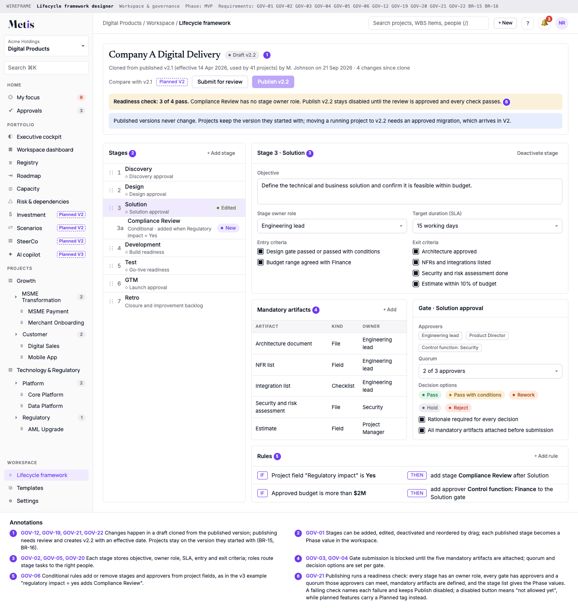


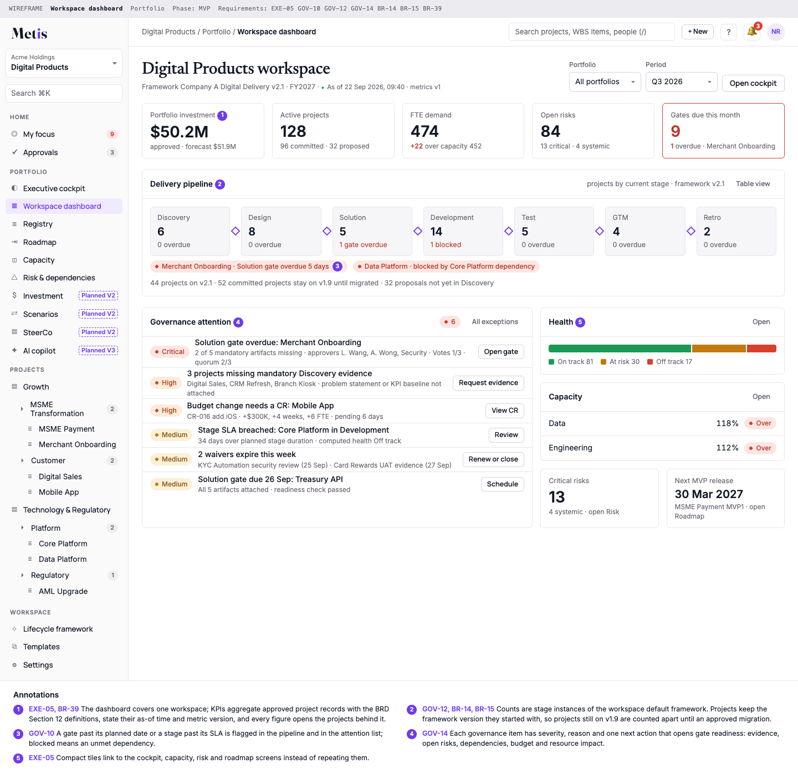


# Appendix F. Netlify Prototype Cross-Check (from BRD v2.0)

BRD v2.0 reviewed the Netlify "Enterprise Governance Platform MVP Demo". It showed resource capacity across 50 resources, resource bottlenecks, active risk counts, department workload, project health across 25 projects, a Requires Attention section, project search and filtering, project drill-down, missing weekly report alerts, green-but-risky discrepancy detection and pending change requests. This prototype was not re-reviewed for v4.0 (A-03, Q-05).

| Prototype element | Observed | BRD v2.0 treatment | v4.0 requirements |
|------------------------------|--------------|------------------------------------------|------------------------|
| Resource Capacity | Yes | Keep as P0; expand to demand and capacity scenarios | RES-01, RES-04 |
| Resource Bottleneck | Yes | Keep; link to projects and capabilities | RES-02 |
| Risk Overview | Yes | Keep; add systemic portfolio risk | RSK-02 |
| Department Workload | Yes | Keep; add capability-level capacity | RES-01 |
| Project Health | Yes | Keep; add multi-dimensional health score | EXE-03, OVW-05 |
| Requires Attention | Yes | Keep and make it the CEO entry point | EXE-02 |
| Missing Weekly Reports | Yes | Keep as governance exception | RPT-04 |
| Green-but-Risky | Yes | Keep as risk-engine discrepancy | RSK-04 |
| Change Requests | Yes | Keep and formalize baseline governance | CHG-01…CHG-07 |
| Project Registry | Yes | Keep; add strategy and investment fields | REG-01, REG-02, REG-03 |
| Milestones / Checkpoints | Yes | Keep; connect to MVP and WBS | WBS-11, MVP-02 |
| Strategic Alignment | Not evidenced | Add P0/P1 | CHR-15, STR-01 |
| Investment / Benefits | Not evidenced | Add P1 | INV-01, INV-02 |
| Scenario Planning | Not evidenced | Add P1 | STR-03, STR-04 |
| AI Copilot | Not evidenced | Add P2 | AIC-01…AIC-03 |

# Appendix G. Recommended Next Artifacts

- Product requirements document per release increment, derived from this BRD.
- Enterprise data dictionary, canonical status and health taxonomy, and versioned metric specification (Section 12, 12.5).
- High-fidelity designs built from the wireframes (wireframes/) and the design tokens (brand/tokens.css).
- MCP tool catalogue specification: names, schemas, scopes, examples and versioning (M05).
- Tenancy and security architecture: isolation model (D-28), identity per tenant, token and OAuth design, support access.
- POC source-code review notes (Q-03) confirming formulas and Builder scheduling.
- API and integration specification, with one integration contract per system (Section 16).
- Tenant isolation matrix with its negative test suite (TEN-02) and the data lifecycle and retention matrix (Section 17).
- Machine-readable role-permission matrix (role × action × scope, with approval thresholds) that drives server enforcement and generated permission tests (Section 14, CHG-10, D-15).
- Portfolio scoring model and scenario methodology.
- Catalogue of lifecycle frameworks (Company A, creative production) and process frameworks.
- Pilot portfolio onboarding checklist and migration plan from spreadsheets and POC exports.
- SteerCo operating calendar and governance playbook.
