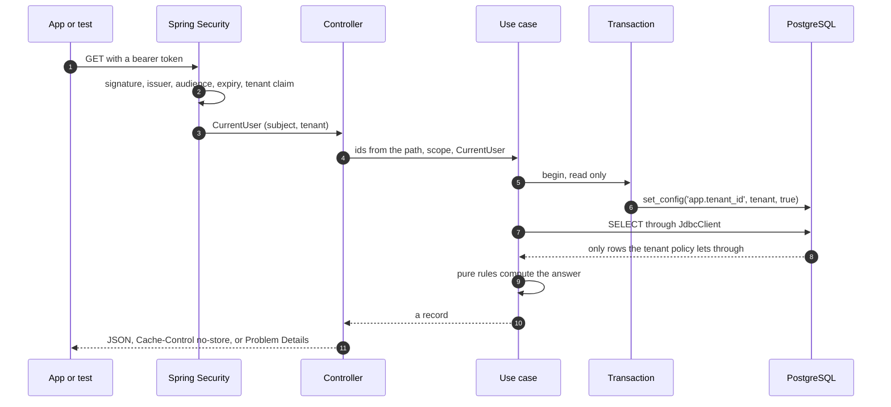

<!-- record banner: generated by tools/generate.mjs from history/records.json -->
> **Record, written 15 Oct 2026.** It is never current truth. Replaced by [Business core](../../components/core/README.md), [Core interfaces](../../components/core/interfaces.md), [The API contract](../../architecture/contract.md).
<!-- end of record banner -->

# Backend skeleton and the overview slice: design

| Item | Value |
|---|---|
| Status | Approved by the owner on 14 Oct 2026 (BK-03), with one addition, that the code base runs well in Docker from the start, which is section 5.10 and the `image` check. Nothing is built. Next: the four implementation plans of section 12, plan one first. |
| Question | What the first code base of `metis-backend` holds, how it is structured so that every later task builds on it, and which checks prove each line of it. |
| Inputs | The architecture pages and decision records of this repository; the diagrams `01-what-metis-runs-on`, `10-why-these-components` and `11-why-these-components-services`; the contract the app wrote in `src/core/api/` of `metis-app` and its mock data in `src/mocks/fixtures/`; the owner decisions below. |

## Owner decisions

| ID | Date | Decision, in the owner's words | How it applies |
|---|---|---|---|
| BK-01 | 13 Oct 2026 | "based on metis-docs and the diagram components, brainstorm to create the backend code base for the metis-backend repo" (machine translation) | The inputs of this spec; the code base follows the components of the diagrams |
| BK-02 | 14 Oct 2026 | "the goal is to build one backend framework (skeleton) as the base for all later tasks, well designed, following Spring best practice, easy to extend and stable; the APIs that screen 24, already built in the storefront, needs may be set up first to test, and no other function is needed. Make sure the test suite goes as deep as the frontend app's, coverage included, so that lines of code no longer used are pointed out and removed (list every test that can exist)" (machine translation) | The scope of section 2; the conventions of section 7; the checks and the catalogue of tests of section 8 |

| BK-03 | 14 Oct 2026 | "ok, but add that the code base must run well in Docker right from the start, so that deployment is smooth" (machine translation) | The spec is approved as presented: the rows of sections 3 and 4, the provisional rules of 6.4, the differences of 6.5, the licences and the ids file. The addition is section 5.10, the seventh condition of section 1, the `image` check of 8.2 and the first step of the plan |

The owner calls the app "storefront" in BK-02: it is `metis-app`, and screen 24 is its project overview.

## 1. Goal and what done means

One code base that every later backend task extends without reshaping it: a business core in Java 25 with Spring Boot 4, whose structure, conventions and checks are fixed here and proven by one real slice, the two reads that screen 24 calls.

The skeleton is done when all of these hold on one tree:

1. `./verify` runs every check of section 8.2 and records green for each one.
2. `./canary all` plants one defect per check and every check goes red for its defect.
3. The core answers `GET /workspaces/{workspaceId}/shell` and `GET /workspaces/{workspaceId}/projects/{projectId}/overview` from PostgreSQL for the demo tenant, behind a token, with tenants kept apart by the database itself.
4. Those answers pass the contract the app wrote and equal the app's mock data, except for the fields section 6.5 lists.
5. `contract/openapi.json` is generated by the core and current.
6. The owner opens screen 24 in a browser, drawn from the core and not from the mock server, with the review package beside it.
7. On a machine that has Docker and nothing else, one command builds the image from the sources and starts the database, Keycloak, the migration job and the core, and both reads answer. The image that passes the checks is the one a deployment runs, unchanged.

## 2. Scope

In scope:

- The repository layout, the Gradle build, the toolchain pins and the continuous integration file.
- The core: the `platform` module (errors, security, tenancy, contract metadata, time, logging) and two business modules, `workspace` and `delivery`, which hold only what the two reads need.
- PostgreSQL 18 with Flyway migrations, two database roles and row-level security on every table of the slice.
- The contract file, its checks and the declaration of each operation with its BRD ids.
- The checks of section 8, the record of a run and the counter-test of each check.
- The container image, built from the sources by Docker alone and run the same way everywhere, with its one-shot migration job (section 5.10); a local stack (PostgreSQL, Keycloak, the migration job, the core) and a development relay that lets the app call the core.
- The pages of this repository that become true when the code exists (section 10).

Out of scope, each built by a later round with its own spec and plan:

| Not in this round | Round that builds it |
|---|---|
| Writes: the command dispatcher, idempotency, versions per field, audit rows, outbox events, typed rejections of a write, the permission matrix of the 16 roles | The write path and the command catalog |
| Sign-in screens, sessions of the web build, tokens of the native builds, the magic-link authenticator, the login theme, realm settings for production | Sign-in |
| The MCP gateway and the tool list | MCP gateway |
| The `worker` role, the outbox forwarder, Temporal, Valkey, pushes to screens, rate limits | Background work and durable workflows |
| Presigned uploads, ClamAV, PDF rendering, MS Project import | Files and sandbox |
| The agent service and the LLM gateway | Agent |
| Export of traces, metrics and logs to a collector | With the first deployed environment |
| Every business module beyond the two reads | Feature tasks, after the write path |

Left out on purpose, because nothing in this round would use it: the `worker` role, an API version in the path or in a header, a paging helper, a generic repository base class, a shared utilities package, a permission engine, CORS in the core, Lombok, a second Gradle project for each module. Each of them enters with its first user, and the rule of section 8.1 that something must use every line keeps it out until then.

## 3. Drafts this spec turns into decisions

Building the code decides what the code embodies. Each row names a draft record, the part this spec adopts and the part that stays a draft. Approving this spec approves the middle column and nothing else.

| Draft record | Adopted by this spec | Stays a draft |
|---|---|---|
| [One code base and one image, run as `api` or `worker`](../../architecture/decisions/modular-monolith-core.md) | One code base of modules with boundaries enforced by tooling, built into one image; the image runs as the API and, chosen by configuration, as a one-shot migration job | The `worker` role, built with the first background job |
| [Tenant isolation with PostgreSQL row-level security](../../architecture/decisions/tenant-isolation-rls.md) | All of it, for the tables of the slice: a tenant id on every row, policies enabled with `FORCE`, an application role that cannot bypass them, the tenant set for each transaction, one code path for a missing record and for another tenant's record, negative tests in the checks | A database of its own for a large tenant |
| [The core's libraries](../../architecture/decisions/core-libraries.md) | Spring Security as a resource server; explicit SQL through `JdbcClient` with HikariCP and the PostgreSQL driver (section 4.2); Flyway under a role of its own; springdoc-openapi as the generator of the contract | orval or Kubb, which the app chooses; MPXJ; Playwright for Java |
| [The same test discipline as the front end](../../architecture/decisions/backend-testing.md) | All of it, made concrete in section 8 and with the tool list verified in section 9; the test with Keycloak tokens covers the core and PostgreSQL, since the gateway and the agent do not exist | The legs of the end-to-end test through the gateway and the agent |
| [One catalog generates the API, the MCP tools, the workflow blocks and the permission tests](../../architecture/decisions/command-catalog.md) | The declaration of an operation: a durable name, its BRD ids and its action class on each endpoint, exported into the contract file (section 5.8) | The permission, the undo rule, the audit fields, the confirmation mode, and every generator but the OpenAPI one |
| [One transactional write path for the app, MCP, workflows and agents](../../architecture/decisions/single-write-path.md) | Steps 1 to 3 for a read: the token is checked, the tenant comes from the token, the tenant is set at the start of the transaction | Steps 4 to 8 |
| [Keycloak 26 for sign-in, with a magic-link authenticator](../../architecture/decisions/identity-keycloak.md) | Keycloak issues the tokens the core checks, in the local stack and in one test | Everything else |
| [OpenTelemetry sent to Grafana Cloud](../../architecture/decisions/observability-opentelemetry.md) | Logs carry the tenant id and the request id and never the content of a record | The export and the receiver |
| [The server owns every rule; the UI shows its result](../../architecture/decisions/server-owned-validation.md) | Every error answer carries a correlation id | The rest |

Decided records this spec implements without changing them: [The core in Java 25 LTS with Spring Boot 4; no C# or .NET](../../architecture/decisions/backend-language-java-spring-boot.md), [The core generates `openapi.json`; oasdiff guards it; a bot copies it into `metis-app`](../../architecture/decisions/api-contract-flow.md) (the file, the stale check and oasdiff; the bot belongs to plan two of the repositories design), [Commands and workflows carry BRD ids](../../architecture/decisions/brd-ids-on-commands.md), [Prefer mature, supported components](../../architecture/decisions/component-selection-stability.md), [The app never computes a metric or a drill filter](../../architecture/decisions/metrics-are-server-snapshots.md), [The shell has its own endpoint](../../architecture/decisions/shell-api-contract.md) and [Coverage 100, mutation 100, no unused code](../../architecture/decisions/machine-proven-code.md), whose five conditions section 8.1 restates for the back end.

## 4. Choices of this spec

Each subsection compares the options and gives a recommendation. The recommendation is what the rest of the spec describes.

### 4.1 How modules are kept apart

| | Spring Modulith, modules as packages (recommended) | One Gradle project per module | Packages with hand-written rules only |
|---|---|---|---|
| A module | A direct sub-package of the application; its base package is its interface and every sub-package is hidden, unless named as an interface | A Gradle project with its own build file | A package, by convention |
| What stops a forbidden import | A test that fails: `ApplicationModules.verify()` rejects cycles, access to a hidden package and a dependency a module did not declare | The compiler: the class is not on the classpath | ArchUnit rules the team writes and keeps complete |
| Cost of a new module | A package and one `package-info.java` | A build file, a settings entry, a longer configuration phase | A package and new rules |
| One image, one transaction across modules | Yes | Yes | Yes |
| Module tests and documentation | Built in: a test can start one module with only its declared dependencies, and the module diagram is generated | To build | To build |
| Later split into a service | Along the verified boundary | Along the project | Along whatever the rules covered |

Recommended: Spring Modulith. It is the Spring project for exactly this shape, the proposals name it beside ArchUnit, and it matches the app's rule of one project until a second consumer exists ([One app, no multi-package workspace](../../architecture/decisions/one-app-no-package-workspace.md)). ArchUnit, which Spring Modulith is built on, adds the rules inside a module (section 7.2). What the first column says of Spring Modulith is on its reference pages. [Source: docs.spring.io/spring-modulith/reference/verification.html, testing.html and documentation.html, read 14 Oct 2026] Section 9.1 records its version and the one caveat, that it publishes no end of support.

### 4.2 How the core reads and writes data

| | `JdbcClient` with explicit SQL (recommended) | Spring Data JDBC | jOOQ |
|---|---|---|---|
| Fits the proposal "explicit SQL and no heavy ORM" | Yes, literally | Partly: aggregates are loaded and saved whole, custom SQL for the rest | Yes |
| What the code looks like | A SQL text block, named parameters, a row mapped to a record | Repositories derived from interfaces, plus `@Query` for anything else | SQL written in a typed Java DSL generated from the schema |
| Extra moving parts | None: it is part of Spring Framework | Mapping conventions, aggregate rules, callbacks | A code generator in the build and generated sources |
| Row-level security | Nothing hidden: every statement is in the source | The generated statements are not in the source | Nothing hidden |

Recommended: `JdbcClient`. The slice only reads, the SQL stays visible beside its mapping, and nothing is generated. Spring Data JDBC can be added for a module whose aggregates are written whole, when the write path exists. `JdbcClient` is part of Spring Framework and Spring Boot configures it. [Source: docs.spring.io/spring-framework/reference/data-access/jdbc/core.html and docs.spring.io/spring-boot/reference/data/sql.html, read 14 Oct 2026] The columns on Spring Data JDBC and jOOQ are the writer's reading of the two tools and were not checked on their pages. [Unverified - confirm before applying]

### 4.3 Where the rules of the overview run

| | Java over the loaded items (recommended) | SQL aggregates | Stored documents |
|---|---|---|---|
| How | One query loads the items of the project, at most 2,000 by the BRD; pure functions compute every number | One query per metric with `count`, `filter` and `case` | A table holds the finished answer of each project as JSON |
| Coverage and mutation testing | Every rule is Java, so every rule is under both | SQL text is not mutated and its branches are not measured | Nothing to measure: the numbers are typed in |
| Speed for one project | One indexed read of at most 2,000 narrow rows, then arithmetic in memory | Fast | Fast |
| Honest | Yes | Yes | No: it is a second mock server |

Recommended: Java over the loaded items. It puts every business rule under the two strongest checks. A portfolio screen that spans thousands of projects will need aggregates in SQL or stored snapshots, and that is its own design.

### 4.4 What the tools of the checks are written in

The checks need tools the build does not bring: the record of a run, the counter-tests, the language check, the trace check, the pinned copies.

| | A Java command-line tool in `tools/` (recommended) | The app's Node scripts, copied and adapted | Gradle tasks only |
|---|---|---|---|
| Toolchains needed to verify a change of the core | The JDK and Docker | The JDK, Docker and Node | The JDK and Docker |
| Under the same bar as the code | Yes: the same coverage and mutation setup applies to `tools/` | Coverage only, as in the app | Build logic is hard to cover |
| New code | A port, with the app's scripts and their tests as the reference for behaviour | The least | The record of a run and the counter-tests fight the build model |
| Who maintains it later | The backend team, in its own language | The backend team, in a second language | The backend team |

Recommended: a Java tool. Every check is a Gradle task, so a developer runs one check as `./gradlew checkLint`; the tool only runs those tasks one after the other, records the results and plants the defects of the counter-tests. Node enters the repository with the MCP gateway, not before.

### 4.5 Smaller choices

| Choice | Recommendation | Why |
|---|---|---|
| Build tool | Gradle with the Kotlin DSL, one version catalog, a lock file and verified checksums | The repositories design names Gradle; its approval covered the repositories, so this row asks for the tool itself |
| JDK distribution | Amazon Corretto 25, fetched by Gradle's toolchain support | The proposals name it; no system-wide install on a developer machine or in CI |
| Web stack | Spring MVC, with virtual threads switched on by `spring.threads.virtual.enabled` | The core talks to PostgreSQL through JDBC, which blocks, so plain blocking code on virtual threads is the simplest fit. [Source: docs.spring.io/spring-boot/reference/features/spring-application.html, read 14 Oct 2026] |
| Base package | `dev.metis.core` | It follows the identifier of the app, `dev.metis.app`, and shares its open question about the organization name |
| Public ids | A text key, unique in its scope and never changed, beside a UUID primary key that never leaves the database | The app's addresses use readable keys such as `creative-studio`; how a key is chosen at creation belongs to the modules that create records |
| Where the tenant comes from | One claim of the token, `tenant_id`, holding the Metis tenant id | The docs leave the claim open; a claim of our own keeps the core independent of how Keycloak models organizations; section 9 records what Keycloak offers |
| Who may open a project | A rule of the `workspace` module, written as code in the use case | The permission model of D-15 is not designed; an annotation with an expression in a string would sit outside coverage, mutation testing and the unused-code check |
| Database roles | Created by the environment (the local stack's init script here), never by a migration; migrations only grant | A migration cannot hold a password, and creating roles needs a privilege the migration role should not have. This differs from the proposals, which let Flyway create the roles |
| springdoc-openapi | On the test classpath only | The contract is generated in a test; the image then carries no documentation endpoint and fewer libraries |
| Error bodies | Problem Details (RFC 9457) with a `kind` and a `correlationId` | The kinds of [The API contract](../../architecture/contract.md), plus `notFound`, which that list lacks and the app needs |
| Demo data | Files outside the image, mounted into the migration job by the demo overlay of the local stack and added as a second Flyway location by the `demo` profile | The same migration engine; the image that ships holds no demo data, and the image check proves it |
| How migrations run | A one-shot run of the same image, before the API starts; the API never migrates and never holds the password of the role that owns the tables | A role that owns a table can switch its policies off, so the owner's password stays out of the process that faces the network; and a deployment gets one clear order, migrate then start |
| Health endpoints | Liveness and readiness on the port of the API, without detail; nothing else of Actuator | Several container platforms route and probe one port; an answer without detail is safe to reach |
| How the image is built | A multi-stage Dockerfile that compiles from the sources | Any machine or platform with Docker builds the same image, with no JDK installed |
| API versioning | None now | The contract is guarded by oasdiff; a version enters with the first breaking change |
| Licences | The app's list (permissive and MPL-2.0) plus EPL-1.0 and EPL-2.0 | Logback, the logging library Spring Boot uses by default, and the Jakarta API jars are under Eclipse licences. [Unverified - confirm before applying] Like MPL-2.0 they bind changes to their own files only. The plan reads the licence report of the real dependency tree before the list is fixed, and a licence outside this row comes back to the owner |

## 5. Architecture

### 5.1 Repository layout

```text
metis-backend/
  AGENTS.md  CLAUDE.md  README.md
  verify  canary                 launchers of the tool: run every check, run the counter-tests
  settings.gradle.kts  build.gradle.kts  gradlew
  gradle/
    libs.versions.toml           the one place a version is written
    verification-metadata.xml    checksums of every dependency
  .dockerignore
  core/                          the business core, one Gradle project
    build.gradle.kts  Dockerfile
    src/main/java/dev/metis/core/
    src/main/resources/          application.yml, db/migration/
    src/test/                    tests that need no container
    src/integrationTest/         tests on a real PostgreSQL and a real Keycloak
    src/testShared/              what both test sets share, such as the issuer of test tokens
  tools/                         the Java tool of the checks, one Gradle project
  contract/openapi.json          generated by the core, committed
  stack/                         local stack: compose.yaml, the demo overlay, database roles, Keycloak realm,
                                 the demo data, the relay for the app
  pinned/  docs.lock             byte copies of files of metis-docs that a check reads
  .github/workflows/check.yml    calls ./verify and ./canary, nothing else
  reports/                       written by ./verify, ignored by git
```

The other parts of the repository (`mcp-gateway/`, `agent/`, `keycloak/`, `sandbox/`) get their folder when their round starts.

### 5.2 Modules and packages of the core

```text
dev.metis.core
  CoreApplication
  platform/                 what every module builds on
    web/                    interface "web": the problem kinds and the exceptions a module throws
      internal/             the advice that writes Problem Details, the request id, the cache headers
    security/               interface "security": CurrentUser
      internal/             the resource server settings, the token converter, the 401 and 403 writers
    contract/               interface "contract": the annotation that declares an operation, ActionClass
    tenancy/internal/       sets the tenant at the start of each transaction
    time/internal/          the Clock
    logging/internal/       puts the tenant id and the request id on every log line
  workspace/                business module: tenant, people, workspaces, the navigation tree, project records
    ProjectRegistry         its interface for other modules
    internal/web  internal/app  internal/domain  internal/data
  delivery/                 business module: work items and the overview
    internal/web  internal/app  internal/domain  internal/data
```

- A module is a direct sub-package of `dev.metis.core`. Types in its base package are its interface; everything under `internal` is hidden from other modules. `platform` exposes three named interfaces and hides the rest.
- `delivery` depends on `workspace` and on `platform`; `workspace` depends on `platform`; `platform` depends on no module. Each module declares its allowed dependencies in its `package-info.java`, and the architecture check fails on any other.
- The two business modules follow the BRD's own split: the registry of workspaces, portfolios, programs and projects on one side, the work of one project on the other. They are small on purpose. A later module (risks, baselines, frameworks) takes its tables and rules out of them when it is built.

### 5.3 Path of one read



1. Spring Security checks the token as an OAuth2 resource server. A missing, expired or foreign token is answered 401 before any controller runs.
2. The controller only reads the path and the query and calls one use case. It holds no rule.
3. The use case is the transaction boundary, read only for a read. The first statement of every transaction sets the tenant for that transaction alone.
4. The repository runs explicit SQL. The policies of the database filter the rows, so a query that forgets a tenant filter still returns only the tenant's rows.
5. Pure functions of the `domain` package compute the answer from the rows, the clock and the user.
6. The answer leaves as a record turned into JSON. An error leaves as Problem Details.

### 5.4 Tenancy

- Every table of a tenant carries `tenant_id uuid not null`, with a default that reads the tenant of the transaction, so application code never writes a tenant id.
- Every such table has row-level security enabled and forced, and one policy for reads and writes: the row's tenant equals the tenant of the transaction. The policy reads the setting with `nullif(current_setting('app.tenant_id', true), '')::uuid`, so a transaction without a tenant sees no row and writes none, whether the setting was never set or is left empty after an earlier transaction on the same pooled connection. PostgreSQL leaves an empty text, not a missing setting, once a transaction that set it has ended. [Source: measured by `TenantTransactionTest` of plan two on PostgreSQL 18.6, 15 Oct 2026] The tenant transaction tests of section 8.4 measure both cases.
- The tenant is set in one place: the transaction manager of the core overrides the hook Spring calls right after a transaction begins and runs `select set_config('app.tenant_id', ?, true)` there, from the tenant of the current user. The third argument makes the setting last for that transaction only. The same hook makes a read-only transaction read-only in the database, so a read that tries to write fails. The JDBC driver does so too by default; the integration tests switch the driver's own mode off, so that they prove the hook.
- Any role may set `app.tenant_id`, `metis_app` included. [Source: measured on PostgreSQL 18.6 by the security review of plan two, 15 Oct 2026] The policies therefore keep tenants apart for the SQL the core writes, and the architecture check guards that SQL: only the repositories and the tenant hook reach the database, a repository calls nothing but `JdbcClient`, and the text of every statement is a constant of its class. An injected statement could otherwise choose its own tenant.
- The core connects as `metis_app`, a role without `SUPERUSER`, without `BYPASSRLS`, that owns no table, is a member of no other role and holds only the rights the code uses; the role tests read these as effective rights. Flyway connects as `metis_migrator`, which owns the tables and is itself subject to the forced policies. The environment of the API holds neither the owner's role nor its password, which the image check reads from the running container.
- A record that does not exist and a record of another tenant take the same path: the query returns no row and the use case answers 404. Section 8 tests the status, the body and the number of queries of both cases.
- Data paths of the BRD's isolation matrix that this round has: the database, and the application logs. The other eight paths enter with their components.

### 5.5 Security

- Authentication: bearer tokens only, checked for signature (keys fetched from the issuer), issuer, audience and expiry. The token must carry exactly one tenant in `tenant_id` and a subject that is a person of that tenant; otherwise the answer is 401 for a token that cannot be trusted and 403 for a person the tenant does not know.
- The tenant claim holds one UUID, in either case, or a list of exactly one, which a multivalued mapper of Keycloak sends; the development realm's mapper is multivalued, so that a person given two tenants reaches the core with both and is refused.
- The time of a token is judged by the real clock in every profile. The fixed date of `metis.time.fixed` moves the business date alone, and the core refuses to start with it unless the `demo` or `test` profile is active. A token without an expiry is refused.
- Spring Security 7 serves the metadata of the protected resource (RFC 9728) at `/.well-known/oauth-protected-resource`, to anyone. It names the issuer alone, which every token already carries, and MCP clients will read it. [Source: plan two, "What the sandbox taught", 15 Oct 2026]
- `CurrentUser` holds the subject and the tenant. Controllers receive it as a parameter and pass it on, so no rule reads a static holder.
- Authorization in this round: the tenant boundary, enforced by the database, and one rule of the `workspace` module on who may open a workspace and a project (section 6). The permission matrix of the 16 roles enters with the write path.
- The core is stateless: no session, no cookie, no CSRF token. The session of the web build belongs to the sign-in round.
- Every answer of the API carries `Cache-Control: no-store`, because Cloudflare sits in front of the core and an answer belongs to one person.
- No stack trace, SQL text or internal name leaves in an error body.

### 5.6 Errors

Every error is `application/problem+json` (RFC 9457) with `type`, `title`, `status`, `kind` and `correlationId`. The app reads only the status today.

| Status | `kind` | When | What the app draws |
|---|---|---|---|
| 401 | `unauthenticated` | No token, or a token that fails a check | Session expired |
| 403 | `forbidden` | The person may not open the workspace or the project | No access |
| 404 | `notFound` | No such record for this tenant; an unknown path, `/error` called directly included | Not found |
| 400 | `validation` | A query parameter with a value outside its list; a path that holds an encoded slash | Unavailable, with the status |
| 405, 406, 415 | `validation` | A method, an `Accept` or a `Content-Type` the endpoint does not take; a kind of their own waits for a client that must tell them apart | Unavailable, with the status |
| 500 | `server` | A defect; the body holds the correlation id and nothing else | Unavailable, with the status |
| 503 | `unavailable` | The database cannot be reached | Unavailable, with the status |

A module throws one of the exceptions of the `web` interface; one advice in `platform` writes the body. The kinds of a rejected write (`stale`, `locked`, `limit` and the others of [The API contract](../../architecture/contract.md)) enter with the write path.

### 5.7 Persistence and migrations

- PostgreSQL 18. Keys are `uuid` with the default `uuidv7()`. Times are `timestamptz` and leave the API as UTC instants; days are `date`.
- Migrations are SQL files under `db/migration`, written by hand, applied by Flyway as `metis_migrator` in the migration job of 5.10 and never by the API. A merged migration never changes: a lock file holds the hash of each one and the contract check fails on a difference.
- A migration that creates a table also enables and forces row-level security, creates the policy and grants `metis_app` exactly the rights the code uses. A test reads the catalog of the database after migrating and fails for a table that misses any of these, so a later table cannot forget them.
- SQL lives in the repository class of the `data` package as a text block with named parameters. A statement is never built by joining strings; the architecture check rejects it.
- Reads run in read-only transactions. No statement runs outside a transaction: without one no tenant is set and the policies return nothing.

### 5.8 Contract

- Each endpoint is declared once, on its controller method, with the annotation of the `contract` interface: a durable name such as `delivery.overview.read`, its BRD ids and its action class (`read` for both operations of this round).
- A test starts the web layer with springdoc-openapi, adds the name as `operationId` and the BRD ids and the action class as `x-metis-brd` and `x-metis-action`, writes the document with its keys in a fixed order and compares it with `contract/openapi.json`. A difference is red; `./gradlew writeContract` writes the file.
- The same file is therefore the first form of the command catalog: one entry per operation, with its name, its schemas, its BRD ids and its action class. The later rounds add the fields the catalog still lacks.
- Checks on the file: it is current; an OpenAPI linter passes, with no schema left unused; every BRD id exists in the BRD; every operation and every documented status is produced by a test, and every answer a test receives validates against the file; oasdiff finds no breaking change against the base branch, once one exists.
- The list of BRD ids comes from this repository. Today no file holds it: `business/requirements/source/build.py --ids` prints it. This spec adds a generated file, `business/requirements/ids.txt`, written by `tools/generate.mjs` and covered by the `generated` rule, and `metis-backend` pins a copy of it under `pinned/` with its hash in `docs.lock`, as the app pins the brand files.

### 5.9 Configuration, logging and health

- One `application.yml` with the defaults that are safe in production. Everything an environment decides (addresses, credentials, the issuer) comes from environment variables and from nowhere else, so no file changes between environments. Three profiles exist: `migrate` (the migration job of 5.10), `demo` (a fixed clock, and the demo data for the migration job) and `test` (no file: the tests that fix the date activate it). A setting of our own is a validated `@ConfigurationProperties` record; `@Value` is not used.
- The clock is a bean. No code reads the system clock; the architecture check rejects it. The `demo` and `test` profiles fix the clock, so the demo shows the same numbers every day and a test never depends on the date.
- Logs are structured JSON on standard output. Every line of a request carries the tenant id and the request id. No value of a record is logged; a test plants marker values in the database, runs every endpoint and fails if a marker appears in the log. The line of a 500 carries the type of the exception and of each cause with their frames, never a message, and the driver leaves the server's detail out of its messages: a message of PostgreSQL can hold a value of a row.
- Health: liveness and readiness probes through Spring Boot Actuator, on the port of the API and without detail; readiness follows the database. No other Actuator endpoint is exposed.
- Shutdown is graceful: the core finishes the requests in flight.

### 5.10 Container first: the image, its two runs and the local stack

The owner's addition (BK-03): the code base runs well in Docker from the start, so that a deployment holds no surprise. The container is therefore the unit that is built, checked and shipped, from the first step of the plan, and each rule below is proven by the `image` check of 8.2 or by a test of 8.4.

The image:

- One image for every environment. `core/Dockerfile` builds it from the sources in two stages: a build stage with the JDK that compiles with the Gradle wrapper, and a runtime stage on `amazoncorretto:25-al2023-headless` that holds the layered jar and nothing else. No JDK needs to be installed to build it, so a developer machine, CI and a hosting platform that builds from a Dockerfile all produce the same image. [Source: docs.spring.io/spring-boot/reference/packaging/container-images/dockerfiles.html, read 14 Oct 2026]
- Nothing of an environment is baked in. The image holds no demo data, no test code, no build tool, no documentation endpoint and no secret. A `.dockerignore` keeps reports, the git folder and local files out of the build.
- Base images are pinned by digest, in the Dockerfile and in the compose files.
- It builds and runs on both processor families in use: arm64 on a developer's Mac, amd64 in CI and at the proposed hosting. The two places the checks run cover both.

How it is configured:

- Only by environment variables (5.9). The compose file of the local stack is the complete, working list of the variables the image reads. A start without a required variable stops at once with a message that names it.
- The port is Spring Boot's own `SERVER_PORT`, 8080 when unset.

Its two runs, chosen by configuration:

| Run | What it does | Database role | Ends |
|---|---|---|---|
| `migrate` | Applies the migrations and exits | `metis_migrator`, which owns the tables | With 0, or with another code when a migration fails |
| The API, the default | Serves the API. It never migrates. At start it compares the schema of the database with the migrations it carries and refuses to start on a database that is behind | `metis_app`, which owns nothing and cannot bypass a policy | When the platform stops it |

- A deployment is always the same two moves: run `migrate`, then start the API. The local stack, the tests and CI make exactly these moves, so the order is rehearsed on every change.
- Only the migration job ever holds the password of the role that owns the tables. A role that owns a table can switch its policies off, so that password stays out of the process that faces the network.
- Migrations follow expand, then contract: a migration never breaks the image that is running while the new one rolls out. A database that is ahead of an image is therefore accepted, and one that is behind is refused.

How it behaves under a platform:

- Health: liveness and readiness on the port of the API (5.9). Readiness follows the database.
- Stopping: the JVM is the first process of the container and receives the stop signal itself; requests in flight finish and the container exits inside the grace period. The image check stops the container during a slow request and measures both.
- Limits: the heap follows the memory limit of the container, never a fixed size, and the process exits on an out-of-memory error so that the platform restarts it. [Unverified - confirm before applying] The image check runs the container with one processor and 2 GB, the floor the proposals give for a Java container ([The core in Java 25 LTS with Spring Boot 4; no C# or .NET](../../architecture/decisions/backend-language-java-spring-boot.md)), and requires it to be ready within 60 seconds.
- Locked down: a user without privileges, a read-only root file system with one temporary folder to write in, no added capability. The image check starts it that way, so a write outside the temporary folder is red.
- Logs go to standard output as JSON (5.9). The image writes no file.
- The time zone of the container has no effect: the image check runs it in a zone that is not UTC and expects the same answers.
- Each run of the image check records the size of the image, the seconds from start to ready and the memory in use after the calls, so that a platform can be sized from measurements.

The local stack:

- `stack/compose.yaml` starts PostgreSQL 18 (its init script creates the two roles), Keycloak with a development realm, the migration job and then the API, each waiting for the health of what it needs. It runs the image exactly as a deployment would.
- `stack/compose.demo.yaml` is an overlay for the demo: it mounts the demo data into the migration job, switches the `demo` profile on, and adds the development relay.
- The app sends no token today, because sign-in is not built. So that the owner can open screen 24 on the real core, the relay is a reverse proxy that fetches a token for the demo person from the local Keycloak and adds it to every call it forwards to the core, with the CORS headers the app's development server needs. The app is started with `EXPO_PUBLIC_API_BASE` pointing at the relay.
- The relay is configuration in `stack/`, never code of the core, and never part of the image. The core has no way to accept a call without a token in any profile.

Not in this round, because it needs an environment: pushing the image to a registry, the deployment pipeline, and the rehearsal of a deployment on the real platform. They belong to `metis-infra` and to the first deployed environment.

## 6. The slice: the shell and the overview

The slice exists to prove the skeleton and to give screen 24 a real server. It holds what the two answers need and nothing more.

### 6.1 The two operations

| Name | Request | BRD ids | Statuses |
|---|---|---|---|
| `workspace.shell.read` | `GET /workspaces/{workspaceId}/shell` | WSP-02, WSP-06, REG-03 | 200; 401; 403 for a person who is no member of the workspace; 404 for a workspace the tenant does not have |
| `delivery.overview.read` | `GET /workspaces/{workspaceId}/projects/{projectId}/overview`, with `scope=mine` or no parameter | OVW-01, OVW-02, OVW-03, OVW-04, OVW-05, BR-24, BR-32, BR-39 | 200; 400 for another value of `scope`; 401; 403 for a person who is no member of the project; 404 for a project that is not in that workspace |

The shapes are the ones the app wrote in `src/core/api/shell.ts`, `overview.ts` and `project.ts` of `metis-app`, field for field. This spec confirms them as the contract, which answers the app's question about the shell.

### 6.2 Tables

Nine tables, each with `tenant_id` and the forced policy of 5.4. A text key is the public id of 4.5.

| Table | Columns beyond the key and the tenant | Needed for |
|---|---|---|
| `tenant` | name | `tenant.name` |
| `person` | key, subject of the token, name, initials | The user of the shell; the project manager; the workload rows and their drill |
| `workspace` | key, name, time zone, freshness threshold, position | The workspace and the list of workspaces; "today"; freshness |
| `workspace_member` | workspace, person | Which workspaces a person sees |
| `portfolio` | workspace, name, position | The tree |
| `program` | portfolio, name, position | The tree |
| `project` | workspace, program, key, name, client name, manager, position, declared health, saved time; the stage as name, index and count; the framework as name and version; the baseline as version and date, both empty before the first baseline | The tree and the header of every project page |
| `project_member` | project, person | Who may open a project |
| `wbs_node` | project, key, kind (category or work item), code, name, the category it sits in, type, status, person in charge, target date, target date at the baseline, labels, risk level, mitigation, changed time | Every number and list of the overview |

- A position column orders each level of the tree, because the app's order is not alphabetical.
- The stage, the framework and the baseline are columns of `project` and of `wbs_node` here. They belong to modules that do not exist; the module that owns each replaces these columns with its tables.
- Left out because neither answer reads it: the parent of a work item beyond its category, phases, start dates, effort, reviewers, dependencies, descriptions.

### 6.3 The shell

- `user` is the person whose subject the token carries; `tenant` is the tenant of the token; `workspace` is the one in the path; `workspaces` lists the workspaces the person is a member of, in position order.
- `tree` holds every portfolio, program and project of the workspace, in position order, whether or not the person may open the project. The app's mock data lists a project it then refuses, and the BRD's no-access state offers a request for access (PLT-04), which presumes the project is visible.
- `nav` is the fixed list of fifteen items in three groups, with the release label of the four later items. It is a constant of the `workspace` module, not a table: no requirement lets a tenant change it.
- The two counts beside "My focus" and "Approvals" and the number of unread notifications are not sent: each badge is `null` and `notifications` is 0. The focus list, the approval queue and the notification centre are not built, and no rule of the BRD gives the numbers the mock data shows. A stored number would be a second mock server.

### 6.4 The overview

One query loads the work breakdown of the project. Pure functions compute the answer from those rows, the project record, the clock and the user. Each rule carries a definition version, sent as `definitionVersion`.

| Part of the answer | Rule | Source |
|---|---|---|
| "Today" | The date of the clock in the workspace time zone | BRD section 12.1 |
| Work item | A node that is not a category row; `categoryRowsExcluded` counts the category rows | BR-24 |
| Deliverables, work packages | Work items of that type | BRD section 12.1 |
| Milestones, approval gates | Work items with that label; `overdue` counts those among them that are overdue | BRD section 12.1 |
| Blocked | Work items whose status is blocked | BRD section 12.1 |
| Overdue | A work item that is not done and whose target date is before today; `daysOverdue` is today minus the target date in calendar days | BRD section 12.1 |
| Delayed | A work item that is not done and whose target date is later than its target date at the baseline; `notBaselined` when the project has no baseline | BRD section 12.1 |
| High risk | Work items whose risk level is high or critical; `critical` counts the critical ones | BRD section 12.1 |
| Progress | Done work items over all work items, as a percentage; the app rounds down | BRD section 12.1 |
| Status breakdown | Five rows, always, in the order done, in progress, waiting, blocked, not started | WSP-08; the order is the mock data's |
| Progress by category | For each category row: done work items over work items in it | BRD section 12.1 |
| Workload | Work items that are not done, per person in charge | OVW-03 |
| Upcoming | Milestones and approval gates that are not done, with a target date of today or later, earliest first | BRD section 12.1 |
| `asOf` | The time of the newest change among the rows counted | BR-39 |
| `freshness` | `stale` when `asOf` is older than the freshness threshold of the workspace, else `fresh` | BR-39 |
| `drill` | Built by the server from field names of the work breakdown, as in the mock data; no value holds a comma | BR-32 |

The BRD is silent on the following. Each gets a provisional rule here, chosen so that the demo data gives the mock data's answer, kept in one function with its own definition version, and listed for the owner.

| Open point | Provisional rule | Why this one |
|---|---|---|
| The level of the computed health (OVW-05 gives no formula) | `unknown` when the figures are not fresh. Otherwise `red` when a milestone or an approval gate is overdue or a critical risk has no mitigation; `amber` when any work item is overdue or any risk is high; else `green`. The reasons sent are the overdue items with the milestones among them, and the critical risks without mitigation | It gives red for the demo project that has both reasons and unknown for the one whose figures are stale |
| `sinceBaseline` of the delayed tile | Equal to the delayed count: at the moment a baseline is captured nothing is delayed against it | The app only prints it beside the baseline version |
| "My items" (`scope=mine`) | Every number is computed over the work items whose person in charge is the current user; the header does not change | The Focus screen of the BRD filters "only mine" the same way |
| Order and length of the lists | Overdue by days overdue, largest first, then by code; risks critical first, then by code; each list sends its first four rows with the true total | The mock data's rows |
| Order of the workload rows | Most open items first; a tie goes to the person whose first open item has the lower code | The mock data's rows |
| Whether a done item counts as a milestone, a gate, a deliverable or a high risk | It counts: the BRD's rule for each has no "not done" | The rule as written |
| `partial` and `unknown` freshness | Never sent by this operation: the BRD words both for figures that span several projects | BR-39 |
| Codes of the item types the app has not met | `task` and `subtask`, beside `deliverable` and `workPackage` | The spelling of the other codes |

### 6.5 Demo data, and where the core differs from the mock server

- The demo data is the app's own: the tenant, four people, two workspaces, three portfolios, six programs and ten projects of `src/mocks/fixtures/` in `metis-app`, with the same keys. The work breakdown of the first demo project is the 18 rows the wireframes draw (six category rows and twelve work items); that of the second is eight rows chosen to give its numbers.
- The mock data's numbers hold for one day only, 22 Sep 2026 in the workspace time zone: on any later day more items are overdue. The `demo` profile therefore fixes the clock at that day, and the seed stores the changed times that give the mock data's `asOf`. The freshness threshold of both demo workspaces is 24 hours, which makes the figures of the first demo project fresh and those of the second, last changed a week earlier, stale, as in the mock data.
- A test compares the answers of the core for both demo projects and both workspaces with JSON exports of the app's fixtures, field for field.

What the core answers differently, on purpose:

| Case | Mock server | Core | Why |
|---|---|---|---|
| The counts beside "My focus" and "Approvals", unread notifications | 9, 3 and 3 | No badge, and 0 | 6.3 |
| The overview of the seven projects of the second workspace, which the tree lists | 404 | 403 | The projects exist, and the demo person is no member of them |
| `scope=mine` | The same answer as without it | The numbers of the user's own items | 6.4 |
| The body of an error | Empty | Problem Details | 5.6; the app reads only the status |

### 6.6 The app's open questions, as this round leaves them

| Question of the app | After this round |
|---|---|
| Will the back end answer the shell in the shape of the app's schema? | Yes, confirmed here |
| Will it keep the rules on the time zone, the project header, the initials and the drill values? | Yes; each has a test |
| Which filter does the Delayed tile open? | Still `delayed=true`, provisional: the BRD's filter list has no such filter |
| Does "My items" filter by the person in charge or the assignee? | By the person in charge, provisional |
| Does the upcoming list also filter by date and status? | The list does; its drill still carries the labels only, because the BRD's filter list has no date filter |
| How is health computed for resources and finance? | Not computed; the contract carries delivery and risk, with the provisional rule of 6.4 |
| Which field says the viewer has read-only access? | None yet: it enters with the permission model |
| Will reads stay under 1 second at the 95th percentile? | Measured by the image check on a project of 2,000 items |

## 7. Conventions: how a later task extends the skeleton

### 7.1 Adding things

| To add | Do this | The check that proves it |
|---|---|---|
| A module | A package under `dev.metis.core` with a `package-info.java` that names it and lists its allowed dependencies; `internal/web`, `internal/app`, `internal/domain`, `internal/data` as needed | Architecture |
| An endpoint | A controller method in `internal/web` with the contract annotation (name, BRD ids, action class); a use case in `internal/app`; records for the answer; then `./gradlew writeContract` | Contract, trace |
| A rule | A pure function or record in `internal/domain`, with its tests first | Unit, coverage, mutation |
| A table | A new migration with the tenant column, the forced policy and the grants; its repository in `internal/data`; a line in the migration lock | Integration (the catalog test), contract |
| A call from one module to another | A type in the base package of the called module, added to the caller's allowed dependencies | Architecture |
| A setting | A field of a validated `@ConfigurationProperties` record, read by production code | Unused code |
| A check | A Gradle task, a row in the tool's list, and its counter-test or its reason in `NO_CANARY` | Tooling |

### 7.2 Rules inside a module

- `web` calls `app`; `app` calls `domain` and `data`; `data` may use `domain` types; `domain` uses nothing of Spring and nothing of the other packages. No other direction compiles past the architecture check.
- A controller holds no rule and touches no repository. A repository holds no rule: it runs SQL and maps rows.
- Dependencies arrive through the constructor. No field injection, no static holder, no `new` of a bean.
- A use case method is the only place a transaction starts.
- Types are package-private unless another package needs them. An answer of the API is a record.
- A null never crosses a method boundary unmarked: every package is marked `@NullMarked` with JSpecify, and NullAway fails the compilation otherwise.
- No interface with a single implementation, no base class for one subclass, no setting for a value that never changes. A shared helper needs two callers in the change that adds it, and code in `platform` needs two modules that use it.
- A deliberate shortcut carries a `ponytail:` comment that names its ceiling and how to lift it.

### 7.3 Language, comments and single source

The rules of the app, unchanged ([English code, one source per value, no retyped literal](../../architecture/decisions/code-language-and-single-source.md)):

- Code, comments, test names, log messages and the output of the tool are English. A letter outside ASCII is allowed only on the line after a `lang-exception: <reason>` comment.
- A comment is one line that says why. It never cites a plan, a ruling, a task number, a date or a line of another file. BRD ids are fine.
- Every value has one source. The ids, names and numbers of the demo data are defined once, in the demo data builders of the tests and the seed they generate, and a test reads them from there. The tool rejects a string in a test that retypes one of them.
- A test name is an English sentence about behaviour, and a test that proves a requirement starts with its BRD id: `OVW-01 BR-32 the blocked tile counts the items whose status is blocked`.

## 8. Tests and checks

### 8.1 The five conditions for a line of code

The rule of the app, restated for the back end. Each condition is a check.

1. A test runs through it: 100% of lines and of branches, over the core and the tool, measured over the unit and the integration tests together. An exclusion is one entry of a list, with its reason.
2. The test catches errors: every mutant that PIT makes is killed. A mutant that changes no behaviour is first removed by rewriting the code; where that is impossible the method is marked with a reason, and the number of marks may only shrink.
3. Something uses it. No class, method, field, constructor or enum constant of production code that production code never reaches from an entry point; no code that only tests call; no test helper no test calls; no dependency nothing imports; no setting nothing reads; no resource file, table or column nothing names. Removing a feature makes this check force the removal of its code, its settings, its tables and its dependencies.
4. If it is an endpoint, it is declared in the contract, with a name, its BRD ids and its action class.
5. It traces to a requirement: every BRD id an operation declares is in the name of at least one test that ran and passed.

How the third condition is checked, since the owner asked for it by name:

| What | How it is found | Where |
|---|---|---|
| An unused local, parameter, private member or import | Error Prone's unused checks, raised to errors; the formatter removes an unused import | Compile, format |
| An unused class or member that is not private | A rule that walks every call, reference and type use of production code, starting from the entry points (the application's main method, methods mapped to a request, bean and listener methods, overrides of framework types, the records of the contract). Whatever it never reaches is red. The list of entry points is one file, with a reason per entry. A constant, which the compiler copies into its users, is checked by name in the sources | Unused code |
| Code that only tests reach | The same walk: tests are not entry points of production code | Unused code |
| An unused test helper | The same walk over the test sources, with test methods and lifecycle methods as entry points | Unused code |
| A dependency that is declared and not used, or used and not declared | The Dependency Analysis Gradle Plugin | Unused code |
| A setting nothing binds or reads | A test that compares the keys of every `application*.yml` with the settings Spring Boot and the core define | Unused code |
| A resource file, a table or a column nothing names | A scan for its name in the production sources; a list of accepted leftovers that may only shrink | Unused code |
| A line no test runs, a branch no test takes | Coverage at 100 | Coverage |
| A statement whose removal no test notices | Mutation testing at 100 | Mutation |
| A schema of the contract no operation uses | The OpenAPI linter | Contract |
| An operation no test calls | Contract coverage | Integration |
| Code in `platform` that only one module uses | An architecture rule | Architecture |

What stays inside coverage but outside mutation testing, as the app keeps its data and its style files outside. Each entry is one line of a list, with its reason:

- The repository classes of the `data` packages. They hold SQL text, which no tool mutates, and one call that runs it; only a database can show their effect, and PIT cannot run a test that starts a container. A rule keeps them free of any decision (a cyclomatic complexity of 1), the repository tests pin every query on a real PostgreSQL, and the distinct-data variant makes a wrong column fail.
- The transaction manager that sets the tenant, for the same reason. The cross-tenant tests pin it, and two counter-tests break it on purpose.
- The `main` method of the application, one line of start-up.
- The builders of the demo data in the tests: data, not logic.

PIT skips a line that calls a logging library by default. The build turns that off, so a line that logs is mutated like any other line.

### 8.2 The checks of `./verify`

Every check is one Gradle task. `./verify` runs them in this order, goes on after a red one, and writes the record. The first ten are the fast group that runs on every push.

| Check | What it proves | Main tools |
|---|---|---|
| `format` | Every source file is formatted | Spotless |
| `compile` | The code compiles with every warning an error; no common bug pattern; no null where none is allowed | javac, Error Prone, NullAway |
| `lint` | No method above a cyclomatic complexity of 10; no file above 300 lines; every suppression carries a reason and their number did not grow; no test retypes a value of the demo data | Checkstyle, the tool |
| `language` | English only; no comment that cites a plan, a ruling, a date or a line number | The tool |
| `architecture` | Module boundaries and declared dependencies; the layers of a module; the forbidden APIs (the system clock, field injection, SQL built from strings, standard output, legacy date types); `platform` code has two users | Spring Modulith, ArchUnit |
| `deadcode` | The third condition of 8.1 | ArchUnit, the Dependency Analysis plugin, the tool |
| `tooling` | The tests of the tool; every check has a counter-test or a reason; the pinned copies match `docs.lock`; the workflow file passes its linter and pins every action | JUnit, the tool, actionlint |
| `contract` | `contract/openapi.json` is current and passes the linter; every BRD id exists; no merged migration changed; no breaking change against the base branch | springdoc-openapi, an OpenAPI linter, oasdiff, the tool |
| `trace` | The fifth condition of 8.1; a skipped test counts for nothing | The tool, over the test reports |
| `unit` | The tests that need no container: rules, JSON shapes, error mapping, the web layer, the security filter. No test skipped or disabled; the number that passed equals the floor | JUnit, AssertJ, Spring's test support |
| `integration` | The tests on a real PostgreSQL and a real Keycloak: migrations, the catalog rules, the roles, the tenant boundary, the repositories, the whole API over HTTP, the contract coverage. Same rules on skipped tests and the floor | Testcontainers |
| `coverage` | The first condition of 8.1, over both test tasks | JaCoCo |
| `mutation` | The second condition of 8.1: no mutant survived and none was left without a test, read from PIT's report | PIT, the tool |
| `deps` | No known vulnerability in what ships, but for a reviewed list that may only shrink; only allowed licences; the lock file and the checksums are current | Trivy over the lock file, the licence report plugin, Gradle |
| `secrets` | No secret in the tree | gitleaks |
| `image` | The rules of 5.10. The image builds from the sources with Docker alone; the Dockerfile passes its linter; the image has no known vulnerability, no demo data and no build tool. Started as a deployment starts it (the migration job, then the API, locked down, under its memory and processor limit, in a time zone that is not UTC), it is ready in time and answers its health probes and both reads with a token from Keycloak; the API refuses a database that was not migrated; a stop signal during a slow request lets the request finish; calls generated from the contract cause no 5xx and no answer outside the contract; the overview of a project of 2,000 items answers under 1 second at the 95th percentile. Size, start time and memory are recorded | Docker, hadolint, Trivy, Schemathesis, the tool |

The record: `./verify` keeps `reports/verify.json` and draws `reports/verify.md` from it on every run, one row per check with the result, the seconds, the counts (tests passed against the floor, coverage, the scope and the score of mutation testing) and the stamp of the tree it ran on, a hash of the files git would commit plus the count of uncommitted changes. A red row makes the exit code 1, and so does a full run that cannot name its tree. `./verify --only <check>[,<check>] --append` reruns some checks and adds their rows.

### 8.3 Counter-tests

A check that cannot go red proves nothing. `./canary <name>` copies the tree into a scratch folder, requires the check to be green there, plants one defect, runs the check again and requires red for that very defect. The working tree is never touched. `./canary all` runs every one. A new check comes with its counter-test in the same change, or with its reason in `NO_CANARY`; the `tooling` check fails a check that has neither.

| Check | Defects planted, one counter-test each |
|---|---|
| `format` | A badly indented line |
| `compile` | An unused local; a null returned where none is allowed; a raw type |
| `lint` | A method of complexity 11; a file of 301 lines; a suppression without a reason; a test that retypes a demo name |
| `language` | A comment in Vietnamese; a comment that cites a ruling; a comment with a date |
| `architecture` | `delivery` imports a hidden type of `workspace`; a module uses one it did not declare; a controller calls a repository; a `domain` class imports Spring; a field is injected; code reads the system clock; SQL is built by joining strings |
| `deadcode` | A public method nothing calls; a class only a test uses; a test helper no test calls; a dependency nothing imports; a setting nothing reads; a column nothing names |
| `tooling` | A check without a counter-test; a pinned copy with one byte changed |
| `contract` | A field of an answer renamed without writing the contract again; an operation without BRD ids; a BRD id that does not exist; a merged migration edited |
| `trace` | The BRD id removed from the only test that names it; that test disabled |
| `unit` | A failing assertion; a disabled test; one test deleted without lowering the floor |
| `integration` | The policy of one table dropped; `FORCE` removed from one table; a new table without a tenant column; the application role given `BYPASSRLS`; the tenant set for the session and not for the transaction |
| `coverage` | A function no test calls |
| `mutation` | A test that asserts nothing about the result |
| `deps` | A library with a known vulnerability added; a library under a licence outside the list added |
| `secrets` | A file holding a key in a well-known format |
| `image` | A Dockerfile that runs as root; a core started with a wrong issuer; an entry point that starts the JVM through a shell, so the stop signal never reaches it; the demo data copied into the image; a write to the root file system at start |

### 8.4 Every kind of test, and what this round does with it

The owner asked for the whole list. Built means built in this round and run by the check named in brackets. Later names the round that brings the thing the test needs.

Static, nothing runs:

| Test | Proves | Status |
|---|---|---|
| Formatting | One layout for every file | Built (`format`) |
| Compiler warnings as errors | No deprecated, unchecked or raw use | Built (`compile`) |
| Bug-pattern analysis | Common mistakes do not compile | Built (`compile`) |
| Null-safety analysis | A null cannot reach where none is allowed | Built (`compile`) |
| Complexity and file-size ceilings | Small methods and files | Built (`lint`) |
| Reason on every suppression, counts only shrink | No silent escape from a check | Built (`lint`) |
| English only, comment rules | The language rules of 7.3 | Built (`language`) |
| No restated literal in tests | One source per value | Built (`lint`) |
| Module boundaries | No module reaches into another | Built (`architecture`) |
| Layer rules inside a module | 7.2 | Built (`architecture`) |
| Forbidden APIs | No system clock, field injection, string-built SQL | Built (`architecture`) |
| Unused production code, unused test code | 8.1, third condition | Built (`deadcode`) |
| Unused or undeclared dependencies | 8.1, third condition | Built (`deadcode`) |
| Unread settings; unnamed resources, tables and columns | 8.1, third condition | Built (`deadcode`) |
| Contract is current | The committed file is what the code generates | Built (`contract`) |
| Contract lint | A well-formed OpenAPI document, no unused schema | Built (`contract`) |
| Contract compatibility with the base branch | No breaking change without the label | Built (`contract`), compares once a base exists |
| BRD ids exist | Every declared id is in the BRD | Built (`contract`) |
| Requirement trace | Every declared id has a passing test | Built (`trace`) |
| Migrations never change once merged | A database built last month equals one built today | Built (`contract`) |
| Known vulnerabilities in dependencies | Nothing shipped with a known hole | Built (`deps`) |
| Licences of dependencies | Only allowed licences ship | Built (`deps`) |
| Locked and verified dependencies | The build uses exactly the reviewed files | Built (`deps`) |
| Secret scan | No key in the tree | Built (`secrets`) |
| Dockerfile lint, workflow lint, pinned actions | The files around the code are sound | Built (`image`, `tooling`) |
| Pinned copies match their lock | No drift from metis-docs | Built (`tooling`) |
| Every check has a counter-test | No blind check | Built (`tooling`) |
| Static security analysis by a dedicated scanner | Injection and unsafe API patterns | Later: with the first deployed environment; Error Prone and the architecture rules cover the patterns this code can have |
| Bill of materials and signed builds | What exactly shipped | Later: its decision record is a draft |
| Reproducible build | Two builds of one tree are identical | Later: with signed builds |

Tests without a container:

| Test | Proves | Status |
|---|---|---|
| Rule tests by example | Each rule of the overview, one test per case of the BRD | Built (`unit`) |
| Invariant tests on seeded random inputs | For any work breakdown: a list never holds more rows than its total, a drill value holds no comma, the status counts add up to the work items, progress matches done over total | Built (`unit`) |
| Distinct-data variant | Reading the wrong field fails even when two fields are equal in the demo data | Built (`unit`) |
| Time and time-zone tests | "Today" follows the workspace time zone across midnight and a clock change | Built (`unit`) |
| JSON shape tests | Field names, instants ending in Z, days, codes, no extra field | Built (`unit`) |
| Error-mapping tests | Each failure becomes its status and kind, with a correlation id and nothing internal | Built (`unit`) |
| Web-layer tests | Paths, statuses, headers, ids with a slash or a dot, an unknown value of a query parameter, no-store | Built (`unit`) |
| Token tests | No token, expired, wrong issuer, wrong audience, wrong signature, the algorithm "none", no tenant claim, two tenants | Built (`unit`) |
| Tool tests | Every tool of the checks | Built (`tooling`) |
| Line and branch coverage at 100 | 8.1, first condition | Built (`coverage`) |
| Mutation score at 100 | 8.1, second condition | Built (`mutation`) |
| Exact test floor, nothing skipped | A test cannot disappear unnoticed | Built (`unit`, `integration`) |
| Random order | No test depends on another | Built (`unit`, `integration`) |
| Guard against calls that leave the machine | A unit test cannot resolve any host but the local one; a literal address is beyond its reach | Built (`unit`) |
| Validation of request bodies | Each field rule of a write | Later: the write path |

Tests on a real PostgreSQL and a real Keycloak:

| Test | Proves | Status |
|---|---|---|
| Migration from an empty database | The schema builds from nothing and Flyway validates it | Built (`integration`) |
| Catalog rules | Every table has the tenant column, the forced policy, a UUID key and indexed foreign keys | Built (`integration`) |
| Role tests | The application role cannot bypass a policy, owns nothing and holds only the rights the code uses | Built (`integration`) |
| Repository tests | Each query against real rows | Built (`integration`) |
| Tenant transaction tests | The tenant lasts one transaction; a pooled connection carries nothing over; no tenant means no row | Built (`integration`) |
| Cross-tenant negative tests | Every endpoint, called with the ids of another tenant, answers as for a missing record; a new endpoint without such a test is red | Built (`integration`) |
| Same answer for missing and foreign | Equal status, body and number of queries | Built (`integration`) |
| Query count | A fixed number of statements per request, so no query per row | Built (`integration`) |
| API tests over HTTP | The whole path with signed test tokens | Built (`integration`) |
| Contract coverage | Every operation and documented status has a test; every answer validates against the contract file | Built (`integration`) |
| Equality with the app's mock data | The answers for the demo tenant equal the app's fixtures, but for the listed fields | Built (`integration`) |
| Tokens from a real Keycloak | Issuer discovery, keys and claims work with the real product | Built (`integration`) |
| Start-up tests | The context starts as the API and as the migration job; a missing setting stops it with a message that names it; without the `demo` profile no demo data can load | Built (`integration`) |
| Health and shutdown | Probes follow the database; requests in flight finish | Built (`integration`) |
| Log tests | Tenant id and request id on every line; no value of a record | Built (`integration`) |
| Failure tests | Database unreachable gives 503; the issuer's keys unreachable gives 401 and never 500 | Built (`integration`) |
| Upgrade test | A database of the previous release, with data, migrates | Later: needs a first release |
| Write-path tests | Idempotency, conflicts per field, audit in the same transaction, outbox, 25 people writing at once | Later: the write path |
| Permission matrix | Every operation against each of the 16 roles | Later: the write path |

Tests of the built image and of the running system:

| Test | Proves | Status |
|---|---|---|
| Build from the sources with Docker alone | Any machine with Docker builds the image | Built (`image`) |
| Image smoke test | The shipped image, run as a deployment runs it, answers its probes and both reads | Built (`image`) |
| Image scan and image content | Nothing known to be vulnerable; no demo data, no build tool | Built (`image`) |
| Locked-down run | It works without privileges, on a read-only file system, with no added capability | Built (`image`) |
| Migration job | It exits with 0 after migrating and with another code on a failing migration; the API refuses a database that is behind and holds no password of the owner role | Built (`integration`, `image`) |
| Stop signal | Requests in flight finish and the container exits inside the grace period | Built (`image`) |
| Limits and start-up budget | It is ready within 60 seconds with one processor and 2 GB; size, start time and memory are recorded | Built (`image`) |
| Time-zone independence | The same answers in a container whose zone is not UTC | Built (`image`) |
| API fuzzing from the contract | No generated call causes a 5xx or an answer outside the contract | Built (`image`) |
| Latency budget | The overview of 2,000 items answers under 1 second at the 95th percentile | Built (`image`) |
| Counter-tests | Every check goes red on its planted defect | Built (`./canary all`) |
| Review by the owner | Screen 24 on the real core, with the review package | Built: the deliverable |
| Dynamic security scan of a deployed API | Missing headers, known attack patterns | Later: with the first deployed environment |
| Load, stress and soak tests | The service targets of BRD section 17.1 under the measured volume | Later: the load test the BRD asks for before the architecture is frozen |
| Backup, restore and one-tenant restore rehearsal | The recovery targets | Later: infrastructure |
| Penetration test | An independent attack | Later: before go-live, by an outside firm |
| Replay of older app versions | A released app still gets answers it understands | Later: needs a released app |
| The previous image on the new schema | A rolling deployment never breaks the image still running | Later: needs a first release |
| Deployment rehearsal on a real environment | The pipeline, the registry and the platform's own settings | Later: `metis-infra` and the first deployed environment |

Tests that arrive with components this round does not have: workflow replay tests (Temporal), stream and reconnect tests (pushes to screens), rate-limit tests (Valkey), upload, malware and PDF tests (files and sandbox), MCP conformance and audience tests (gateway), prompt-injection tests (agent), email tests.

### 8.5 Where the checks run, and how hard

The app's rules ([CI runs `pnpm verify`; macOS work runs on a Mac; every run leaves a record](../../architecture/decisions/where-checks-run.md), [Checks must not overload the machine](../../architecture/decisions/resource-caps.md)), for the back end:

- A check is a Gradle task; `./verify`, `./canary` and CI only call the tool, and no logic lives in the workflow file alone.
- On the developer's machine, `./verify` before a change is handed over. It lowers its own priority, and Gradle workers, test processes and PIT threads are capped in the repository at half the cores.
- In CI on Linux: the fast group on every push; every check on a pull request, with mutation testing limited to the classes changed against the base branch and the tests beside them; once a week the dependency check and every counter-test. The full mutation run stays on a developer machine if it does not fit a job, as in the app.
- Only one heavy job at a time.

How long the checks take is not known: nothing is built. The plan measures each check and records it on the page of section 10.

## 9. Toolchain

Every version below was read on its official page on 14 Oct 2026. A version is written once, in `gradle/libs.versions.toml` or in the file the row names, and the plan reads each page again on the day it pins the version.

### 9.1 Runtime and build

| Concern | Choice and version | Source |
|---|---|---|
| Framework | Spring Boot 4.1.1, released 20 Aug 2026; open-source support of the 4.1 line ends 31 Jul 2027; runs on Java 17 to 26; builds with Gradle 8.14 or later and 9.x | [Source: api.github.com/repos/spring-projects/spring-boot/releases/latest, api.spring.io/projects/spring-boot/generations and docs.spring.io/spring-boot/system-requirements.html, read 14 Oct 2026] |
| Libraries whose version Spring Boot 4.1.1 manages | Spring Framework 7.0.9, Spring Security 7.1.1, JUnit Jupiter 6.0.3, Mockito 5.23.0, AssertJ 3.27.7, Testcontainers 2.0.5, Flyway 12.4.0, HikariCP 7.0.2, PostgreSQL JDBC driver 42.7.13, Jackson 3.1.5, Tomcat 11.0.24, Logback 1.5.38, Hibernate Validator 9.1.3 | [Source: docs.spring.io/spring-boot/appendix/dependency-versions/coordinates.html, read 14 Oct 2026] |
| JDK | Amazon Corretto 25.0.4, end of life October 2032; image `amazoncorretto:25-al2023-headless` | [Source: aws.amazon.com/corretto/faqs and the amazoncorretto page of github.com/docker-library/docs, read 14 Oct 2026] |
| Build | Gradle 9.8.1, which runs on and compiles Java 25 since 9.1.0; the toolchain resolver plugin `org.gradle.toolchains.foojay-resolver-convention` 1.0.0; the configuration cache is not the default | [Source: services.gradle.org/versions/current, docs.gradle.org/current/userguide/compatibility.html and plugins.gradle.org, read 14 Oct 2026] |
| Module boundaries | Spring Modulith 2.1.1, the release built on Spring Boot 4.1.1; Spring Boot does not manage its version | [Source: github.com/spring-projects/spring-modulith/releases/tag/2.1.1 and docs.spring.io/spring-modulith/reference/verification.html, read 14 Oct 2026] |
| Database | PostgreSQL 18.6, image `postgres:18.6`; `uuidv7()` is built in; `FORCE ROW LEVEL SECURITY` binds the table owner; `NOBYPASSRLS` is the default of a role; `set_config` with its third argument true lasts for the current transaction, and `current_setting` with its second argument true returns null for a missing setting | [Source: postgresql.org/support/versioning, postgresql.org/docs/18/functions-uuid.html, postgresql.org/docs/18/sql-altertable.html, postgresql.org/docs/18/sql-createrole.html and postgresql.org/docs/18/functions-admin.html, read 14 Oct 2026] |
| Migrations | Flyway 12.4.0 with the module `flyway-database-postgresql`, Apache-2.0; PostgreSQL 18 is on its list of supported versions | [Source: docs.spring.io/spring-boot/how-to/data-initialization.html and documentation.red-gate.com/fd/supported-databases-and-versions-143754067.html, read 14 Oct 2026] |
| Contract generator | springdoc-openapi 3.1.1, built on Spring Boot 4.1; OpenAPI 3.1 is its default; `springdoc.writer-with-order-by-keys` fixes the order of the output | [Source: api.github.com/repos/springdoc/springdoc-openapi/releases/latest and springdoc.org, read 14 Oct 2026] |
| Contract comparison | oasdiff 1.33.0; `oasdiff breaking --fail-on ERR <base> <revision>` exits 1 on a breaking change, which settles the open point of the contract-flow record | [Source: api.github.com/repos/oasdiff/oasdiff/releases/latest and the page docs/BREAKING-CHANGES.md of github.com/oasdiff/oasdiff, read 14 Oct 2026] |
| Sign-in in the local stack | Keycloak 26.8.1, image `quay.io/keycloak/keycloak:26.8.1` | [Source: keycloak.org/getting-started/getting-started-docker, read 14 Oct 2026] |

What the pages say that shapes the design:

- Spring Boot 4 manages JUnit 6, not the JUnit 5 the draft records name. Section 9.2 records which test tools follow it.
- Jackson 3 is the default JSON library of Spring Boot 4. [Source: docs.spring.io/spring-boot/reference/features/json.html, read 14 Oct 2026]
- Problem Details is off until `spring.mvc.problemdetails.enabled` is set; liveness and readiness probes and graceful shutdown are on by default. [Source: docs.spring.io/spring-boot/reference/web/servlet.html, docs.spring.io/spring-boot/reference/actuator/endpoints.html and docs.spring.io/spring-boot/reference/web/graceful-shutdown.html, read 14 Oct 2026]
- The starters have new names: `spring-boot-starter-webmvc`, `spring-boot-starter-jdbc`, `spring-boot-starter-flyway`, `spring-boot-starter-security-oauth2-resource-server`, `spring-boot-starter-actuator`, each with a test companion. [Source: docs.spring.io/spring-boot/reference/using/build-systems.html, read 14 Oct 2026]
- The place to set the tenant is the transaction manager's own hook, `DataSourceTransactionManager.prepareTransactionalConnection`, which runs right after the transaction begins. A `TransactionExecutionListener` is documented for observation and statistics, and a wrapper of the data source hands out the connection before the transaction starts, where a setting local to the transaction would be lost. [Source: the Javadoc of both types on docs.spring.io/spring-framework, read 14 Oct 2026] Section 5.4 uses the hook.
- Flyway runs with its own database user once `spring.flyway.user` is set. [Source: docs.spring.io/spring-boot/how-to/data-initialization.html, read 14 Oct 2026]
- The Gradle plugin of springdoc-openapi dates from June 2024 and was built for Gradle 7, so the contract is generated by a test and not by that plugin. [Source: plugins.gradle.org/plugin/org.springdoc.openapi-gradle-plugin, read 14 Oct 2026]
- Keycloak's `organization` claim is a list of organization aliases by default, and an object that also carries the id and the attributes of each organization when its mapper is told to add them. [Source: keycloak.org/docs/latest/server_admin, read 14 Oct 2026] The default shape was read in Keycloak's source and has to be checked on a real token. [Unverified - confirm before applying]
- Spring Modulith publishes no end of support. [Source: api.spring.io/projects/spring-modulith/generations, read 14 Oct 2026] Whether the Spring support policy covers it is not stated. [Unverified - confirm before applying] Its rules are ArchUnit rules, so the boundary check can be rewritten on ArchUnit alone if it is ever dropped.
- The `postgres:18` image keeps its data in `/var/lib/postgresql/18/docker`, which a volume of the local stack has to name. [Source: the postgres page of github.com/docker-library/docs, read 14 Oct 2026]
- Testcontainers under colima needs `DOCKER_HOST`, `TESTCONTAINERS_DOCKER_SOCKET_OVERRIDE` and `TESTCONTAINERS_HOST_OVERRIDE`, and colima started with a network address. [Source: java.testcontainers.org/supported_docker_environment, read 14 Oct 2026]

### 9.2 Test and quality tools

| Job | Tool and version | Java 25 and JUnit 6 | Source |
|---|---|---|---|
| Tests | JUnit Jupiter 6.0.3, AssertJ 3.27.7 and Mockito 5.23.0, with Spring's `MockMvcTester`, `RestTestClient` and `jwt()` request post-processor | Managed by Spring Boot 4.1.1 | [Source: docs.spring.io/spring-boot/appendix/dependency-versions/coordinates.html, read 14 Oct 2026] |
| Containers in tests | Testcontainers 2.0.5 with `testcontainers-postgresql`; Keycloak as a generic container of the stack's own image and realm | Testcontainers is managed by Spring Boot. `testcontainers-keycloak` 4.4.0 was dropped: it brings Jackson 2.21.5, in which Trivy reports a high vulnerability, so the `deps` check refuses it (plan two, 15 Oct 2026) | [Source: github.com/testcontainers/testcontainers-java/releases/tag/2.0.0 and the page docs/versions.md of github.com/dasniko/testcontainers-keycloak, read 14 Oct 2026] |
| Coverage | JaCoCo 0.8.15 | Java 25 since 0.8.14 | [Source: jacoco.org/jacoco/trunk/doc/changes.html, read 14 Oct 2026] |
| Mutation testing | PIT 1.30.0 with pitest-junit5-plugin 1.2.3 and the Gradle plugin `info.solidsoft.pitest` 1.19.0 | Java 25: yes. JUnit 6: not confirmed, see below | [Source: github.com/hcoles/pitest/issues/1439, github.com/pitest/pitest-junit5-plugin/issues/113 and the changelog of github.com/szpak/gradle-pitest-plugin, read 14 Oct 2026] |
| Architecture rules and the unused-code walk | ArchUnit 1.5.1 with `archunit-junit6` | Java 25 since 1.4.1, JUnit 6 since 1.5.0 | [Source: github.com/TNG/ArchUnit/releases, read 14 Oct 2026] |
| Bug patterns and null safety | Error Prone 2.50.0 and NullAway 0.14.2, through the Gradle plugin `net.ltgt.errorprone` 5.1.1 | Both are tested on JDK 25 | [Source: errorprone.info/docs/installation and github.com/uber/NullAway, read 14 Oct 2026] |
| Formatting | Spotless 8.10.4 with google-java-format 1.37.0 | Java 25 since 1.34.0 | [Source: github.com/diffplug/spotless and github.com/google/google-java-format/releases, read 14 Oct 2026] |
| Complexity and file size | Checkstyle 14.3.0 | Parses Java 25 | [Source: checkstyle.org, read 14 Oct 2026] |
| Unused dependencies | Dependency Analysis Gradle Plugin 3.19.2 | Java 25 since 3.1.0 | [Source: the changelog of github.com/autonomousapps/dependency-analysis-gradle-plugin, read 14 Oct 2026] |
| Vulnerabilities, in the lock file and in the image | Trivy 0.75.0, which reads Gradle lock files and container images | Not applicable | [Source: trivy.dev/docs/latest/coverage/language/java, read 14 Oct 2026] |
| Licences | The Gradle plugin `com.github.jk1.dependency-license-report` 3.1.4, whose `checkLicense` task fails on a licence outside the list | Not applicable | [Source: github.com/jk1/Gradle-License-Report, read 14 Oct 2026] |
| Answers against the contract | `openapi-request-validator` 3.0.0 of Atlassian, the release that reads OpenAPI 3.1 | Needs JDK 21 or later | [Source: the release notes of github.com/atlassian/openapi-request-validator, read 14 Oct 2026] |
| Contract lint | Redocly CLI 2.63.0, with its rule `no-unused-components` | Not applicable | [Source: github.com/Redocly/redocly-cli, read 14 Oct 2026] |
| Calls generated from the contract | Schemathesis 4.31.0, which reads OpenAPI 3.1 and exits 1 on a failed check | Not applicable | [Source: schemathesis.readthedocs.io/en/stable/reference/cli, read 14 Oct 2026] |
| Statements per request | datasource-proxy 1.11.1 | Not stated | [Source: jdbc-observations.github.io/datasource-proxy, read 14 Oct 2026] |
| Secrets, Dockerfile, workflow file | gitleaks 8.30.1, hadolint 2.15.1, actionlint 1.7.12 | Not applicable | [Source: github.com/gitleaks/gitleaks, github.com/hadolint/hadolint and github.com/rhysd/actionlint, read 14 Oct 2026] |

What the pages say that shapes the design:

- Mutation testing on JUnit 6 is the one tool question that is not settled. The JUnit plugin of PIT dates from May 2025 and its page claims the JUnit platform only up to the 1.x line; an open report describes a run that finds no test, and nobody has reproduced it. A second open report says the Gradle plugin picks a JUnit launcher of the 1.x line beside JUnit 6 and fails, and that pinning the launcher in the `pitest` configuration repairs it. [Unverified - confirm before applying] The plan therefore proves PIT on the empty application before any code depends on it (section 12, step 1), and section 11 says what happens if it cannot be made to work.
- A PIT threshold is a whole number, and PIT rounds the score to compare it. [Source: pitest.org/quickstart/commandline, read 14 Oct 2026] So the check does not use the threshold: the tool reads PIT's report and requires that no mutant survived and none was left without a test.
- PIT reruns the covering tests for each mutant inside one JVM, so a test that starts a container stays out of it. [Source: pitest.org/faq, read 14 Oct 2026] Section 8.1 lists the code this leaves outside mutation testing, and what proves it instead.
- PIT skips a class or a method that carries an annotation whose name ends in `DoNotMutate`, with class or runtime retention. Skipping one line by a comment exists only in a commercial plugin. [Source: the annotation filter in the source of github.com/hcoles/pitest and docs.arcmutate.com/docs/exclusions.html, read 14 Oct 2026] So a mutant without effect is excused per method, with the core's own `@DoNotMutate(reason)`.
- javac has no warning for an unused member. [Source: the javac page of docs.oracle.com for JDK 25, read 14 Oct 2026] The unused-code rules rest on Error Prone for private members and on the ArchUnit walk for everything else.
- ArchUnit reads bytecode. It sees method references since 0.23 and code inside lambdas since 1.0. [Source: github.com/TNG/ArchUnit/releases, read 14 Oct 2026] It cannot see reflection, nor a constant the compiler copied into the classes that use it. [Unverified - confirm before applying] The walk therefore takes its entry points from a list and checks constants by name in the sources.
- NullAway's JSpecify mode is still under development, and Spring's own guidance is NullAway on the packages marked `@NullMarked`. [Source: github.com/uber/NullAway/wiki/JSpecify-Support and docs.spring.io/spring-framework/reference/core/null-safety.html, read 14 Oct 2026] The core follows that guidance.
- Neither Gradle nor JUnit can fail a build because a test was skipped. [Source: the Test task of docs.gradle.org and docs.junit.org/6.1.3, read 14 Oct 2026] The tool reads the test reports for it.
- Since JDK 24 no security manager can block a network call; the JDK's name-resolution provider, present since JDK 18, can refuse a host name but not a literal address. [Source: openjdk.org/jeps/486 and openjdk.org/jeps/418, read 14 Oct 2026] The network guard of the unit tests is such a provider that knows only the local host.

Tools considered and left out:

| Tool | Why not |
|---|---|
| jqwik, for property tests | It is in maintenance mode, built on the JUnit 5 platform, and its release notes discourage its use with coding agents. [Source: github.com/jqwik-team/jqwik and jqwik.net/release-notes.html, read 14 Oct 2026] Invariants are tested on seeded random inputs in plain JUnit |
| k6 or Gatling, for the latency budget | The budget needs one loop of calls and one percentile, which the tool does with the HTTP client of the JDK. A load tool enters with the load test |
| ProGuard or Qodana, for unused code | One is a shrinker used only for its report, the other an analysis image of several gigabytes; the ArchUnit walk needs no new tool |
| SpotBugs with FindSecBugs | The security plugin has had no release since April 2025. [Source: github.com/find-sec-bugs/find-sec-bugs, read 14 Oct 2026] |
| PMD | Its unused-code rules cover private members only, which Error Prone covers |
| OSV-Scanner | Trivy reads both the lock file and the image |
| REST Assured | Spring's own test clients do the job |
| palantir-java-format | An open report says it cannot parse part of the Java 25 syntax. [Source: github.com/palantir/palantir-java-format/issues/1701, read 14 Oct 2026] |

The linters and scanners that are not Gradle plugins (Trivy, Redocly CLI, Schemathesis, gitleaks, hadolint, actionlint, oasdiff) run as container images pinned by digest. Some of them are under copyleft licences; they check the code and never ship with it, and the licence rule of the `deps` check covers what ships.

### 9.3 What a developer machine needs

- Any JDK from 17 on, to start Gradle. Gradle then fetches Corretto 25 itself and compiles and tests with it.
- Docker. The linters and scanners run as container images pinned by digest, so none is installed.
- Nothing is installed system-wide. On the owner's Mac, which has no `java` on its path, `JAVA_HOME` points at the Homebrew JDK 21 that is already there, and `GRADLE_USER_HOME` points inside the project's work folder so that Gradle keeps its downloads there. Docker Desktop is the container runtime that answers on that Mac, measured on 14 Oct 2026 (colima is installed and stopped), so Testcontainers needs no setting there; the three variables of 9.1 are for a machine that runs colima.

## 10. Documents that change with the code

When the code exists, in the same change:

- [Develop the core](../../components/core/develop.md) becomes current: the commands, the checks and their measured durations, the conventions of section 7.
- [Core interfaces](../../components/core/interfaces.md) and [The API contract](../../architecture/contract.md): the two operations, the error bodies, the answers to the app's questions that section 6 gives.
- [Troubleshoot the core](../../components/core/troubleshoot.md): the traps measured while building.
- Each draft record of section 3 is rewritten for the part adopted, with the status the owner gave it, and each choice of section 4 gets its decision record.
- `tools/generate.mjs` writes `business/requirements/ids.txt`, with its test and its line in [Checks and generators](../../tools/README.md).
- This spec and its plan move to `history/`.

The documentation bot of the repositories design is not built, so these edits are made by hand in the last task of the plan and checked by `node tools/check.mjs`.

## 11. Risks and open questions

| Risk or question | What this spec does about it |
|---|---|
| PIT may not run on JUnit 6, which Spring Boot 4 brings (section 9.2) | The first step of the plan proves it on the empty application. If neither the pinned launcher nor PIT's command line works, the plan stops and the owner chooses: wait for a release of the plugin, or accept the skeleton with the `mutation` check recorded red. The plan never lowers the bar on its own |
| Mutation testing of code that needs a Spring context is slow, and code that needs a database cannot be mutated | Rules live in pure functions, which mutate fast; the web and security tests run inside the JVM; section 8.1 lists the little that stays outside and what proves it |
| The unused-code walk reports framework entry points as unused, or misses reflection | One list of entry points with reasons, each with a test; a counter-test for each kind of dead code |
| A tool does not support Java 25 or the JUnit version of Spring Boot 4 | Section 9 records the support of each tool; a tool without it is replaced or held back there, never worked around silently |
| The app's mock data holds for one day only, and the BRD has no rule for five of its values | The `demo` and `test` profiles fix the clock at that day; section 6.4 gives each of the five a provisional rule in one function, listed for the owner |
| The free minutes of CI do not hold the checks | The fast group on a push; the heavy checks on a pull request and on the developer machine, as in the app |
| Which claim Keycloak can put the tenant in | Section 9; the core only needs `tenant_id` in the token, and the local stack adds it with a mapper |
| The meaning of "My items", of "delayed" and of the upcoming list | Section 6 answers each with a rule marked provisional, where the BRD has none |

## 12. The plans that follow

Four implementation plans in sequence, in English, in `proposals/`, each executed without a further question (RD-13 of the repositories design). The code blocks of a plan are proven in a sandbox before the plan is written down, so a plan is written only when the code it builds on exists: each plan is written from the tree its predecessor left. The work, in order:

1. The build: wrapper, version catalog, toolchain, lock and checksums, an empty application, the workflow file. On that empty application, before anything else is built, every tool of section 9.2 is shown to run on Java 25 with JUnit 6, PIT first. The same step writes the Dockerfile and the compose file, so the empty application already builds as an image and answers its health probe in the local stack: from then on every step is run in Docker as well.
2. The tool and the checks that need no application code: the record, the counter-tests, format, compile, lint, language, tooling, secrets. In parallel with step 3.
3. The `platform` module with the database: errors, security, tenancy, the clock, logging; migrations, roles, the `migrate` run, the catalog and tenant tests.
4. The `workspace` module and the shell. In parallel with step 5 once step 3 is merged.
5. The `delivery` module and the overview.
6. The contract: the file, its checks, the BRD ids file in this repository, the trace.
7. The rest of 5.10: the migration job in the stack, the demo overlay, the relay, and the whole of the image check.
8. The full `./verify`, every counter-test, the review package with screen 24 on the real core, and the documents of section 10.

How the eight steps fall into the four plans:

| Plan | Steps | What exists when it ends |
|---|---|---|
| One, the foundation | 1 and 2, with every check that needs no business code and the first form of the image check | An empty application that builds as an image and runs in the local stack; `./verify` green on it; every counter-test of those checks red on its defect |
| Two, the platform and the first read | 3 and 4, with the `integration` check | The shell answered from PostgreSQL behind a token, tenants kept apart by the database, the migration job |
| Three, the overview and the contract | 5 and 6, with the `contract` and `trace` checks | Both reads, equal to the app's mock data; the contract file |
| Four, the delivery | 7 and 8 | The whole image check, the demo overlay and the relay, the review package, the documents of section 10 |

Nothing is committed by an agent: each plan ends with the list of changed files of `metis-backend` and of `metis-docs` for the owner.
