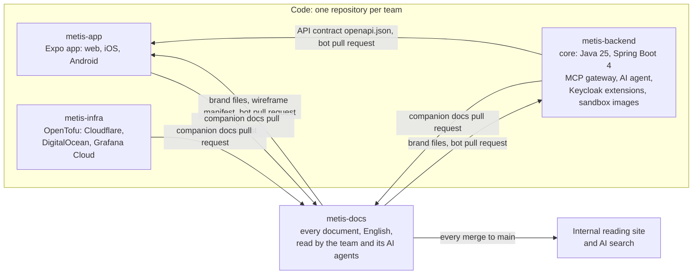
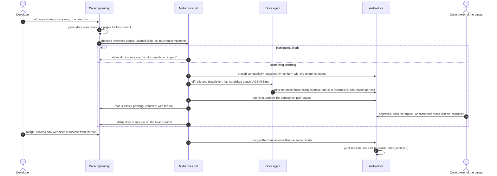

# Metis repositories and central documentation: design

| Item | Value |
|---|---|
| Status | Every section approved on 11 Oct 2026: 2 to 4 (RD-05 to RD-07), 5 rewritten for the team only and on condition that it costs nothing (RD-08 to RD-10), 6 and the docs agent's sign-in (RD-11); no costs section. Self-review done and the whole file approved the same day (RD-12). Plan one (the four repositories and the moves, `plan/2026-10-11-repos-and-moves.md`) is done on 12 Oct 2026 and waits for the owner's commit (its Task 18). Next: plans two and three (6.3). |
| Question | How many GitHub repositories Metis uses and what each one holds; how one documentation repository stays the single source of truth and updates itself whenever code changes. |
| Inputs | `spec/diagrams/2026-10-10-pitch/src/data.mjs` (the components), `spec/2026-10-10-backend-two-proposals.md` sections 2 and 3 (core, contract, MCP gateway, agent), both pitch material kept in the owner's private store (RD-02); `apps/metis` (the built app and its checks); the owner decisions below. |

## Owner decisions

| ID | Date | Decision, in the owner's words | How it applies |
|---|---|---|---|
| RD-01 | 11 Oct 2026 | One repository for all documents, readable by every party, structured for search by people and AI agents: "one single repo but readable by every party, structured for easy search, AI agents included", "one single source of truth for the parties to consult, for each component needed to develop new features, to read and understand the current business, or for troubleshooting", "Metis's own RAG knowledge" (machine translation) | `metis-docs`: one folder per component, searchable, the knowledge base people and agents read before building, learning the business or troubleshooting |
| RD-02 | 11 Oct 2026 | Pitch material stays out: "I will not upload the pitching information here" (machine translation) | Pitch diagrams, cost model and legal-entity comparison never enter `metis-docs`; their technical content (stack, why each component) is rewritten there without prices. RD-15 later put the pitch diagrams in |
| RD-03 | 11 Oct 2026 | Code lives in other repositories: "I only meant the documents, the code base must go in another repo" (machine translation) | `metis-docs` holds no product code; the code repositories are section 2 |
| RD-04 | 11 Oct 2026 | English only: "documents use English only" (machine translation) | Every file in `metis-docs` is English, migrated specs and plans included; the documentation agent writes English |
| RD-05 | 11 Oct 2026 | Section 2 approved: "approved" (machine translation) | Three code repositories, `metis-app`, `metis-backend`, `metis-infra`, plus `metis-docs` |
| RD-06 | 11 Oct 2026 | Section 3 approved: "ok" | Folders, the header, current truth apart from history, the agent index and the checks of section 3 |
| RD-07 | 11 Oct 2026 | Section 4 approved: "ok" | Companion pull requests, the docs agent, the `docs` check, both sync directions and the safety net of section 4 |
| RD-08 | 11 Oct 2026 | Scope is the repositories and the document sync only: "I only ask for the design of the repository structure on github for this project, together with the mechanism to sync / update documents when code changes, that is all", "what are these, I did not ask for them?" (machine translation) | The first section 5 (outside readers without accounts, public AI connectors, seat prices) is removed; no costs section; RD-09 sets what comes back |
| RD-09 | 11 Oct 2026 | A reading site and an AI search tool are right, for the team only: "“I thought there had to be a website to read and a search tool for AI.” this is right, but I mean it is internal documentation, read internally only" (machine translation) | Section 5 rewritten for the team building Metis: a reading site and an AI search server behind one sign-in that lets in only the team's addresses; no outside readers, no prices |
| RD-10 | 11 Oct 2026 | Section 5 approved on one condition, and the folder mapping kept (the "ok" answers both recommendations): "ok as long as it costs nothing, that is fine" (machine translation) | Section 5 runs on free plans and never upgrades; Cloudflare AI Search is dropped because it bills beyond its free allowance; at a limit a service stops instead of billing; the mapping section follows |
| RD-11 | 11 Oct 2026 | Both recommendations accepted: "ok" | The docs agent signs in with the Claude subscription the team already pays, not a paid API key (4.2); section 6 approved |
| RD-12 | 11 Oct 2026 | The whole file approved after the self-review: "approved" (machine translation) | The implementation plans of 6.3 are written next, the first one covering the repositories and every move of section 6 |
| RD-13 | 11 Oct 2026 | Plans run without a further question: "when the spec is done, continue to the plan and execute the plan, no need to ask me again" (machine translation) | Each plan of 6.3 is written, self-reviewed and executed without asking for plan approval or an execution method; execution stops only at steps the owner alone can take (choosing or creating the GitHub organization and repositories, committing, pushing) |
| RD-14 | 11 Oct 2026 | The repositories live on the owner's existing GitHub account: "use the github account phongnguyen6691 that is already set up in ssh on this machine" (machine translation) | The four repositories are private repositories of the personal account `phongnguyen6691`, reached through the SSH alias `github-phong`. A personal account has no teams and no organization secrets, so `CODEOWNERS` names users (3.7) and the secrets of section 4 are repository secrets (4.2, 4.8) |
| RD-15 | 13 Oct 2026 | The pitch diagrams go into the documents, whole: "I have put architecture/diagrams into metis-docs", then "no need to separate them, putting them in is my decision" (machine translation) | The owner copied `spec/diagrams/2026-10-10-pitch/`, without its `backup/` folder, to `metis-docs/architecture/diagrams/`: the eleven diagrams and their source stay whole, prices and the comparison of the two proposals included. RD-02 still keeps the cost model, the proposal documents and the backend notes out |

Corrections recorded on 11 Oct 2026: the first reading of RD-01 put code and documents in one repository; the owner corrected it (RD-03). The first wording of RD-02 also kept the BRD review reports out; the owner excluded only pitch material, so those reports go to `history/`. The first draft of section 5 opened the documents to readers outside the team (stakeholders without accounts, public AI connectors) and priced seats; the owner removed it (RD-08), then confirmed the reading site and the AI search for the team only (RD-09).

## Assumptions

- **A-1, per-team code access.** From the owner's earlier choice "One part for each team", each team sees only its own code repository. Not confirmed after RD-03. Section 2's boundaries stand without it (2.2, app apart from backend and infra apart from backend); it only adds team access on top. (machine translation)
- **A-2, team shape.** About 40 developers (BRD assumption A-07) across frontend, backend and infrastructure, plus QA and BA.

## 1. The whole picture

Four repositories: three for code, one per team, and one for every document.



- **Code to documents:** every code pull request that changes behaviour gets a companion pull request in `metis-docs`, opened by a bot, holding the reference pages regenerated from code and the prose an AI agent drafted. The code pull request merges only with its companion approved; both merge together (section 4).
- **Documents to code:** the brand files and the wireframe manifest are design decisions, so their source is `metis-docs`; a bot opens a pull request in each code repository that compiles or tests against them (section 4).
- **Backend to app:** the core generates the OpenAPI 3.1 contract; a bot copies it into `metis-app`, which generates its zod schemas from it, as today's plan says (`spec/2026-10-10-backend-two-proposals.md` section 2).

## 2. Code repositories

### 2.1 Recommendation: three code repositories

| Repository | Holds | Built with | Ships to | Owned by |
|---|---|---|---|---|
| `metis-app` | The Metis app, one code base and three builds (web, iOS, Android); its 13 automated checks; pinned copies of the brand files, the wireframe manifest and the API contract | TypeScript 6, React Native 0.86, Expo SDK 57; pnpm, Jest, StrykerJS, Playwright, Maestro | the web build to static hosting behind Cloudflare; App Store; Google Play | frontend team |
| `metis-backend` | Business core (roles `api` and `worker`, Temporal workflows, Flyway migrations, the command catalog and the OpenAPI contract it generates); MCP gateway; AI agent; Keycloak extensions (magic-link authenticator, login theme, realm settings); sandbox images (ClamAV, Playwright server with Chromium); a local stack that runs all of them together | Java 25 with Spring Boot 4 on Gradle, JUnit 5, Testcontainers, PIT; TypeScript on Node.js 24 with pnpm for the gateway; Docker | container images in the registry, deployed to the environments `metis-infra` creates | backend team |
| `metis-infra` | OpenTofu for every environment: Cloudflare, DigitalOcean (App Platform, PostgreSQL, Valkey, Spaces, registry), Grafana Cloud, Temporal Cloud when that variant is chosen; the development network on HostHatch | OpenTofu | development, staging, production | infrastructure team, two or three people |

With `metis-docs`, four repositories in total.

### 2.2 Why these boundaries

Fewer repositories is the default; each boundary below has to pay for itself.

1. **App apart from backend.**
   - Different toolchains and checks: the app's 13 checks (`apps/metis/scripts/verify.mjs`) against a Gradle build with JUnit and PIT.
   - Different release channels. Apple and Google review every app release, and people update their phones at their own pace, so the backend must keep answering older app versions. With the app in its own repository, every change to the contract arrives at another team as a pull request: exactly the review that backward compatibility needs.
   - Matches team ownership.
2. **Infrastructure apart from backend.** The infrastructure pipeline holds the keys that can change or delete production (DigitalOcean and Cloudflare tokens). In its own repository, only the infrastructure team can change the workflows that use those keys, and every production change is recorded in one place, which ISO 27001 change management asks for. A backend developer who needs a new setting opens a small pull request there.
3. **Backend kept together.** The core, MCP gateway, agent, Keycloak extensions and sandbox images belong to one team and deploy together to the same environments. A new command usually touches the catalog in the core, the tools the gateway exposes, the Keycloak scopes for MCP and the agent that uses it: one pull request instead of four. One end-to-end test (agent, gateway, core, PostgreSQL, with Keycloak tokens) runs in one pipeline.
4. **Documents apart from code:** RD-03.

### 2.3 The two other layouts, compared

| | One code repository, 2 in total | Three code repositories, 4 in total (recommended) | One repository per service, 8 in total |
|---|---|---|---|
| Repositories | `metis` (app, backend, infrastructure), `metis-docs` | `metis-app`, `metis-backend`, `metis-infra`, `metis-docs` | `metis-app`, `metis-core`, `metis-mcp-gateway`, `metis-agent`, `metis-keycloak`, `metis-sandbox`, `metis-infra`, `metis-docs` |
| A change across app and backend | one pull request | two, joined by the contract | two or more |
| A new backend command (core, gateway, Keycloak, agent) | one pull request | one pull request | up to four, merged in order |
| Who can change the workflows holding production keys | every developer with write access | infrastructure team | infrastructure team |
| Code access per team | not possible: GitHub grants access per repository, not per folder [Source: docs.github.com, Repository roles for an organization, read 11 Oct 2026] | yes | yes |
| Continuous integration | one workflow per area with path filters; a required check skipped by a path filter stays pending and blocks merging [Source: docs.github.com, Troubleshooting required status checks, read 11 Oct 2026], so an extra summary job is needed | one pipeline per repository | seven pipelines, mostly copies of each other |
| Documentation bot wired into | one code repository | three | seven |
| Contract copies kept in sync by bot | none | one (`metis-app`) | three (`metis-app`, `metis-mcp-gateway`, `metis-agent`) |

### 2.4 Later splits

If an AI team forms, the agent folder of `metis-backend` moves to its own repository with its history (`git subtree split`). No other split is planned.

## 3. Inside `metis-docs`

### 3.1 Folders: one per reading purpose, one per component

RD-01 names three reasons to open the repository: build a feature in a component, understand the business, troubleshoot. Each top folder answers one question. Every component folder holds the same five entries, so a reader who knows one component knows where everything is in the others.

```text
metis-docs/
├── README.md            for people: what is here, where to start
├── AGENTS.md            for AI agents: how to read and write here
├── CLAUDE.md            one line: @AGENTS.md
├── llms.txt             generated index of every current page
├── business/            what Metis does today, and for whom
│   ├── overview.md      product, personas, tenants and workspaces in one page
│   ├── glossary.md      every business term and its meaning
│   ├── requirements/    BRD v4.5 and its addenda, built from parts
│   │   ├── source/      today's brd/source: parts, build.py, evidence.tsv
│   │   └── status.md    generated: each requirement id, where built and tested, or not yet
│   ├── modules/         one page per BRD module, M01 to M23: how it works in the app today
│   └── journeys/        one page per key user journey (BRD 7.9), across modules
├── design/
│   ├── brand/           tokens.css, logos, style guide: the source the code copies
│   └── wireframes/      the 58 screens, manifest.json, tools
├── architecture/        how the parts fit
│   ├── overview.md      the components, what each runs on, the path of one request
│   ├── tenancy.md       how tenants stay apart
│   ├── security.md      sign-in, permissions, audit, secrets
│   ├── data.md          what is stored where, backups, retention
│   ├── contract.md      how the core, the app and the gateway share one API contract
│   ├── diagrams/        the eleven pitch diagrams and the source that builds them (RD-15)
│   └── decisions/       one decision per file: context, decision, consequences, status
├── components/          one folder per deployable part
│   ├── app/
│   │   ├── README.md        what it does, what it depends on, its team, its code repository
│   │   ├── develop.md       build, run, test, the checks it must pass
│   │   ├── interfaces.md    what it exposes and what it calls
│   │   ├── troubleshoot.md  symptom, cause, fix; links to runbooks
│   │   └── reference/       generated from its code, never edited by hand
│   └── core/, mcp-gateway/, agent/, keycloak/, sandbox/, infra/: the same five entries
├── operations/          running Metis
│   ├── environments.md  development, staging, production: where, what, who deploys
│   ├── runbooks/        one procedure per file: deploy, roll back, restore, rotate a key
│   └── incidents/       one review per incident: timeline, cause, fix, follow-ups
├── proposals/           specs and plans being worked on
├── history/             records: delivered plans, decision logs, reviews, old BRD versions
├── tools/               the checks of 3.6 and the llms.txt generator
├── site/                the reading site (section 5)
└── mcp/                 the AI search server (section 5)
```

### 3.2 What each component generates into its `reference/`

Built with each component; today only the app exists.

| Component | Generated pages | Generated from |
|---|---|---|
| core | API (the OpenAPI 3.1 file and a readable page per endpoint); commands (name, input, output, permission, action class, undo rule, audit fields, requirement ids); permissions (16 roles by command); data model (tables, row-level security policies, a diagram); outbox events; settings; error codes | the command catalog, springdoc-openapi, Flyway migrations applied to a throwaway PostgreSQL |
| app | screens (route, requirement ids, each element and what it does); the checks and their last result | each screen's `contract.yaml`; the report of `scripts/verify.mjs` |
| mcp-gateway | MCP tools with their scopes and rate limits | the command catalog the gateway reads |
| agent | agents, the tools each may call, the model each calls | agent definitions |
| keycloak | sign-in flows, clients and scopes, never secrets | realm settings kept in code |
| sandbox | images, versions, limits | image definitions |
| infra | resources per environment (sizes, regions, network), never secrets, never state | OpenTofu configuration |

### 3.3 The header every file carries

```yaml
---
title: Change request
summary: How a change request goes from logged to applied, and who decides.
component: all     # app, core, mcp-gateway, agent, keycloak, sandbox, infra or all
type: journey      # overview, module, journey, how-to, reference, runbook, decision,
                   # incident, proposal or record
status: current    # current, draft, superseded or record
ids: [CHG-01, CHG-04, BR-42]   # BRD requirement, rule and decision ids the page covers
---
```

- `title` and `summary` feed `llms.txt` (3.5) and the site's menu and search (section 5).
- `ids` tie a page to the code: section 4 uses them to find the pages a code change touches. They are the BRD's own ids (`WBS-01`, `BR-42`, `D-19`), so nothing is numbered twice. The app already tags screens this way in each `contract.yaml`.
- A generated page adds `generated_from: <repository>/<path>@<commit>`.
- No date and no owner in the header: dates come from git and owners from `.github/CODEOWNERS`, so neither can drift.

### 3.4 Current truth apart from history

- A current page describes the app as it is on `main` of the code repositories. It tells no "changed on" story; git and the decision records keep that.
- `history/` holds records. Each opens with a generated banner: the date it was written and the current page that replaced it.
- `llms.txt` lists `history/` and every `superseded` page only under its Optional section (3.5), which agents may skip, and the site's search and the AI search leave them out (section 5), so an answer never rests on a replaced fact. An agent asked "why" can still open them.
- A replaced decision keeps its file, with `status: superseded` and a link to the decision that replaced it.
- A spec or plan is written in `proposals/`. When the work ships, its lasting content goes into the current pages in the same companion pull request, and the spec or plan moves to `history/`.
- A module page does not copy the BRD. It lists the requirement ids built (generated), says in a few paragraphs what users can do today, and records every place where the app differs from the BRD, with the decision id that allowed it.

### 3.5 What agents read first

- `AGENTS.md`, written by hand and short: what the repository is; the folder map; the reading order (`llms.txt`, then the component's `README.md`, then the pages); the trust order (generated reference over current pages, and history is never current truth); the writing rules (English, the header, one topic per file, never edit a generated page, no history inside a current page). Claude Code reads it as project instructions when no `CLAUDE.md` exists [Source: code.claude.com/docs/en/memory, section AGENTS.md, read 11 Oct 2026]; other coding agents look for the same file name [Unverified - confirm before applying].
- `CLAUDE.md` holds one line, `@AGENTS.md`. With a `CLAUDE.md` present, Claude Code reads `AGENTS.md` only through such an import [Source: same page].
- `llms.txt` is generated on every merge from the headers, in the llmstxt.org format: a title, a one-paragraph summary, one section per top folder with one line per current page (link and summary), and the history pages under the section named Optional, which agents may skip when context is short [Source: llmstxt.org, read 11 Oct 2026].

### 3.6 Checks on every pull request in `metis-docs`

- Every page has a valid header: fields present, values from the lists in 3.3.
- Every id exists: BRD ids from the requirements build, command names from the generated catalog, screen numbers from the wireframe manifest.
- Every link resolves.
- English only, with the method of the app's `scripts/check-language.mjs`.
- No em dash and no en dash.
- A generated file changes only when its generator's output changes: the check regenerates and compares.
- No secret in any file, through a secret scanner such as gitleaks [Unverified - confirm before applying].

The checks and the `llms.txt` generator live in `tools/` of `metis-docs`: documentation tooling, not product code, so RD-03 holds.

### 3.7 Who approves what

`.github/CODEOWNERS` names the reviewers per folder:

- `business/`: the product owner and the BA.
- `design/`: the designer and the frontend lead.
- `architecture/`: the backend and frontend leads.
- `components/<name>/`: that component's lead.
- `operations/`: the infrastructure lead.

Required code-owner review on private repositories needs GitHub Team [Source: github.com/pricing, read 11 Oct 2026].

On the personal account of RD-14 there are no teams: a code owner is a user with explicit write access to the repository, and a team is written `@org/team-name`, so it needs an organization [Source: docs.github.com, About code owners, read 11 Oct 2026]. Every line names `@phongnguyen6691` until the people of each role have accounts with write access. For private repositories, GitHub Pro, the paid plan of a personal account, lists required pull request reviewers, protected branches and code owners, and GitHub Free lists none of them [Source: docs.github.com, GitHub's plans, read 12 Oct 2026].

## 4. How documents update themselves

### 4.1 Two kinds of content

- **Reference pages** are generated from code. The bot copies them; nobody judges them, and they are always exact.
- **Prose pages** are written: module pages, journeys, architecture, component guides, runbooks. The docs agent drafts the change; a person approves it.

### 4.2 The pieces

- **Generators, one per component.** Each code repository has one command that writes its components' reference pages into `build/docs/`, mirroring the paths of `metis-docs` (for example `build/docs/components/core/reference/`). It runs in the code repository's own continuous integration, so a broken generator fails the code pull request.
- **Every screen, command and workflow names its BRD ids.** The app's `contract.yaml` files already do (`requirements:`); each entry of the core's command catalog and each Temporal workflow gets the same field, and a check rejects one without ids or with an unknown id. These ids are what connects a code change to the pages it touches.
- **Metis docs bot**, a GitHub App installed on the four repositories. Each job mints a token with `actions/create-github-app-token@v3`, listing only the repositories and permissions it needs [Source: github.com/actions/create-github-app-token, read 11 Oct 2026]. An App is needed for two reasons: it reaches across repositories, and events made with the default `GITHUB_TOKEN` start no new workflow runs [Source: docs.github.com, GITHUB_TOKEN, read 11 Oct 2026].
- **Docs agent**: Claude Code, run by `anthropics/claude-code-action@v1`, restricted with `claude_args: --allowedTools Read,Edit,Write,Glob,Grep` [Source: github.com/anthropics/claude-code-action, docs/usage.md, read 11 Oct 2026]. It works only inside the `metis-docs` checkout. A later step, `peter-evans/create-pull-request@v8`, commits its edits and opens or updates the pull request; with a fixed branch name, later runs update the same pull request [Source: github.com/peter-evans/create-pull-request, read 11 Oct 2026]. The agent signs in with the Claude subscription the team already pays, not a paid API key (RD-11): the input `claude_code_oauth_token` takes a token made with `claude setup-token`, available on the Pro, Max, Team and Enterprise plans, and its runs use the subscription instead of API billing [Source: code.claude.com/docs/en/github-actions, read 11 Oct 2026]. The token is tied to the subscription of the person who made it, replaced when that person leaves. It is a repository secret in each repository whose workflow runs the agent: a personal account (RD-14) has no organization secrets, only repository and environment secrets [Source: docs.github.com, Using secrets in GitHub Actions, read 11 Oct 2026].
- **One shared workflow**, kept in `metis-docs` and called by a few-line workflow in each code repository, so the documentation logic lives in one place. A private repository can open its workflows to the organization's other private repositories under Settings, Actions, General, Access [Source: docs.github.com, Sharing actions and workflows with your organization, read 11 Oct 2026]; whether GitHub Free allows it [Unverified - confirm before applying].

### 4.3 One code pull request, start to merge



1. **Impact**, in the code repository's continuous integration, on a pull request marked ready for review and on every later push (a new push cancels the run still in progress):
   - the generators run for the head commit and are compared with the reference pages on `metis-docs` `main`;
   - the BRD ids carried by the changed screens, commands and workflows are collected, with each component the change touches;
   - the candidate prose pages are the current pages whose header `ids` include a touched id, plus the touched components' pages.
   A change that touches no reference page and no candidate page (tests, formatting) ends here with `docs` = success.
2. **Companion branch** `companion/<repository>/<number>` in `metis-docs`: the bot writes the changed reference pages and regenerates `business/requirements/status.md`.
3. **Draft.** The docs agent gets the diff, the pull request's title and description, the touched ids and the candidate pages, under the rules of `AGENTS.md`. It edits only prose that the change makes untrue or incomplete, and it may search other current pages for the same fact. Each edit carries one line saying why; "no prose change" carries its reason. It runs again on a later push only when the touched ids, components or reference pages changed, or when a code owner comments `/docs` with an instruction.
4. **Companion pull request**, opened or updated on the same branch. Its body links the code pull request and the commit it reflects, and lists every changed page with the agent's reason. The bot comments the link on the code pull request and sets the `docs` status to pending.
5. **Review** in `metis-docs`: the checks of 3.6 run, and the code owners of the touched folders (3.7) approve, edit the branch, or ask the agent again with `/docs`.
6. **Approval.** When the companion is approved with green checks, the bot sets `docs` = success on the code pull request's head commit. A new push to the code pull request makes a new head commit without that status, so the steps run again; the companion's approval is dismissed when its branch changes ("Dismiss stale pull request approvals when new commits are pushed").
7. **Merge.** Branch protection on each code repository requires the `docs` check with the bot as its expected source: a status set by any other person or integration does not allow the merge [Source: docs.github.com, About protected branches, read 11 Oct 2026]. When the code pull request merges, the bot merges the companion within the same minute; when it closes unmerged, the bot closes the companion and deletes its branch.
8. **Reference-only companions** (no prose edited) merge without a person: their content is exactly the generators' output, which the check of 3.6 proves. The ruleset on `metis-docs` `main` lists the bot as the only bypass actor, in the mode "For pull requests only", so it can merge a pull request without a person but can never push to `main` directly [Source: docs.github.com, Creating rulesets for a repository, read 11 Oct 2026]; the bot uses the bypass for nothing else.

### 4.4 Documents to code: brand files and the wireframe manifest

- When `design/brand/` or `design/wireframes/manifest.json` changes on `metis-docs` `main`, the bot opens a pull request in each code repository that uses them, replacing its pinned copy and recording the source commit in `docs.lock`.
- `metis-app` keeps a copy of the brand files and the manifest it reads, under `pinned/` with the paths of `metis-docs` (for example `pinned/design/brand/tokens.css`), and `docs.lock` holds the sha256 of each copy; its token, brand-file and route checks read the copy instead of `../../brand` and `../../wireframes`.
- `metis-backend` keeps a copy of the brand files for the Keycloak login theme, emails and PDFs.
- A copy that differs from what `docs.lock` names fails the code repository's check, so nobody edits a copy by hand.

### 4.5 Backend to app: the API contract

- The core generates `contract/openapi.json` (OpenAPI 3.1) in `metis-backend`; the build fails when the committed file is stale.
- On every backend pull request, oasdiff compares the contract with `main`'s [Source: github.com/oasdiff/oasdiff, Apache-2.0, supports OpenAPI 3.1, read 11 Oct 2026]. A breaking change, such as a removed field or a new required input, needs the label `contract: breaking` set by the frontend lead, because app versions already on phones keep calling the old shape. The flag that makes oasdiff exit with an error [Unverified - confirm before applying].
- When the backend pull request merges, the bot opens a pull request in `metis-app` copying the contract; the app regenerates its zod schemas and its checks run. The API reference reaches `metis-docs` through the backend pull request's own companion.

### 4.6 Safety net on `main`

On every push to `main` of a code repository, and once a night, the bot regenerates every reference page from each code repository's `main` and compares it with `metis-docs` `main`. A difference, or a merged code pull request without a merged companion (an administrator's bypass, a failed merge), makes the bot run steps 2 to 5 for that commit as a late companion, assigned to the component's lead.

### 4.7 When something fails

- **The agent fails, times out or reaches the subscription's usage limit:** the companion still opens, with the reference pages and the note "prose not drafted" and the reason; a code owner writes the prose or approves the companion as it is.
- **A generator fails:** the code pull request's own checks fail; fixing the generator is part of the change.
- **Two code pull requests touch the same page:** the second companion to merge conflicts; the bot rebases it on `main` and runs steps 2 to 5 again, which dismisses its approval, so a code owner approves the new text.
- **The companion cannot merge after its code merged:** the bot retries once after a rebase; after that the safety net opens a late companion and assigns it.
- **A pull request from a fork:** forks receive no secrets, so the bot cannot run. Metis accepts no fork pull requests; the agency works on branches in the organization.

### 4.8 Keeping the agent safe

- A pull request's code, description and comments are untrusted input and can carry instructions aimed at the agent. The agent therefore runs with Read, Edit, Write, Glob and Grep only: no shell, no web access, no GitHub token. It works in the `metis-docs` checkout alone, and its edits reach `main` only after a code owner approves them.
- The bot's private key is a repository secret of each of the four repositories and of no other (RD-14: a personal account has no organization secrets); each job's token covers only the repositories and permissions of that job.

### 4.9 What it needs from GitHub

Required checks with an expected source and code-owner review on private repositories need GitHub Team [Source: github.com/pricing, read 11 Oct 2026]. On GitHub Free the same bot runs, but the `docs` status only warns, and the safety net of 4.6 catches a merge without documents after the fact. The implementation sets up whichever plan the organization is on; moving from Free to Team later only turns on the rules of 3.7 and of steps 7 and 8 in 4.3. On the personal account of RD-14 the free plan applies, so the `docs` status warns; a bypass list, which step 8 uses, exists only for repositories that belong to an organization [Source: docs.github.com, About protected branches, read 11 Oct 2026], so step 8 waits for an organization.

## 5. Internal reading site and AI search

Only the team building Metis reads these documents (RD-09): developers, BA, QA, the designer and the owner. Nobody outside the team gets in.

Everything in this section runs on free plans and stays there (RD-10). No service here bills by itself at a limit: Access refuses the 51st person (5.2); the Worker answers Error 1027 after 100,000 requests in a day, until midnight UTC [Source: developers.cloudflare.com/workers/platform/limits, read 11 Oct 2026]; Workers Builds stops after its 3,000 free minutes in a month [Unverified - confirm before applying].

### 5.1 The reading site

- **Built** with Astro Starlight 0.42.6 from the folders of section 3 on every merge to `main` of `metis-docs`; the sidebar follows the folders [Source: starlight.astro.build; registry.npmjs.org, read 11 Oct 2026]. Cloudflare Workers Builds, connected to `metis-docs`, builds and deploys: 3,000 build minutes a month and 20 minutes per build on the free plan, so publishing uses none of GitHub's Actions minutes [Source: developers.cloudflare.com/workers/ci-cd/builds/limits-and-pricing, read 11 Oct 2026]. It builds repositories of a GitHub organization it is installed on [Source: developers.cloudflare.com/workers/ci-cd/builds/git-integration/github-integration, read 11 Oct 2026]; a private repository [Unverified - confirm before applying]; if not, the build runs in the GitHub Actions workflows of section 4. The header of 3.3 is part of the site's frontmatter schema, so an invalid header fails the build [Source: starlight.astro.build/reference/frontmatter].
- **Shows** every current page, the API reference rendered from the core's OpenAPI file by starlight-openapi 0.27.0 [Source: github.com/HiDeoo/starlight-openapi, read 11 Oct 2026], Mermaid diagrams through astro-mermaid 2.1.0 [Source: starlight.astro.build/resources/plugins, read 11 Oct 2026], and the wireframe screens as they are.
- **Search**: Pagefind, built into Starlight, runs in the browser at no cost; `history/` and `superseded` pages get `pagefind: false`, so it skips them (3.4) [Source: starlight.astro.build/guides/site-search].
- **Hosted** as Cloudflare Workers static assets at `docs.<metis domain>`: requests to static assets are free and unlimited, up to 20,000 files of up to 25 MiB each; the largest file today, the BRD in Word, is 4.7 MiB [Source: developers.cloudflare.com/workers/static-assets/billing-and-limitations, read 11 Oct 2026]. One Worker serves the site's files on `docs.` and the AI search server of 5.3 on `mcp.docs.`, so each merge makes one build.

### 5.2 Only the team gets in

- One Cloudflare Access policy covers the site and the AI search server of 5.3. It lets in email addresses on the team's company domains (selector "Emails ending in") and any member added by address (selector "Emails"); they sign in with a one-time code sent to that address; everyone else is refused [Source: developers.cloudflare.com/cloudflare-one/access-controls/policies; developers.cloudflare.com/cloudflare-one/integrations/identity-providers, read 11 Oct 2026].
- Free for up to 50 people who sign in. One person takes one seat whatever they open; when the seats run out, the next person is refused until a seat frees; Metis frees a seat after one month without sign-in [Source: developers.cloudflare.com/cloudflare-one/team-and-resources/users/seat-management, read 11 Oct 2026].
- Developers read on GitHub and their coding agents read a clone (5.3), so the seats go to the people who need the site. Metis stays on the free plan (RD-10): at 50, the next person waits for a free seat or reads on GitHub.

### 5.3 AI search

- **The docs MCP server**: a small read-only MCP server on the Worker of 5.1 at `mcp.docs.<metis domain>`, behind the policy of 5.2. Access runs the sign-in of MCP clients ("Managed OAuth") and the Worker only checks the Access token [Source: developers.cloudflare.com/cloudflare-one/access-controls/applications/http-apps/managed-oauth, read 11 Oct 2026]. For plan three to confirm: the MCP specification of 28 Jul 2026 marks dynamic client registration deprecated and prefers Client ID Metadata Documents [Source: modelcontextprotocol.io/specification/2026-07-28/basic/authorization, read 12 Oct 2026 by a plan one writer]; which registration Managed OAuth offers decides whether the docs MCP server needs more than this [Unverified - confirm before applying]. Three tools: `search` (a question in, the best current pages out, each with its summary and the matching passage), `read` (one page with its header), `list` (the pages of a folder). `read` opens a history page only when asked by its path.
- **Search**: `search` matches the words of a question against a small index of the current pages (titles, summaries, ids and headings) that each build writes beside the site; never history. The assistant then reads the pages it picked, and searches again with other words when the first try misses. The index must stay small enough to search within the free plan's 10 ms of CPU per request [Source: developers.cloudflare.com/workers/platform/limits, read 11 Oct 2026]; the implementation plan measures it.
- **Not Cloudflare AI Search**, which searches by meaning: from 1 Nov 2026 it bills beyond 1,000 meaning-based searches a month, and its page does not say that a free account is stopped instead of billed [Source: developers.cloudflare.com/ai-search/platform/limits-pricing, read 11 Oct 2026].
- **Used from** the team's AI assistants that sign in to remote MCP servers with OAuth, for example the Claude app as a custom connector [Source: support.claude.com, article 11175166, read 11 Oct 2026] and Claude Code [Source: code.claude.com/docs/en/mcp, read 11 Oct 2026].
- **Coding agents in the code repositories** read a clone of `metis-docs` beside the code instead: no sign-in, no seat, readable offline. Each code repository's `AGENTS.md` points to `../metis-docs` and its `llms.txt`, and a one-line `CLAUDE.md` imports it (6.1); `.claude/settings.json` lists the clone under `permissions.additionalDirectories`, so Claude Code reads it without a prompt once the developer accepts the trust dialog for the folder [Source: code.claude.com/docs/en/permissions, sections Working directories and Project allow rules and workspace trust, read 11 Oct 2026]; how a relative path there resolves [Unverified - confirm before applying].
- Both hosts are Workers Custom Domains, so each gets its own certificate, `mcp.docs.` two levels deep included [Source: developers.cloudflare.com/workers/configuration/routing/custom-domains, read 11 Oct 2026].

### 5.4 Tooling, and what was not chosen

- `site/` (Starlight) and `mcp/` (the server) sit beside `tools/` (3.6): documentation tooling, not product code, so RD-03 holds.
- Not chosen: GitHub Pages, because a private Pages site needs GitHub Enterprise Cloud [Source: docs.github.com, GitHub's plans, read 11 Oct 2026]; a site reachable only through a VPN into the development network, because it needs a server and a VPN for every member, and that network does not exist yet.

## 6. Moving today's folder into the four repositories

Today every file sits in one folder, `metis/`, which has no commit yet. The counts and languages below were measured on 11 Oct 2026 over the files git would track; a file counts as Vietnamese when more than 0.5% of its characters are Vietnamese letters, checked against a planted Vietnamese sentence.

### 6.1 Where each part goes

| Today | Goes to | Work on the way |
|---|---|---|
| `apps/metis/` (the app, its checks, `LICENSES.md`), `.github/workflows/check.yml`, `.nvmrc`, `.prettierrc`, `.gitignore` | `metis-app`; the app folder becomes the repository root | The reads outside the app folder change (6.3); the root `.gitignore` merges into the app's own; the 13 checks pass before the first commit |
| `apps/metis/CONTRIBUTING.md` (English) | `metis-docs/components/app/develop.md` | Moved; `metis-app` keeps a short `README.md`, an `AGENTS.md` that points to `metis-docs` (5.3) and a one-line `CLAUDE.md` importing it |
| `apps/metis-rn-guide.html`, the React Native handbook (Vietnamese) | `metis-docs/components/app/` | Rewritten in English as guide pages |
| `brd/source/` (parts, `build.py`, `evidence.tsv`, the addendum's parts) and `brd/images/` | `metis-docs/business/requirements/source/` | `build.py` stops using `sips` (6.3) |
| `brd/*.md`: BRD v4.5 and addendum v1.1 (English) | `metis-docs/business/requirements/` | Generated from the source; the Word files are built on demand and never committed |
| `brd/archive/*.md`, `brd/source/legacy/`, the addendum's plan, design, rulings and research (English) | `metis-docs/history/` | The banner of 3.4 |
| `brand/` | `metis-docs/design/brand/` | `style-guide.md`, its only Vietnamese file, translated |
| `wireframes/` (58 screens, 58 pictures, the manifest, the tools) | `metis-docs/design/wireframes/` | None |
| The plans from 5 Oct 2026 on (five), `spec/2026-10-05-frontend-foundation-spec.md`, `spec/2026-10-05-cross-platform-research.md`, `spec/frontend-brainstorm-log.md`, `analysis/metis-code-review/`, `review/*.md` | `metis-docs/history/` | 25 of these files are Vietnamese, 2.1 MB: their lasting content first becomes current pages and decision records, then each is translated (6.2) |
| `spec/2026-10-11-repos-and-docs-design.md`, this file | `metis-docs/proposals/` | The owner's words quoted in Vietnamese are translated (6.2); moves to `history/` when this work ships (3.4) |
| The pitch diagrams (RD-15): `spec/diagrams/2026-10-10-pitch/`, the eleven drawings and their source | `metis-docs/architecture/diagrams/` | Copied whole by the owner on 13 Oct 2026, without its `backup/` folder. For the checks of 3.6 to pass, the two licence texts written in Markdown become `.txt` and the one Vietnamese letter of the legal drawing is written in ASCII; the builder loads its browser from a `metis-app` clone |
| The rest of the pitch material (RD-02): `spec/diagrams/2026-10-10-backend-proposals/`, `spec/2026-10-10-backend-cost-model.md`, `spec/2026-10-10-backend-two-proposals.md` | Outside every repository, in the owner's private store | Their technical content (the stack, why each part) is rewritten without prices as `architecture/` pages and decision records |
| Backend notes that mix prices and legal entities: `spec/2026-10-09-backend-brainstorm-log.md`, `spec/2026-10-10-backend-system-draft.md`, `spec/backend-brainstorm-log.md`, `spec/backend-brainstorming-prompt.md` | The owner's private store | The same rewrite |
| Records of the abandoned first app: `spec/2026-10-03-*`, `spec/2026-10-04-*`, `plan/2026-10-03-*`, `plan/2026-10-04-*`, `analysis/metis-storefront/` | The owner's private store | None |
| Material about VistaX, an outside product: `vistax-poc-screens/` and its zip, `review/poc-frameworks-2026-10-03/` (screenshots and an export) | The owner's private store | None |
| Archives and binaries: the four `review/*.zip`, the Word files of `brd/archive/` and the two at the root, `spec/diagrams/sample1.svg`, `spec/diagrams/sample2.png` | The owner's private store | None |
| Local working files: `.claude/`, `.superpowers/`, `CLAUDE.md`, `apps/metis/reports/` | The owner's machines; never committed | None |

`metis-backend` and `metis-infra` start empty, each with a `README.md`, an `AGENTS.md` and the same one-line `CLAUDE.md`. Each code repository needs that line: Claude Code reads `AGENTS.md` by itself only when no `CLAUDE.md` exists in the working folder or above it [Source: code.claude.com/docs/en/memory, read 11 Oct 2026 by plan one's writer], and a clone may sit under a folder that has one.

### 6.2 Records moved into `history/`

- RD-04 makes every file of `metis-docs` English, and the BRD review reports belong in `history/` (the corrections under the owner decisions).
- First, the lasting content of these records (decisions that still govern the app, the reasons behind the built screens, open questions) becomes English current pages and decision records (3.4).
- Then each record is translated by machine into `history/`. Its banner adds one line: machine translation of a Vietnamese record, the original kept in the owner's private store. Nobody reviews these translations: they are records, never current truth.
- A Vietnamese passage inside an English file, such as the owner's words quoted in this spec or in a plan, is translated the same way, with the same note; the English-only check of 3.6 finds every one.
- A link in a moved file that points to a file left outside `metis-docs` (a pitch file, a VistaX screenshot, a zip) becomes plain text naming that file and the owner's private store, so the link check of 3.6 passes.
- The translation runs in Claude Code sessions on the Claude subscription the team already pays, so it costs nothing extra.
- Not chosen: leaving the records out and keeping only the decision records. Cheaper, but the reasons behind the built app (the code cleanup alone recorded 89 rulings) would leave the team's reach.

### 6.3 Facts the implementation plan needs

- Eight files of the app read outside its folder: `scripts/verify.mjs` (`../../brand` among the files it fingerprints), `scripts/check-language.mjs` (scans `../../.github/workflows` and `../../brand`), `scripts/gen-tokens.mjs` (`../../brand/tokens.css`), `scripts/brand-files.test.mjs` and `scripts/gen-tokens.test.mjs` (`brand/`), `src/core/routes.test.ts` (`wireframes/manifest.json`), `e2e/web/brand.spec.ts` (the wordmark and the 180 px icon) and `e2e/web/support.ts` (the tokens); the first count, six, missed the last two, which plan one found. The tests `verify.tree.test.mjs`, `check-language.test.mjs`, `verify.cli.test.mjs` and `e2e/web/support.spec.ts` name the same paths. The brand and manifest reads switch to the pinned copies of 4.4; the workflow scan points at the repository's own `.github/workflows`.
- `.github/workflows/check.yml` runs in `apps/metis`; at the root of `metis-app` that working directory goes away.
- `brd/source/build.py` needs pandoc, LibreOffice, poppler and `sips`, a macOS-only image tool; it must run on Linux to build in continuous integration.
- Order: create the four repositories; move `metis-app` and pass its checks; set up `metis-docs` (folders, headers, checks, pages); the bot and workflows of section 4; the site and search of section 5; `metis-backend` and `metis-infra` last, empty. The order splits into three implementation plans: the repositories and every move of this section; the bot, the workflows and the docs agent; the reading site and the AI search.
- Inputs the owner gives when the plans run: the GitHub account (RD-14 settled it: `phongnguyen6691`, alias `github-phong`), the Metis domain on Cloudflare, the team's email domains for 5.2, and the Claude token of 4.2, made with `claude setup-token` by the person whose subscription pays.
